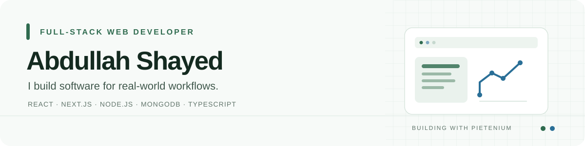
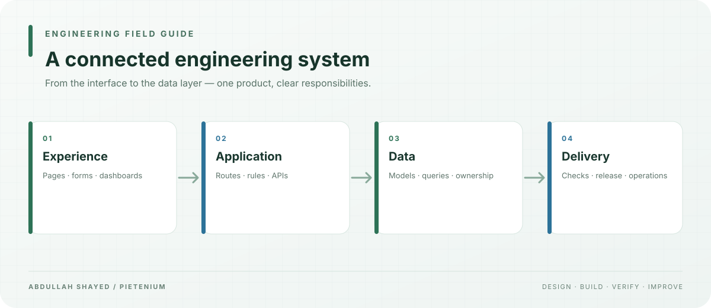
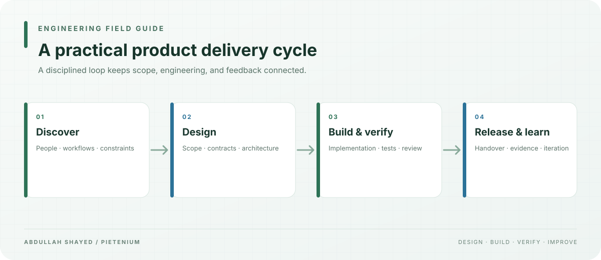
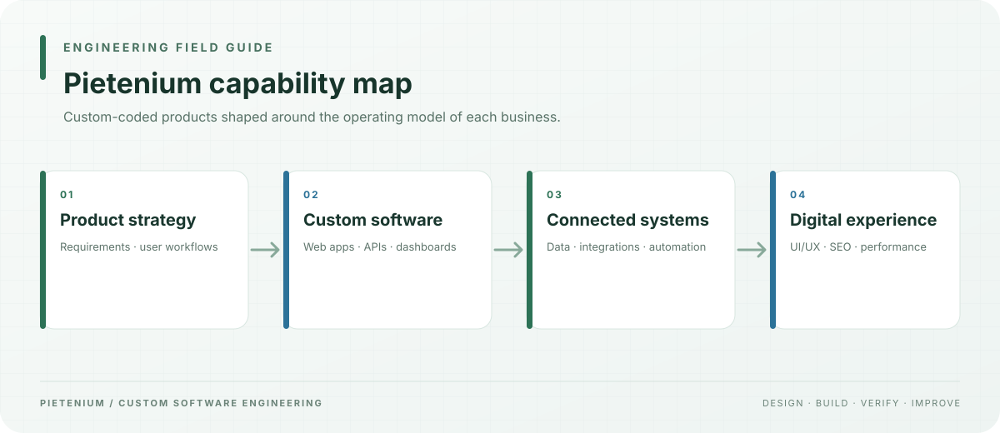
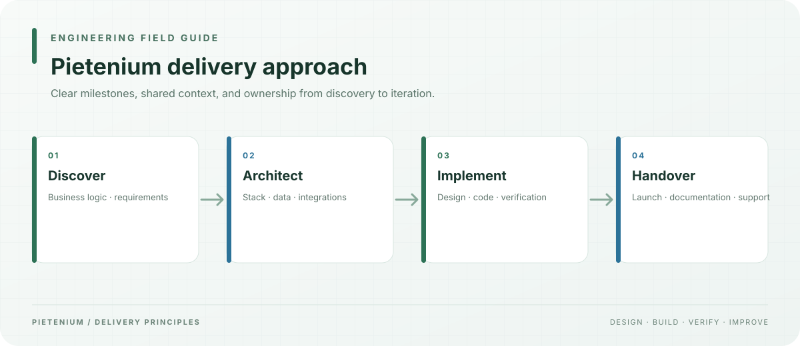

<!--
  GitHub Profile README for @heyAbdullahBruh
  Long-form edition: a visual front page plus a detailed engineering and studio reference.
  Keep project claims, links, and public metrics accurate before publishing.
-->

<picture>
  <source media="(prefers-color-scheme: dark)" srcset="./assets/profile-banner-dark.svg">
  
</picture>

  <a href="https://abdullah-shayed.vercel.app/about">PORTFOLIO</a>
  &nbsp;·&nbsp;
  <a href="https://pietenium.vercel.app/">PIETENIUM</a>
  &nbsp;·&nbsp;
  <a href="https://www.linkedin.com/in/heyAbdullahBro/">LINKEDIN</a>
  &nbsp;·&nbsp;
  <a href="https://orcid.org/0009-0007-9319-9408">ORCID</a>
  &nbsp;·&nbsp;
  <a href="https://github.com/heyAbdullahBruh">GITHUB</a>

  
  
  
  
  
  
  

---

# Abdullah Shayed

### Full-stack web developer · Product-minded engineer · Building with Pietenium

I build custom web applications and the systems behind them. My work and learning are centered on the JavaScript ecosystem: **React, Next.js, Node.js, Express, MongoDB, and TypeScript**. I also work with backend infrastructure and keep developing my skills in **Python and machine-learning foundations**.

I care about the complete product: the interface a person uses, the API that powers it, the data model that supports it, the permissions that protect it, and the delivery process that keeps it maintainable.

> **My engineering principle:** understand the workflow first, make the system fit the problem, and verify the behavior that matters.

  

## At a glance

| Area | Focus |
|---|---|
| Product interface | React, Next.js, JavaScript, TypeScript, responsive UI |
| Application backend | Node.js, Express, REST APIs, authentication, validation |
| Data | MongoDB, Mongoose, Redis concepts, schema and query design |
| Application workflow | Dashboards, portals, business operations, integrations |
| Engineering delivery | Git, GitHub Actions, Docker, NGINX, PM2, deployment workflows |
| Exploration | Python, machine learning foundations, system design |
| Studio | Pietenium — custom-coded software and digital product development |

## What I like building

<table>
  <tr>
    <td width="33%" valign="top">
      <h3>01 / Interfaces</h3>
      
Responsive websites, dashboards, forms, and user journeys that make business workflows easier to understand.

      React · Next.js · Tailwind CSS · UI architecture
    </td>
    <td width="33%" valign="top">
      <h3>02 / Application systems</h3>
      
Backend services, REST APIs, authentication flows, database models, and integrations.

      Node.js · Express · MongoDB · Mongoose
    </td>
    <td width="33%" valign="top">
      <h3>03 / Product delivery</h3>
      
Connecting requirements, frontend and backend contracts, background work, quality checks, and deployment.

      Git · CI/CD · Redis · Docker · Linux
    </td>
  </tr>
</table>

## Selected public work

<table>
  <tr>
    <td width="50%" valign="top">
      <h3><a href="https://pietenium.vercel.app/">Pietenium</a></h3>
      
A software engineering brand focused on custom-coded web platforms, APIs, dashboards, and business applications.

      Studio · Custom software · Product engineering
    </td>
    <td width="50%" valign="top">
      <h3><a href="https://github.com/heyAbdullahBruh/DSA_with_JS">DSA with JavaScript</a></h3>
      
A public learning repository for data structures, algorithms, and problem-solving practice.

      JavaScript · Algorithms · Learning in public
    </td>
  </tr>
  <tr>
    <td width="50%" valign="top">
      <h3><a href="https://github.com/heyAbdullahBruh/MizTypescript">MizTypescript</a></h3>
      
A public collection of TypeScript learning examples and language experiments.

      TypeScript · Language fundamentals
    </td>
    <td width="50%" valign="top">
      <h3><a href="https://github.com/heyAbdullahBruh">More repositories</a></h3>
      
Browse the rest of my public repositories, experiments, and learning work.

      GitHub · Practice · Open source
    </td>
  </tr>
</table>

## My working stack

| Layer | Technologies and areas |
|---|---|
| Frontend | JavaScript, TypeScript, React, Next.js, Vite, Tailwind CSS, Framer Motion |
| Forms and validation | React Hook Form, Zod, schema-driven validation |
| Server state | TanStack Query, Axios |
| Client state | Zustand, React state and context |
| Backend | Node.js, Express, REST APIs, JWT concepts |
| Data and infrastructure | MongoDB, Mongoose, Redis, BullMQ, Socket.IO |
| Delivery | Git, GitHub Actions, Docker, NGINX, PM2, Linux |
| Exploring | Python, machine learning foundations |

  

## How I approach engineering

- **Start with the workflow.** Understand the people, the task, the data, and the edge cases before settling on an implementation.
- **Make contracts explicit.** Frontend and backend responsibilities, request shapes, permissions, and data ownership should be clear.
- **Debug from evidence.** Reproduce the behavior, isolate assumptions, inspect the actual execution path, and verify the fix.
- **Keep complexity earned.** Use the simplest architecture that satisfies the real requirements and can evolve safely.
- **Treat delivery as part of engineering.** A feature includes validation, error states, documentation, and a reliable release path.

## Currently developing

- Deeper TypeScript fluency and maintainable JavaScript architecture.
- Backend reliability, background jobs, and real-time application patterns.
- Practical Python skills and machine-learning foundations.
- Better system-design judgment: boundaries, trade-offs, and operational cost.

## Pietenium

  

**Pietenium** is the software engineering studio I build with. Its positioning is straightforward: custom-coded digital products shaped around the business workflow, rather than forcing the business into a generic template. The public studio site describes work across web platforms, APIs, dashboards, integrations, UI/UX, and digital growth foundations.

<a href="https://pietenium.vercel.app/">Explore Pietenium</a> · <a href="https://www.linkedin.com/company/pietenium/">Pietenium on LinkedIn</a>

## A note about this profile

This README is intentionally a detailed engineering and studio reference. The sections below document my interests, working principles, technical evaluation areas, and Pietenium's service capabilities. **They are not a claim that every listed technology, industry workflow, or capability has been delivered in a production engagement.** Project-specific results, client names, testimonials, and numerical metrics are included only when they can be publicly verified and approved.

  
<strong>Profile navigation · open a chapter</strong>

  - [My engineering reference](#my-engineering-reference)
  - [Frontend and interface engineering](#frontend-and-interface-engineering)
  - [Backend and application systems](#backend-and-application-systems)
  - [APIs, data, security, and asynchronous work](#apis-data-security-and-asynchronous-work)
  - [Quality, infrastructure, and system design](#quality-infrastructure-and-system-design)
  - [Product thinking and collaboration](#product-thinking-and-collaboration)
  - [Pietenium studio reference](#pietenium-studio-reference)
  - [Pietenium services and solution areas](#pietenium-services-and-solution-areas)
  - [Pietenium industries and platform patterns](#pietenium-industries-and-platform-patterns)
  - [Pietenium delivery and partnership model](#pietenium-delivery-and-partnership-model)

---

# My engineering reference

The detailed notes are a map of the engineering topics I work with, study, or evaluate when designing software. My strongest day-to-day focus is full-stack JavaScript development. Other topics represent project exposure, active learning, or areas I consider during architecture and delivery.

<!-- PERSONAL_REFERENCE_START -->

## Frontend and interface engineering

  
<strong>01 · Frontend architecture · 25 engineering notes</strong>

### 01 · Frontend architecture

> **Scope:** Frontend topics I consider during design, implementation, review, or continued learning.

- **01. Semantic HTML**
  - **Design lens:** Does this keep the interface understandable, responsive, and aligned with the product workflow? The decision should be specific to semantic html, not copied from an unrelated project.
  - **Review check:** Check semantic structure, keyboard access, realistic content, and behavior at narrow and wide viewports. Pay particular attention to semantic html when the implementation changes.

- **02. Document landmarks**
  - **Design lens:** Does this keep the interface understandable, responsive, and aligned with the product workflow? The decision should be specific to document landmarks, not copied from an unrelated project.
  - **Review check:** Check semantic structure, keyboard access, realistic content, and behavior at narrow and wide viewports. Pay particular attention to document landmarks when the implementation changes.

- **03. Page hierarchy**
  - **Design lens:** Does this keep the interface understandable, responsive, and aligned with the product workflow? The decision should be specific to page hierarchy, not copied from an unrelated project.
  - **Review check:** Check semantic structure, keyboard access, realistic content, and behavior at narrow and wide viewports. Pay particular attention to page hierarchy when the implementation changes.

- **04. Responsive layout**
  - **Design lens:** Does this keep the interface understandable, responsive, and aligned with the product workflow? The decision should be specific to responsive layout, not copied from an unrelated project.
  - **Review check:** Check semantic structure, keyboard access, realistic content, and behavior at narrow and wide viewports. Pay particular attention to responsive layout when the implementation changes.

- **05. Mobile-first composition**
  - **Design lens:** Does this keep the interface understandable, responsive, and aligned with the product workflow? The decision should be specific to mobile-first composition, not copied from an unrelated project.
  - **Review check:** Check semantic structure, keyboard access, realistic content, and behavior at narrow and wide viewports. Pay particular attention to mobile-first composition when the implementation changes.

- **06. CSS layout systems**
  - **Design lens:** Does this keep the interface understandable, responsive, and aligned with the product workflow? The decision should be specific to css layout systems, not copied from an unrelated project.
  - **Review check:** Check semantic structure, keyboard access, realistic content, and behavior at narrow and wide viewports. Pay particular attention to css layout systems when the implementation changes.

- **07. Flexbox**
  - **Design lens:** Does this keep the interface understandable, responsive, and aligned with the product workflow? The decision should be specific to flexbox, not copied from an unrelated project.
  - **Review check:** Check semantic structure, keyboard access, realistic content, and behavior at narrow and wide viewports. Pay particular attention to flexbox when the implementation changes.

- **08. CSS Grid**
  - **Design lens:** Does this keep the interface understandable, responsive, and aligned with the product workflow? The decision should be specific to css grid, not copied from an unrelated project.
  - **Review check:** Check semantic structure, keyboard access, realistic content, and behavior at narrow and wide viewports. Pay particular attention to css grid when the implementation changes.

- **09. Reusable components**
  - **Design lens:** Does this keep the interface understandable, responsive, and aligned with the product workflow? The decision should be specific to reusable components, not copied from an unrelated project.
  - **Review check:** Check semantic structure, keyboard access, realistic content, and behavior at narrow and wide viewports. Pay particular attention to reusable components when the implementation changes.

- **10. Component boundaries**
  - **Design lens:** Does this keep the interface understandable, responsive, and aligned with the product workflow? The decision should be specific to component boundaries, not copied from an unrelated project.
  - **Review check:** Check semantic structure, keyboard access, realistic content, and behavior at narrow and wide viewports. Pay particular attention to component boundaries when the implementation changes.

- **11. Design tokens**
  - **Design lens:** Does this keep the interface understandable, responsive, and aligned with the product workflow? The decision should be specific to design tokens, not copied from an unrelated project.
  - **Review check:** Check semantic structure, keyboard access, realistic content, and behavior at narrow and wide viewports. Pay particular attention to design tokens when the implementation changes.

- **12. Spacing scale**
  - **Design lens:** Does this keep the interface understandable, responsive, and aligned with the product workflow? The decision should be specific to spacing scale, not copied from an unrelated project.
  - **Review check:** Check semantic structure, keyboard access, realistic content, and behavior at narrow and wide viewports. Pay particular attention to spacing scale when the implementation changes.

- **13. Typography scale**
  - **Design lens:** Does this keep the interface understandable, responsive, and aligned with the product workflow? The decision should be specific to typography scale, not copied from an unrelated project.
  - **Review check:** Check semantic structure, keyboard access, realistic content, and behavior at narrow and wide viewports. Pay particular attention to typography scale when the implementation changes.

- **14. Color contrast**
  - **Design lens:** Does this keep the interface understandable, responsive, and aligned with the product workflow? The decision should be specific to color contrast, not copied from an unrelated project.
  - **Review check:** Check semantic structure, keyboard access, realistic content, and behavior at narrow and wide viewports. Pay particular attention to color contrast when the implementation changes.

- **15. Visual hierarchy**
  - **Design lens:** Does this keep the interface understandable, responsive, and aligned with the product workflow? The decision should be specific to visual hierarchy, not copied from an unrelated project.
  - **Review check:** Check semantic structure, keyboard access, realistic content, and behavior at narrow and wide viewports. Pay particular attention to visual hierarchy when the implementation changes.

- **16. Navigation patterns**
  - **Design lens:** Does this keep the interface understandable, responsive, and aligned with the product workflow? The decision should be specific to navigation patterns, not copied from an unrelated project.
  - **Review check:** Check semantic structure, keyboard access, realistic content, and behavior at narrow and wide viewports. Pay particular attention to navigation patterns when the implementation changes.

- **17. Route structure**
  - **Design lens:** Does this keep the interface understandable, responsive, and aligned with the product workflow? The decision should be specific to route structure, not copied from an unrelated project.
  - **Review check:** Check semantic structure, keyboard access, realistic content, and behavior at narrow and wide viewports. Pay particular attention to route structure when the implementation changes.

- **18. Link semantics**
  - **Design lens:** Does this keep the interface understandable, responsive, and aligned with the product workflow? The decision should be specific to link semantics, not copied from an unrelated project.
  - **Review check:** Check semantic structure, keyboard access, realistic content, and behavior at narrow and wide viewports. Pay particular attention to link semantics when the implementation changes.

- **19. Button semantics**
  - **Design lens:** Does this keep the interface understandable, responsive, and aligned with the product workflow? The decision should be specific to button semantics, not copied from an unrelated project.
  - **Review check:** Check semantic structure, keyboard access, realistic content, and behavior at narrow and wide viewports. Pay particular attention to button semantics when the implementation changes.

- **20. Image sizing**
  - **Design lens:** Does this keep the interface understandable, responsive, and aligned with the product workflow? The decision should be specific to image sizing, not copied from an unrelated project.
  - **Review check:** Check semantic structure, keyboard access, realistic content, and behavior at narrow and wide viewports. Pay particular attention to image sizing when the implementation changes.

- **21. Font loading**
  - **Design lens:** Does this keep the interface understandable, responsive, and aligned with the product workflow? The decision should be specific to font loading, not copied from an unrelated project.
  - **Review check:** Check semantic structure, keyboard access, realistic content, and behavior at narrow and wide viewports. Pay particular attention to font loading when the implementation changes.

- **22. Asset organization**
  - **Design lens:** Does this keep the interface understandable, responsive, and aligned with the product workflow? The decision should be specific to asset organization, not copied from an unrelated project.
  - **Review check:** Check semantic structure, keyboard access, realistic content, and behavior at narrow and wide viewports. Pay particular attention to asset organization when the implementation changes.

- **23. Progressive enhancement**
  - **Design lens:** Does this keep the interface understandable, responsive, and aligned with the product workflow? The decision should be specific to progressive enhancement, not copied from an unrelated project.
  - **Review check:** Check semantic structure, keyboard access, realistic content, and behavior at narrow and wide viewports. Pay particular attention to progressive enhancement when the implementation changes.

- **24. Browser behavior**
  - **Design lens:** Does this keep the interface understandable, responsive, and aligned with the product workflow? The decision should be specific to browser behavior, not copied from an unrelated project.
  - **Review check:** Check semantic structure, keyboard access, realistic content, and behavior at narrow and wide viewports. Pay particular attention to browser behavior when the implementation changes.

- **25. Reduced-motion preferences**
  - **Design lens:** Does this keep the interface understandable, responsive, and aligned with the product workflow? The decision should be specific to reduced-motion preferences, not copied from an unrelated project.
  - **Review check:** Check semantic structure, keyboard access, realistic content, and behavior at narrow and wide viewports. Pay particular attention to reduced-motion preferences when the implementation changes.

  
<strong>02 · React engineering · 25 engineering notes</strong>

### 02 · React engineering

> **Scope:** React topics I consider during design, implementation, review, or continued learning.

- **01. Component composition**
  - **Design lens:** Does this React pattern make state ownership and component responsibilities obvious? The decision should be specific to component composition, not copied from an unrelated project.
  - **Review check:** Check render behavior, stable identity, effect dependencies, and the simplest component API that fits the use case. Pay particular attention to component composition when the implementation changes.

- **02. Props design**
  - **Design lens:** Does this React pattern make state ownership and component responsibilities obvious? The decision should be specific to props design, not copied from an unrelated project.
  - **Review check:** Check render behavior, stable identity, effect dependencies, and the simplest component API that fits the use case. Pay particular attention to props design when the implementation changes.

- **03. State ownership**
  - **Design lens:** Does this React pattern make state ownership and component responsibilities obvious? The decision should be specific to state ownership, not copied from an unrelated project.
  - **Review check:** Check render behavior, stable identity, effect dependencies, and the simplest component API that fits the use case. Pay particular attention to state ownership when the implementation changes.

- **04. State colocation**
  - **Design lens:** Does this React pattern make state ownership and component responsibilities obvious? The decision should be specific to state colocation, not copied from an unrelated project.
  - **Review check:** Check render behavior, stable identity, effect dependencies, and the simplest component API that fits the use case. Pay particular attention to state colocation when the implementation changes.

- **05. Derived state**
  - **Design lens:** Does this React pattern make state ownership and component responsibilities obvious? The decision should be specific to derived state, not copied from an unrelated project.
  - **Review check:** Check render behavior, stable identity, effect dependencies, and the simplest component API that fits the use case. Pay particular attention to derived state when the implementation changes.

- **06. Controlled components**
  - **Design lens:** Does this React pattern make state ownership and component responsibilities obvious? The decision should be specific to controlled components, not copied from an unrelated project.
  - **Review check:** Check render behavior, stable identity, effect dependencies, and the simplest component API that fits the use case. Pay particular attention to controlled components when the implementation changes.

- **07. Uncontrolled components**
  - **Design lens:** Does this React pattern make state ownership and component responsibilities obvious? The decision should be specific to uncontrolled components, not copied from an unrelated project.
  - **Review check:** Check render behavior, stable identity, effect dependencies, and the simplest component API that fits the use case. Pay particular attention to uncontrolled components when the implementation changes.

- **08. Custom hooks**
  - **Design lens:** Does this React pattern make state ownership and component responsibilities obvious? The decision should be specific to custom hooks, not copied from an unrelated project.
  - **Review check:** Check render behavior, stable identity, effect dependencies, and the simplest component API that fits the use case. Pay particular attention to custom hooks when the implementation changes.

- **09. Context boundaries**
  - **Design lens:** Does this React pattern make state ownership and component responsibilities obvious? The decision should be specific to context boundaries, not copied from an unrelated project.
  - **Review check:** Check render behavior, stable identity, effect dependencies, and the simplest component API that fits the use case. Pay particular attention to context boundaries when the implementation changes.

- **10. Reducer patterns**
  - **Design lens:** Does this React pattern make state ownership and component responsibilities obvious? The decision should be specific to reducer patterns, not copied from an unrelated project.
  - **Review check:** Check render behavior, stable identity, effect dependencies, and the simplest component API that fits the use case. Pay particular attention to reducer patterns when the implementation changes.

- **11. Effect lifecycle**
  - **Design lens:** Does this React pattern make state ownership and component responsibilities obvious? The decision should be specific to effect lifecycle, not copied from an unrelated project.
  - **Review check:** Check render behavior, stable identity, effect dependencies, and the simplest component API that fits the use case. Pay particular attention to effect lifecycle when the implementation changes.

- **12. Effect dependency discipline**
  - **Design lens:** Does this React pattern make state ownership and component responsibilities obvious? The decision should be specific to effect dependency discipline, not copied from an unrelated project.
  - **Review check:** Check render behavior, stable identity, effect dependencies, and the simplest component API that fits the use case. Pay particular attention to effect dependency discipline when the implementation changes.

- **13. Refs**
  - **Design lens:** Does this React pattern make state ownership and component responsibilities obvious? The decision should be specific to refs, not copied from an unrelated project.
  - **Review check:** Check render behavior, stable identity, effect dependencies, and the simplest component API that fits the use case. Pay particular attention to refs when the implementation changes.

- **14. Stable list keys**
  - **Design lens:** Does this React pattern make state ownership and component responsibilities obvious? The decision should be specific to stable list keys, not copied from an unrelated project.
  - **Review check:** Check render behavior, stable identity, effect dependencies, and the simplest component API that fits the use case. Pay particular attention to stable list keys when the implementation changes.

- **15. Memoization**
  - **Design lens:** Does this React pattern make state ownership and component responsibilities obvious? The decision should be specific to memoization, not copied from an unrelated project.
  - **Review check:** Check render behavior, stable identity, effect dependencies, and the simplest component API that fits the use case. Pay particular attention to memoization when the implementation changes.

- **16. Callback stability**
  - **Design lens:** Does this React pattern make state ownership and component responsibilities obvious? The decision should be specific to callback stability, not copied from an unrelated project.
  - **Review check:** Check render behavior, stable identity, effect dependencies, and the simplest component API that fits the use case. Pay particular attention to callback stability when the implementation changes.

- **17. Lazy loading**
  - **Design lens:** Does this React pattern make state ownership and component responsibilities obvious? The decision should be specific to lazy loading, not copied from an unrelated project.
  - **Review check:** Check render behavior, stable identity, effect dependencies, and the simplest component API that fits the use case. Pay particular attention to lazy loading when the implementation changes.

- **18. Suspense boundaries**
  - **Design lens:** Does this React pattern make state ownership and component responsibilities obvious? The decision should be specific to suspense boundaries, not copied from an unrelated project.
  - **Review check:** Check render behavior, stable identity, effect dependencies, and the simplest component API that fits the use case. Pay particular attention to suspense boundaries when the implementation changes.

- **19. Error boundaries**
  - **Design lens:** Does this React pattern make state ownership and component responsibilities obvious? The decision should be specific to error boundaries, not copied from an unrelated project.
  - **Review check:** Check render behavior, stable identity, effect dependencies, and the simplest component API that fits the use case. Pay particular attention to error boundaries when the implementation changes.

- **20. Form composition**
  - **Design lens:** Does this React pattern make state ownership and component responsibilities obvious? The decision should be specific to form composition, not copied from an unrelated project.
  - **Review check:** Check render behavior, stable identity, effect dependencies, and the simplest component API that fits the use case. Pay particular attention to form composition when the implementation changes.

- **21. Conditional rendering**
  - **Design lens:** Does this React pattern make state ownership and component responsibilities obvious? The decision should be specific to conditional rendering, not copied from an unrelated project.
  - **Review check:** Check render behavior, stable identity, effect dependencies, and the simplest component API that fits the use case. Pay particular attention to conditional rendering when the implementation changes.

- **22. Reusable layouts**
  - **Design lens:** Does this React pattern make state ownership and component responsibilities obvious? The decision should be specific to reusable layouts, not copied from an unrelated project.
  - **Review check:** Check render behavior, stable identity, effect dependencies, and the simplest component API that fits the use case. Pay particular attention to reusable layouts when the implementation changes.

- **23. Component testing**
  - **Design lens:** Does this React pattern make state ownership and component responsibilities obvious? The decision should be specific to component testing, not copied from an unrelated project.
  - **Review check:** Check render behavior, stable identity, effect dependencies, and the simplest component API that fits the use case. Pay particular attention to component testing when the implementation changes.

- **24. Strict Mode behavior**
  - **Design lens:** Does this React pattern make state ownership and component responsibilities obvious? The decision should be specific to strict mode behavior, not copied from an unrelated project.
  - **Review check:** Check render behavior, stable identity, effect dependencies, and the simplest component API that fits the use case. Pay particular attention to strict mode behavior when the implementation changes.

- **25. Render performance**
  - **Design lens:** Does this React pattern make state ownership and component responsibilities obvious? The decision should be specific to render performance, not copied from an unrelated project.
  - **Review check:** Check render behavior, stable identity, effect dependencies, and the simplest component API that fits the use case. Pay particular attention to render performance when the implementation changes.

  
<strong>03 · Next.js application design · 25 engineering notes</strong>

### 03 · Next.js application design

> **Scope:** Next.js topics I consider during design, implementation, review, or continued learning.

- **01. App Router structure**
  - **Design lens:** Does the rendering and routing choice match the page's data, SEO, and interaction requirements? The decision should be specific to app router structure, not copied from an unrelated project.
  - **Review check:** Verify server/client boundaries, metadata, cache behavior, route errors, and production build output. Pay particular attention to app router structure when the implementation changes.

- **02. Nested layouts**
  - **Design lens:** Does the rendering and routing choice match the page's data, SEO, and interaction requirements? The decision should be specific to nested layouts, not copied from an unrelated project.
  - **Review check:** Verify server/client boundaries, metadata, cache behavior, route errors, and production build output. Pay particular attention to nested layouts when the implementation changes.

- **03. Route groups**
  - **Design lens:** Does the rendering and routing choice match the page's data, SEO, and interaction requirements? The decision should be specific to route groups, not copied from an unrelated project.
  - **Review check:** Verify server/client boundaries, metadata, cache behavior, route errors, and production build output. Pay particular attention to route groups when the implementation changes.

- **04. Dynamic segments**
  - **Design lens:** Does the rendering and routing choice match the page's data, SEO, and interaction requirements? The decision should be specific to dynamic segments, not copied from an unrelated project.
  - **Review check:** Verify server/client boundaries, metadata, cache behavior, route errors, and production build output. Pay particular attention to dynamic segments when the implementation changes.

- **05. Loading states**
  - **Design lens:** Does the rendering and routing choice match the page's data, SEO, and interaction requirements? The decision should be specific to loading states, not copied from an unrelated project.
  - **Review check:** Verify server/client boundaries, metadata, cache behavior, route errors, and production build output. Pay particular attention to loading states when the implementation changes.

- **06. Error boundaries**
  - **Design lens:** Does the rendering and routing choice match the page's data, SEO, and interaction requirements? The decision should be specific to error boundaries, not copied from an unrelated project.
  - **Review check:** Verify server/client boundaries, metadata, cache behavior, route errors, and production build output. Pay particular attention to error boundaries when the implementation changes.

- **07. Not-found routes**
  - **Design lens:** Does the rendering and routing choice match the page's data, SEO, and interaction requirements? The decision should be specific to not-found routes, not copied from an unrelated project.
  - **Review check:** Verify server/client boundaries, metadata, cache behavior, route errors, and production build output. Pay particular attention to not-found routes when the implementation changes.

- **08. Server Components**
  - **Design lens:** Does the rendering and routing choice match the page's data, SEO, and interaction requirements? The decision should be specific to server components, not copied from an unrelated project.
  - **Review check:** Verify server/client boundaries, metadata, cache behavior, route errors, and production build output. Pay particular attention to server components when the implementation changes.

- **09. Client Components**
  - **Design lens:** Does the rendering and routing choice match the page's data, SEO, and interaction requirements? The decision should be specific to client components, not copied from an unrelated project.
  - **Review check:** Verify server/client boundaries, metadata, cache behavior, route errors, and production build output. Pay particular attention to client components when the implementation changes.

- **10. Server-side data access**
  - **Design lens:** Does the rendering and routing choice match the page's data, SEO, and interaction requirements? The decision should be specific to server-side data access, not copied from an unrelated project.
  - **Review check:** Verify server/client boundaries, metadata, cache behavior, route errors, and production build output. Pay particular attention to server-side data access when the implementation changes.

- **11. Route handlers**
  - **Design lens:** Does the rendering and routing choice match the page's data, SEO, and interaction requirements? The decision should be specific to route handlers, not copied from an unrelated project.
  - **Review check:** Verify server/client boundaries, metadata, cache behavior, route errors, and production build output. Pay particular attention to route handlers when the implementation changes.

- **12. Request validation**
  - **Design lens:** Does the rendering and routing choice match the page's data, SEO, and interaction requirements? The decision should be specific to request validation, not copied from an unrelated project.
  - **Review check:** Verify server/client boundaries, metadata, cache behavior, route errors, and production build output. Pay particular attention to request validation when the implementation changes.

- **13. Metadata API**
  - **Design lens:** Does the rendering and routing choice match the page's data, SEO, and interaction requirements? The decision should be specific to metadata api, not copied from an unrelated project.
  - **Review check:** Verify server/client boundaries, metadata, cache behavior, route errors, and production build output. Pay particular attention to metadata api when the implementation changes.

- **14. Open Graph metadata**
  - **Design lens:** Does the rendering and routing choice match the page's data, SEO, and interaction requirements? The decision should be specific to open graph metadata, not copied from an unrelated project.
  - **Review check:** Verify server/client boundaries, metadata, cache behavior, route errors, and production build output. Pay particular attention to open graph metadata when the implementation changes.

- **15. Static rendering**
  - **Design lens:** Does the rendering and routing choice match the page's data, SEO, and interaction requirements? The decision should be specific to static rendering, not copied from an unrelated project.
  - **Review check:** Verify server/client boundaries, metadata, cache behavior, route errors, and production build output. Pay particular attention to static rendering when the implementation changes.

- **16. Dynamic rendering**
  - **Design lens:** Does the rendering and routing choice match the page's data, SEO, and interaction requirements? The decision should be specific to dynamic rendering, not copied from an unrelated project.
  - **Review check:** Verify server/client boundaries, metadata, cache behavior, route errors, and production build output. Pay particular attention to dynamic rendering when the implementation changes.

- **17. Revalidation strategy**
  - **Design lens:** Does the rendering and routing choice match the page's data, SEO, and interaction requirements? The decision should be specific to revalidation strategy, not copied from an unrelated project.
  - **Review check:** Verify server/client boundaries, metadata, cache behavior, route errors, and production build output. Pay particular attention to revalidation strategy when the implementation changes.

- **18. Cache boundaries**
  - **Design lens:** Does the rendering and routing choice match the page's data, SEO, and interaction requirements? The decision should be specific to cache boundaries, not copied from an unrelated project.
  - **Review check:** Verify server/client boundaries, metadata, cache behavior, route errors, and production build output. Pay particular attention to cache boundaries when the implementation changes.

- **19. Image optimization**
  - **Design lens:** Does the rendering and routing choice match the page's data, SEO, and interaction requirements? The decision should be specific to image optimization, not copied from an unrelated project.
  - **Review check:** Verify server/client boundaries, metadata, cache behavior, route errors, and production build output. Pay particular attention to image optimization when the implementation changes.

- **20. Font optimization**
  - **Design lens:** Does the rendering and routing choice match the page's data, SEO, and interaction requirements? The decision should be specific to font optimization, not copied from an unrelated project.
  - **Review check:** Verify server/client boundaries, metadata, cache behavior, route errors, and production build output. Pay particular attention to font optimization when the implementation changes.

- **21. Streaming UI**
  - **Design lens:** Does the rendering and routing choice match the page's data, SEO, and interaction requirements? The decision should be specific to streaming ui, not copied from an unrelated project.
  - **Review check:** Verify server/client boundaries, metadata, cache behavior, route errors, and production build output. Pay particular attention to streaming ui when the implementation changes.

- **22. Parallel data loading**
  - **Design lens:** Does the rendering and routing choice match the page's data, SEO, and interaction requirements? The decision should be specific to parallel data loading, not copied from an unrelated project.
  - **Review check:** Verify server/client boundaries, metadata, cache behavior, route errors, and production build output. Pay particular attention to parallel data loading when the implementation changes.

- **23. Environment variables**
  - **Design lens:** Does the rendering and routing choice match the page's data, SEO, and interaction requirements? The decision should be specific to environment variables, not copied from an unrelated project.
  - **Review check:** Verify server/client boundaries, metadata, cache behavior, route errors, and production build output. Pay particular attention to environment variables when the implementation changes.

- **24. Deployment configuration**
  - **Design lens:** Does the rendering and routing choice match the page's data, SEO, and interaction requirements? The decision should be specific to deployment configuration, not copied from an unrelated project.
  - **Review check:** Verify server/client boundaries, metadata, cache behavior, route errors, and production build output. Pay particular attention to deployment configuration when the implementation changes.

- **25. SEO-friendly content**
  - **Design lens:** Does the rendering and routing choice match the page's data, SEO, and interaction requirements? The decision should be specific to seo-friendly content, not copied from an unrelated project.
  - **Review check:** Verify server/client boundaries, metadata, cache behavior, route errors, and production build output. Pay particular attention to seo-friendly content when the implementation changes.

  
<strong>04 · Interface and user experience · 25 engineering notes</strong>

### 04 · Interface and user experience

> **Scope:** UX topics I consider during design, implementation, review, or continued learning.

- **01. Information architecture**
  - **Design lens:** Does the interface explain the next action and make important states visible? The decision should be specific to information architecture, not copied from an unrelated project.
  - **Review check:** Review labels, focus order, contrast, validation, empty states, and task completion without relying on color alone. Pay particular attention to information architecture when the implementation changes.

- **02. Task flows**
  - **Design lens:** Does the interface explain the next action and make important states visible? The decision should be specific to task flows, not copied from an unrelated project.
  - **Review check:** Review labels, focus order, contrast, validation, empty states, and task completion without relying on color alone. Pay particular attention to task flows when the implementation changes.

- **03. User intent**
  - **Design lens:** Does the interface explain the next action and make important states visible? The decision should be specific to user intent, not copied from an unrelated project.
  - **Review check:** Review labels, focus order, contrast, validation, empty states, and task completion without relying on color alone. Pay particular attention to user intent when the implementation changes.

- **04. Content prioritization**
  - **Design lens:** Does the interface explain the next action and make important states visible? The decision should be specific to content prioritization, not copied from an unrelated project.
  - **Review check:** Review labels, focus order, contrast, validation, empty states, and task completion without relying on color alone. Pay particular attention to content prioritization when the implementation changes.

- **05. Visual consistency**
  - **Design lens:** Does the interface explain the next action and make important states visible? The decision should be specific to visual consistency, not copied from an unrelated project.
  - **Review check:** Review labels, focus order, contrast, validation, empty states, and task completion without relying on color alone. Pay particular attention to visual consistency when the implementation changes.

- **06. Design systems**
  - **Design lens:** Does the interface explain the next action and make important states visible? The decision should be specific to design systems, not copied from an unrelated project.
  - **Review check:** Review labels, focus order, contrast, validation, empty states, and task completion without relying on color alone. Pay particular attention to design systems when the implementation changes.

- **07. Accessible labels**
  - **Design lens:** Does the interface explain the next action and make important states visible? The decision should be specific to accessible labels, not copied from an unrelated project.
  - **Review check:** Review labels, focus order, contrast, validation, empty states, and task completion without relying on color alone. Pay particular attention to accessible labels when the implementation changes.

- **08. Keyboard navigation**
  - **Design lens:** Does the interface explain the next action and make important states visible? The decision should be specific to keyboard navigation, not copied from an unrelated project.
  - **Review check:** Review labels, focus order, contrast, validation, empty states, and task completion without relying on color alone. Pay particular attention to keyboard navigation when the implementation changes.

- **09. Visible focus**
  - **Design lens:** Does the interface explain the next action and make important states visible? The decision should be specific to visible focus, not copied from an unrelated project.
  - **Review check:** Review labels, focus order, contrast, validation, empty states, and task completion without relying on color alone. Pay particular attention to visible focus when the implementation changes.

- **10. Screen-reader context**
  - **Design lens:** Does the interface explain the next action and make important states visible? The decision should be specific to screen-reader context, not copied from an unrelated project.
  - **Review check:** Review labels, focus order, contrast, validation, empty states, and task completion without relying on color alone. Pay particular attention to screen-reader context when the implementation changes.

- **11. Color contrast**
  - **Design lens:** Does the interface explain the next action and make important states visible? The decision should be specific to color contrast, not copied from an unrelated project.
  - **Review check:** Review labels, focus order, contrast, validation, empty states, and task completion without relying on color alone. Pay particular attention to color contrast when the implementation changes.

- **12. Touch target sizing**
  - **Design lens:** Does the interface explain the next action and make important states visible? The decision should be specific to touch target sizing, not copied from an unrelated project.
  - **Review check:** Review labels, focus order, contrast, validation, empty states, and task completion without relying on color alone. Pay particular attention to touch target sizing when the implementation changes.

- **13. Form field grouping**
  - **Design lens:** Does the interface explain the next action and make important states visible? The decision should be specific to form field grouping, not copied from an unrelated project.
  - **Review check:** Review labels, focus order, contrast, validation, empty states, and task completion without relying on color alone. Pay particular attention to form field grouping when the implementation changes.

- **14. Inline validation**
  - **Design lens:** Does the interface explain the next action and make important states visible? The decision should be specific to inline validation, not copied from an unrelated project.
  - **Review check:** Review labels, focus order, contrast, validation, empty states, and task completion without relying on color alone. Pay particular attention to inline validation when the implementation changes.

- **15. Helpful error messages**
  - **Design lens:** Does the interface explain the next action and make important states visible? The decision should be specific to helpful error messages, not copied from an unrelated project.
  - **Review check:** Review labels, focus order, contrast, validation, empty states, and task completion without relying on color alone. Pay particular attention to helpful error messages when the implementation changes.

- **16. Empty states**
  - **Design lens:** Does the interface explain the next action and make important states visible? The decision should be specific to empty states, not copied from an unrelated project.
  - **Review check:** Review labels, focus order, contrast, validation, empty states, and task completion without relying on color alone. Pay particular attention to empty states when the implementation changes.

- **17. Loading feedback**
  - **Design lens:** Does the interface explain the next action and make important states visible? The decision should be specific to loading feedback, not copied from an unrelated project.
  - **Review check:** Review labels, focus order, contrast, validation, empty states, and task completion without relying on color alone. Pay particular attention to loading feedback when the implementation changes.

- **18. Success feedback**
  - **Design lens:** Does the interface explain the next action and make important states visible? The decision should be specific to success feedback, not copied from an unrelated project.
  - **Review check:** Review labels, focus order, contrast, validation, empty states, and task completion without relying on color alone. Pay particular attention to success feedback when the implementation changes.

- **19. Confirmation patterns**
  - **Design lens:** Does the interface explain the next action and make important states visible? The decision should be specific to confirmation patterns, not copied from an unrelated project.
  - **Review check:** Review labels, focus order, contrast, validation, empty states, and task completion without relying on color alone. Pay particular attention to confirmation patterns when the implementation changes.

- **20. Destructive-action clarity**
  - **Design lens:** Does the interface explain the next action and make important states visible? The decision should be specific to destructive-action clarity, not copied from an unrelated project.
  - **Review check:** Review labels, focus order, contrast, validation, empty states, and task completion without relying on color alone. Pay particular attention to destructive-action clarity when the implementation changes.

- **21. Responsive navigation**
  - **Design lens:** Does the interface explain the next action and make important states visible? The decision should be specific to responsive navigation, not copied from an unrelated project.
  - **Review check:** Review labels, focus order, contrast, validation, empty states, and task completion without relying on color alone. Pay particular attention to responsive navigation when the implementation changes.

- **22. Dashboard density**
  - **Design lens:** Does the interface explain the next action and make important states visible? The decision should be specific to dashboard density, not copied from an unrelated project.
  - **Review check:** Review labels, focus order, contrast, validation, empty states, and task completion without relying on color alone. Pay particular attention to dashboard density when the implementation changes.

- **23. Data-table readability**
  - **Design lens:** Does the interface explain the next action and make important states visible? The decision should be specific to data-table readability, not copied from an unrelated project.
  - **Review check:** Review labels, focus order, contrast, validation, empty states, and task completion without relying on color alone. Pay particular attention to data-table readability when the implementation changes.

- **24. Date and time clarity**
  - **Design lens:** Does the interface explain the next action and make important states visible? The decision should be specific to date and time clarity, not copied from an unrelated project.
  - **Review check:** Review labels, focus order, contrast, validation, empty states, and task completion without relying on color alone. Pay particular attention to date and time clarity when the implementation changes.

- **25. Localization readiness**
  - **Design lens:** Does the interface explain the next action and make important states visible? The decision should be specific to localization readiness, not copied from an unrelated project.
  - **Review check:** Review labels, focus order, contrast, validation, empty states, and task completion without relying on color alone. Pay particular attention to localization readiness when the implementation changes.

  
<strong>05 · Frontend state and data · 25 engineering notes</strong>

### 05 · Frontend state and data

> **Scope:** Frontend data topics I consider during design, implementation, review, or continued learning.

- **01. TanStack Query keys**
  - **Design lens:** Is data ownership clear, and can the user understand when information is loading or stale? The decision should be specific to tanstack query keys, not copied from an unrelated project.
  - **Review check:** Check query keys, cache invalidation, request cancellation, optimistic rollback, and store scope. Pay particular attention to tanstack query keys when the implementation changes.

- **02. Query lifecycle**
  - **Design lens:** Is data ownership clear, and can the user understand when information is loading or stale? The decision should be specific to query lifecycle, not copied from an unrelated project.
  - **Review check:** Check query keys, cache invalidation, request cancellation, optimistic rollback, and store scope. Pay particular attention to query lifecycle when the implementation changes.

- **03. Cache invalidation**
  - **Design lens:** Is data ownership clear, and can the user understand when information is loading or stale? The decision should be specific to cache invalidation, not copied from an unrelated project.
  - **Review check:** Check query keys, cache invalidation, request cancellation, optimistic rollback, and store scope. Pay particular attention to cache invalidation when the implementation changes.

- **04. Stale-time decisions**
  - **Design lens:** Is data ownership clear, and can the user understand when information is loading or stale? The decision should be specific to stale-time decisions, not copied from an unrelated project.
  - **Review check:** Check query keys, cache invalidation, request cancellation, optimistic rollback, and store scope. Pay particular attention to stale-time decisions when the implementation changes.

- **05. Background refetching**
  - **Design lens:** Is data ownership clear, and can the user understand when information is loading or stale? The decision should be specific to background refetching, not copied from an unrelated project.
  - **Review check:** Check query keys, cache invalidation, request cancellation, optimistic rollback, and store scope. Pay particular attention to background refetching when the implementation changes.

- **06. Pagination**
  - **Design lens:** Is data ownership clear, and can the user understand when information is loading or stale? The decision should be specific to pagination, not copied from an unrelated project.
  - **Review check:** Check query keys, cache invalidation, request cancellation, optimistic rollback, and store scope. Pay particular attention to pagination when the implementation changes.

- **07. Infinite queries**
  - **Design lens:** Is data ownership clear, and can the user understand when information is loading or stale? The decision should be specific to infinite queries, not copied from an unrelated project.
  - **Review check:** Check query keys, cache invalidation, request cancellation, optimistic rollback, and store scope. Pay particular attention to infinite queries when the implementation changes.

- **08. Optimistic updates**
  - **Design lens:** Is data ownership clear, and can the user understand when information is loading or stale? The decision should be specific to optimistic updates, not copied from an unrelated project.
  - **Review check:** Check query keys, cache invalidation, request cancellation, optimistic rollback, and store scope. Pay particular attention to optimistic updates when the implementation changes.

- **09. Mutation rollback**
  - **Design lens:** Is data ownership clear, and can the user understand when information is loading or stale? The decision should be specific to mutation rollback, not copied from an unrelated project.
  - **Review check:** Check query keys, cache invalidation, request cancellation, optimistic rollback, and store scope. Pay particular attention to mutation rollback when the implementation changes.

- **10. Request cancellation**
  - **Design lens:** Is data ownership clear, and can the user understand when information is loading or stale? The decision should be specific to request cancellation, not copied from an unrelated project.
  - **Review check:** Check query keys, cache invalidation, request cancellation, optimistic rollback, and store scope. Pay particular attention to request cancellation when the implementation changes.

- **11. Axios instances**
  - **Design lens:** Is data ownership clear, and can the user understand when information is loading or stale? The decision should be specific to axios instances, not copied from an unrelated project.
  - **Review check:** Check query keys, cache invalidation, request cancellation, optimistic rollback, and store scope. Pay particular attention to axios instances when the implementation changes.

- **12. Request interceptors**
  - **Design lens:** Is data ownership clear, and can the user understand when information is loading or stale? The decision should be specific to request interceptors, not copied from an unrelated project.
  - **Review check:** Check query keys, cache invalidation, request cancellation, optimistic rollback, and store scope. Pay particular attention to request interceptors when the implementation changes.

- **13. Response interceptors**
  - **Design lens:** Is data ownership clear, and can the user understand when information is loading or stale? The decision should be specific to response interceptors, not copied from an unrelated project.
  - **Review check:** Check query keys, cache invalidation, request cancellation, optimistic rollback, and store scope. Pay particular attention to response interceptors when the implementation changes.

- **14. API error mapping**
  - **Design lens:** Is data ownership clear, and can the user understand when information is loading or stale? The decision should be specific to api error mapping, not copied from an unrelated project.
  - **Review check:** Check query keys, cache invalidation, request cancellation, optimistic rollback, and store scope. Pay particular attention to api error mapping when the implementation changes.

- **15. Zustand stores**
  - **Design lens:** Is data ownership clear, and can the user understand when information is loading or stale? The decision should be specific to zustand stores, not copied from an unrelated project.
  - **Review check:** Check query keys, cache invalidation, request cancellation, optimistic rollback, and store scope. Pay particular attention to zustand stores when the implementation changes.

- **16. Store boundaries**
  - **Design lens:** Is data ownership clear, and can the user understand when information is loading or stale? The decision should be specific to store boundaries, not copied from an unrelated project.
  - **Review check:** Check query keys, cache invalidation, request cancellation, optimistic rollback, and store scope. Pay particular attention to store boundaries when the implementation changes.

- **17. Selector design**
  - **Design lens:** Is data ownership clear, and can the user understand when information is loading or stale? The decision should be specific to selector design, not copied from an unrelated project.
  - **Review check:** Check query keys, cache invalidation, request cancellation, optimistic rollback, and store scope. Pay particular attention to selector design when the implementation changes.

- **18. Derived selectors**
  - **Design lens:** Is data ownership clear, and can the user understand when information is loading or stale? The decision should be specific to derived selectors, not copied from an unrelated project.
  - **Review check:** Check query keys, cache invalidation, request cancellation, optimistic rollback, and store scope. Pay particular attention to derived selectors when the implementation changes.

- **19. Persistence decisions**
  - **Design lens:** Is data ownership clear, and can the user understand when information is loading or stale? The decision should be specific to persistence decisions, not copied from an unrelated project.
  - **Review check:** Check query keys, cache invalidation, request cancellation, optimistic rollback, and store scope. Pay particular attention to persistence decisions when the implementation changes.

- **20. URL-driven state**
  - **Design lens:** Is data ownership clear, and can the user understand when information is loading or stale? The decision should be specific to url-driven state, not copied from an unrelated project.
  - **Review check:** Check query keys, cache invalidation, request cancellation, optimistic rollback, and store scope. Pay particular attention to url-driven state when the implementation changes.

- **21. Filter state**
  - **Design lens:** Is data ownership clear, and can the user understand when information is loading or stale? The decision should be specific to filter state, not copied from an unrelated project.
  - **Review check:** Check query keys, cache invalidation, request cancellation, optimistic rollback, and store scope. Pay particular attention to filter state when the implementation changes.

- **22. Sorting state**
  - **Design lens:** Is data ownership clear, and can the user understand when information is loading or stale? The decision should be specific to sorting state, not copied from an unrelated project.
  - **Review check:** Check query keys, cache invalidation, request cancellation, optimistic rollback, and store scope. Pay particular attention to sorting state when the implementation changes.

- **23. Search state**
  - **Design lens:** Is data ownership clear, and can the user understand when information is loading or stale? The decision should be specific to search state, not copied from an unrelated project.
  - **Review check:** Check query keys, cache invalidation, request cancellation, optimistic rollback, and store scope. Pay particular attention to search state when the implementation changes.

- **24. Form state**
  - **Design lens:** Is data ownership clear, and can the user understand when information is loading or stale? The decision should be specific to form state, not copied from an unrelated project.
  - **Review check:** Check query keys, cache invalidation, request cancellation, optimistic rollback, and store scope. Pay particular attention to form state when the implementation changes.

- **25. Server-state separation**
  - **Design lens:** Is data ownership clear, and can the user understand when information is loading or stale? The decision should be specific to server-state separation, not copied from an unrelated project.
  - **Review check:** Check query keys, cache invalidation, request cancellation, optimistic rollback, and store scope. Pay particular attention to server-state separation when the implementation changes.

## Backend and application systems

  
<strong>06 · Node.js and Express backend · 25 engineering notes</strong>

### 06 · Node.js and Express backend

> **Scope:** Backend topics I consider during design, implementation, review, or continued learning.

- **01. Node.js runtime**
  - **Design lens:** Does the server keep transport concerns separate from application rules and data access? The decision should be specific to node.js runtime, not copied from an unrelated project.
  - **Review check:** Review validation, error handling, logging, configuration, and behavior under unexpected input. Pay particular attention to node.js runtime when the implementation changes.

- **02. ES modules**
  - **Design lens:** Does the server keep transport concerns separate from application rules and data access? The decision should be specific to es modules, not copied from an unrelated project.
  - **Review check:** Review validation, error handling, logging, configuration, and behavior under unexpected input. Pay particular attention to es modules when the implementation changes.

- **03. Express application setup**
  - **Design lens:** Does the server keep transport concerns separate from application rules and data access? The decision should be specific to express application setup, not copied from an unrelated project.
  - **Review check:** Review validation, error handling, logging, configuration, and behavior under unexpected input. Pay particular attention to express application setup when the implementation changes.

- **04. Route organization**
  - **Design lens:** Does the server keep transport concerns separate from application rules and data access? The decision should be specific to route organization, not copied from an unrelated project.
  - **Review check:** Review validation, error handling, logging, configuration, and behavior under unexpected input. Pay particular attention to route organization when the implementation changes.

- **05. Controller responsibilities**
  - **Design lens:** Does the server keep transport concerns separate from application rules and data access? The decision should be specific to controller responsibilities, not copied from an unrelated project.
  - **Review check:** Review validation, error handling, logging, configuration, and behavior under unexpected input. Pay particular attention to controller responsibilities when the implementation changes.

- **06. Service boundaries**
  - **Design lens:** Does the server keep transport concerns separate from application rules and data access? The decision should be specific to service boundaries, not copied from an unrelated project.
  - **Review check:** Review validation, error handling, logging, configuration, and behavior under unexpected input. Pay particular attention to service boundaries when the implementation changes.

- **07. Repository boundaries**
  - **Design lens:** Does the server keep transport concerns separate from application rules and data access? The decision should be specific to repository boundaries, not copied from an unrelated project.
  - **Review check:** Review validation, error handling, logging, configuration, and behavior under unexpected input. Pay particular attention to repository boundaries when the implementation changes.

- **08. Middleware order**
  - **Design lens:** Does the server keep transport concerns separate from application rules and data access? The decision should be specific to middleware order, not copied from an unrelated project.
  - **Review check:** Review validation, error handling, logging, configuration, and behavior under unexpected input. Pay particular attention to middleware order when the implementation changes.

- **09. Request parsing**
  - **Design lens:** Does the server keep transport concerns separate from application rules and data access? The decision should be specific to request parsing, not copied from an unrelated project.
  - **Review check:** Review validation, error handling, logging, configuration, and behavior under unexpected input. Pay particular attention to request parsing when the implementation changes.

- **10. Central error handling**
  - **Design lens:** Does the server keep transport concerns separate from application rules and data access? The decision should be specific to central error handling, not copied from an unrelated project.
  - **Review check:** Review validation, error handling, logging, configuration, and behavior under unexpected input. Pay particular attention to central error handling when the implementation changes.

- **11. Async error propagation**
  - **Design lens:** Does the server keep transport concerns separate from application rules and data access? The decision should be specific to async error propagation, not copied from an unrelated project.
  - **Review check:** Review validation, error handling, logging, configuration, and behavior under unexpected input. Pay particular attention to async error propagation when the implementation changes.

- **12. Input validation**
  - **Design lens:** Does the server keep transport concerns separate from application rules and data access? The decision should be specific to input validation, not copied from an unrelated project.
  - **Review check:** Review validation, error handling, logging, configuration, and behavior under unexpected input. Pay particular attention to input validation when the implementation changes.

- **13. Configuration modules**
  - **Design lens:** Does the server keep transport concerns separate from application rules and data access? The decision should be specific to configuration modules, not copied from an unrelated project.
  - **Review check:** Review validation, error handling, logging, configuration, and behavior under unexpected input. Pay particular attention to configuration modules when the implementation changes.

- **14. Environment validation**
  - **Design lens:** Does the server keep transport concerns separate from application rules and data access? The decision should be specific to environment validation, not copied from an unrelated project.
  - **Review check:** Review validation, error handling, logging, configuration, and behavior under unexpected input. Pay particular attention to environment validation when the implementation changes.

- **15. Structured logging**
  - **Design lens:** Does the server keep transport concerns separate from application rules and data access? The decision should be specific to structured logging, not copied from an unrelated project.
  - **Review check:** Review validation, error handling, logging, configuration, and behavior under unexpected input. Pay particular attention to structured logging when the implementation changes.

- **16. Request identifiers**
  - **Design lens:** Does the server keep transport concerns separate from application rules and data access? The decision should be specific to request identifiers, not copied from an unrelated project.
  - **Review check:** Review validation, error handling, logging, configuration, and behavior under unexpected input. Pay particular attention to request identifiers when the implementation changes.

- **17. Graceful shutdown**
  - **Design lens:** Does the server keep transport concerns separate from application rules and data access? The decision should be specific to graceful shutdown, not copied from an unrelated project.
  - **Review check:** Review validation, error handling, logging, configuration, and behavior under unexpected input. Pay particular attention to graceful shutdown when the implementation changes.

- **18. Health endpoints**
  - **Design lens:** Does the server keep transport concerns separate from application rules and data access? The decision should be specific to health endpoints, not copied from an unrelated project.
  - **Review check:** Review validation, error handling, logging, configuration, and behavior under unexpected input. Pay particular attention to health endpoints when the implementation changes.

- **19. Worker processes**
  - **Design lens:** Does the server keep transport concerns separate from application rules and data access? The decision should be specific to worker processes, not copied from an unrelated project.
  - **Review check:** Review validation, error handling, logging, configuration, and behavior under unexpected input. Pay particular attention to worker processes when the implementation changes.

- **20. Process signals**
  - **Design lens:** Does the server keep transport concerns separate from application rules and data access? The decision should be specific to process signals, not copied from an unrelated project.
  - **Review check:** Review validation, error handling, logging, configuration, and behavior under unexpected input. Pay particular attention to process signals when the implementation changes.

- **21. Dependency boundaries**
  - **Design lens:** Does the server keep transport concerns separate from application rules and data access? The decision should be specific to dependency boundaries, not copied from an unrelated project.
  - **Review check:** Review validation, error handling, logging, configuration, and behavior under unexpected input. Pay particular attention to dependency boundaries when the implementation changes.

- **22. Reusable utilities**
  - **Design lens:** Does the server keep transport concerns separate from application rules and data access? The decision should be specific to reusable utilities, not copied from an unrelated project.
  - **Review check:** Review validation, error handling, logging, configuration, and behavior under unexpected input. Pay particular attention to reusable utilities when the implementation changes.

- **23. API response conventions**
  - **Design lens:** Does the server keep transport concerns separate from application rules and data access? The decision should be specific to api response conventions, not copied from an unrelated project.
  - **Review check:** Review validation, error handling, logging, configuration, and behavior under unexpected input. Pay particular attention to api response conventions when the implementation changes.

- **24. Error taxonomy**
  - **Design lens:** Does the server keep transport concerns separate from application rules and data access? The decision should be specific to error taxonomy, not copied from an unrelated project.
  - **Review check:** Review validation, error handling, logging, configuration, and behavior under unexpected input. Pay particular attention to error taxonomy when the implementation changes.

- **25. Runtime compatibility**
  - **Design lens:** Does the server keep transport concerns separate from application rules and data access? The decision should be specific to runtime compatibility, not copied from an unrelated project.
  - **Review check:** Review validation, error handling, logging, configuration, and behavior under unexpected input. Pay particular attention to runtime compatibility when the implementation changes.

## APIs, data, security, and asynchronous work

  
<strong>07 · API design and integrations · 25 engineering notes</strong>

### 07 · API design and integrations

> **Scope:** APIs topics I consider during design, implementation, review, or continued learning.

- **01. REST resource modeling**
  - **Design lens:** Does the contract stay predictable for both the caller and the service that owns the data? The decision should be specific to rest resource modeling, not copied from an unrelated project.
  - **Review check:** Verify HTTP semantics, validation, authorization, rate limits, retries, and integration failure behavior. Pay particular attention to rest resource modeling when the implementation changes.

- **02. HTTP method semantics**
  - **Design lens:** Does the contract stay predictable for both the caller and the service that owns the data? The decision should be specific to http method semantics, not copied from an unrelated project.
  - **Review check:** Verify HTTP semantics, validation, authorization, rate limits, retries, and integration failure behavior. Pay particular attention to http method semantics when the implementation changes.

- **03. Status-code consistency**
  - **Design lens:** Does the contract stay predictable for both the caller and the service that owns the data? The decision should be specific to status-code consistency, not copied from an unrelated project.
  - **Review check:** Verify HTTP semantics, validation, authorization, rate limits, retries, and integration failure behavior. Pay particular attention to status-code consistency when the implementation changes.

- **04. Request schemas**
  - **Design lens:** Does the contract stay predictable for both the caller and the service that owns the data? The decision should be specific to request schemas, not copied from an unrelated project.
  - **Review check:** Verify HTTP semantics, validation, authorization, rate limits, retries, and integration failure behavior. Pay particular attention to request schemas when the implementation changes.

- **05. Response schemas**
  - **Design lens:** Does the contract stay predictable for both the caller and the service that owns the data? The decision should be specific to response schemas, not copied from an unrelated project.
  - **Review check:** Verify HTTP semantics, validation, authorization, rate limits, retries, and integration failure behavior. Pay particular attention to response schemas when the implementation changes.

- **06. Pagination contracts**
  - **Design lens:** Does the contract stay predictable for both the caller and the service that owns the data? The decision should be specific to pagination contracts, not copied from an unrelated project.
  - **Review check:** Verify HTTP semantics, validation, authorization, rate limits, retries, and integration failure behavior. Pay particular attention to pagination contracts when the implementation changes.

- **07. Filtering contracts**
  - **Design lens:** Does the contract stay predictable for both the caller and the service that owns the data? The decision should be specific to filtering contracts, not copied from an unrelated project.
  - **Review check:** Verify HTTP semantics, validation, authorization, rate limits, retries, and integration failure behavior. Pay particular attention to filtering contracts when the implementation changes.

- **08. Sorting contracts**
  - **Design lens:** Does the contract stay predictable for both the caller and the service that owns the data? The decision should be specific to sorting contracts, not copied from an unrelated project.
  - **Review check:** Verify HTTP semantics, validation, authorization, rate limits, retries, and integration failure behavior. Pay particular attention to sorting contracts when the implementation changes.

- **09. API versioning**
  - **Design lens:** Does the contract stay predictable for both the caller and the service that owns the data? The decision should be specific to api versioning, not copied from an unrelated project.
  - **Review check:** Verify HTTP semantics, validation, authorization, rate limits, retries, and integration failure behavior. Pay particular attention to api versioning when the implementation changes.

- **10. OpenAPI documentation**
  - **Design lens:** Does the contract stay predictable for both the caller and the service that owns the data? The decision should be specific to openapi documentation, not copied from an unrelated project.
  - **Review check:** Verify HTTP semantics, validation, authorization, rate limits, retries, and integration failure behavior. Pay particular attention to openapi documentation when the implementation changes.

- **11. Webhook verification**
  - **Design lens:** Does the contract stay predictable for both the caller and the service that owns the data? The decision should be specific to webhook verification, not copied from an unrelated project.
  - **Review check:** Verify HTTP semantics, validation, authorization, rate limits, retries, and integration failure behavior. Pay particular attention to webhook verification when the implementation changes.

- **12. Webhook idempotency**
  - **Design lens:** Does the contract stay predictable for both the caller and the service that owns the data? The decision should be specific to webhook idempotency, not copied from an unrelated project.
  - **Review check:** Verify HTTP semantics, validation, authorization, rate limits, retries, and integration failure behavior. Pay particular attention to webhook idempotency when the implementation changes.

- **13. External API adapters**
  - **Design lens:** Does the contract stay predictable for both the caller and the service that owns the data? The decision should be specific to external api adapters, not copied from an unrelated project.
  - **Review check:** Verify HTTP semantics, validation, authorization, rate limits, retries, and integration failure behavior. Pay particular attention to external api adapters when the implementation changes.

- **14. Timeout policies**
  - **Design lens:** Does the contract stay predictable for both the caller and the service that owns the data? The decision should be specific to timeout policies, not copied from an unrelated project.
  - **Review check:** Verify HTTP semantics, validation, authorization, rate limits, retries, and integration failure behavior. Pay particular attention to timeout policies when the implementation changes.

- **15. Retry policies**
  - **Design lens:** Does the contract stay predictable for both the caller and the service that owns the data? The decision should be specific to retry policies, not copied from an unrelated project.
  - **Review check:** Verify HTTP semantics, validation, authorization, rate limits, retries, and integration failure behavior. Pay particular attention to retry policies when the implementation changes.

- **16. Backoff behavior**
  - **Design lens:** Does the contract stay predictable for both the caller and the service that owns the data? The decision should be specific to backoff behavior, not copied from an unrelated project.
  - **Review check:** Verify HTTP semantics, validation, authorization, rate limits, retries, and integration failure behavior. Pay particular attention to backoff behavior when the implementation changes.

- **17. Rate limiting**
  - **Design lens:** Does the contract stay predictable for both the caller and the service that owns the data? The decision should be specific to rate limiting, not copied from an unrelated project.
  - **Review check:** Verify HTTP semantics, validation, authorization, rate limits, retries, and integration failure behavior. Pay particular attention to rate limiting when the implementation changes.

- **18. CORS configuration**
  - **Design lens:** Does the contract stay predictable for both the caller and the service that owns the data? The decision should be specific to cors configuration, not copied from an unrelated project.
  - **Review check:** Verify HTTP semantics, validation, authorization, rate limits, retries, and integration failure behavior. Pay particular attention to cors configuration when the implementation changes.

- **19. Upload constraints**
  - **Design lens:** Does the contract stay predictable for both the caller and the service that owns the data? The decision should be specific to upload constraints, not copied from an unrelated project.
  - **Review check:** Verify HTTP semantics, validation, authorization, rate limits, retries, and integration failure behavior. Pay particular attention to upload constraints when the implementation changes.

- **20. File metadata**
  - **Design lens:** Does the contract stay predictable for both the caller and the service that owns the data? The decision should be specific to file metadata, not copied from an unrelated project.
  - **Review check:** Verify HTTP semantics, validation, authorization, rate limits, retries, and integration failure behavior. Pay particular attention to file metadata when the implementation changes.

- **21. Integration secrets**
  - **Design lens:** Does the contract stay predictable for both the caller and the service that owns the data? The decision should be specific to integration secrets, not copied from an unrelated project.
  - **Review check:** Verify HTTP semantics, validation, authorization, rate limits, retries, and integration failure behavior. Pay particular attention to integration secrets when the implementation changes.

- **22. Provider error mapping**
  - **Design lens:** Does the contract stay predictable for both the caller and the service that owns the data? The decision should be specific to provider error mapping, not copied from an unrelated project.
  - **Review check:** Verify HTTP semantics, validation, authorization, rate limits, retries, and integration failure behavior. Pay particular attention to provider error mapping when the implementation changes.

- **23. Contract compatibility**
  - **Design lens:** Does the contract stay predictable for both the caller and the service that owns the data? The decision should be specific to contract compatibility, not copied from an unrelated project.
  - **Review check:** Verify HTTP semantics, validation, authorization, rate limits, retries, and integration failure behavior. Pay particular attention to contract compatibility when the implementation changes.

- **24. Idempotency keys**
  - **Design lens:** Does the contract stay predictable for both the caller and the service that owns the data? The decision should be specific to idempotency keys, not copied from an unrelated project.
  - **Review check:** Verify HTTP semantics, validation, authorization, rate limits, retries, and integration failure behavior. Pay particular attention to idempotency keys when the implementation changes.

- **25. API observability**
  - **Design lens:** Does the contract stay predictable for both the caller and the service that owns the data? The decision should be specific to api observability, not copied from an unrelated project.
  - **Review check:** Verify HTTP semantics, validation, authorization, rate limits, retries, and integration failure behavior. Pay particular attention to api observability when the implementation changes.

  
<strong>08 · MongoDB and data modeling · 25 engineering notes</strong>

### 08 · MongoDB and data modeling

> **Scope:** Data topics I consider during design, implementation, review, or continued learning.

- **01. MongoDB document design**
  - **Design lens:** Does the schema reflect how the application reads, writes, and protects its information? The decision should be specific to mongodb document design, not copied from an unrelated project.
  - **Review check:** Check indexes against real query patterns, validation at boundaries, data ownership, and migration safety. Pay particular attention to mongodb document design when the implementation changes.

- **02. Mongoose schemas**
  - **Design lens:** Does the schema reflect how the application reads, writes, and protects its information? The decision should be specific to mongoose schemas, not copied from an unrelated project.
  - **Review check:** Check indexes against real query patterns, validation at boundaries, data ownership, and migration safety. Pay particular attention to mongoose schemas when the implementation changes.

- **03. Schema validation**
  - **Design lens:** Does the schema reflect how the application reads, writes, and protects its information? The decision should be specific to schema validation, not copied from an unrelated project.
  - **Review check:** Check indexes against real query patterns, validation at boundaries, data ownership, and migration safety. Pay particular attention to schema validation when the implementation changes.

- **04. Required fields**
  - **Design lens:** Does the schema reflect how the application reads, writes, and protects its information? The decision should be specific to required fields, not copied from an unrelated project.
  - **Review check:** Check indexes against real query patterns, validation at boundaries, data ownership, and migration safety. Pay particular attention to required fields when the implementation changes.

- **05. Enums and constraints**
  - **Design lens:** Does the schema reflect how the application reads, writes, and protects its information? The decision should be specific to enums and constraints, not copied from an unrelated project.
  - **Review check:** Check indexes against real query patterns, validation at boundaries, data ownership, and migration safety. Pay particular attention to enums and constraints when the implementation changes.

- **06. Embedded documents**
  - **Design lens:** Does the schema reflect how the application reads, writes, and protects its information? The decision should be specific to embedded documents, not copied from an unrelated project.
  - **Review check:** Check indexes against real query patterns, validation at boundaries, data ownership, and migration safety. Pay particular attention to embedded documents when the implementation changes.

- **07. Referenced documents**
  - **Design lens:** Does the schema reflect how the application reads, writes, and protects its information? The decision should be specific to referenced documents, not copied from an unrelated project.
  - **Review check:** Check indexes against real query patterns, validation at boundaries, data ownership, and migration safety. Pay particular attention to referenced documents when the implementation changes.

- **08. Population strategy**
  - **Design lens:** Does the schema reflect how the application reads, writes, and protects its information? The decision should be specific to population strategy, not copied from an unrelated project.
  - **Review check:** Check indexes against real query patterns, validation at boundaries, data ownership, and migration safety. Pay particular attention to population strategy when the implementation changes.

- **09. Index selection**
  - **Design lens:** Does the schema reflect how the application reads, writes, and protects its information? The decision should be specific to index selection, not copied from an unrelated project.
  - **Review check:** Check indexes against real query patterns, validation at boundaries, data ownership, and migration safety. Pay particular attention to index selection when the implementation changes.

- **10. Compound indexes**
  - **Design lens:** Does the schema reflect how the application reads, writes, and protects its information? The decision should be specific to compound indexes, not copied from an unrelated project.
  - **Review check:** Check indexes against real query patterns, validation at boundaries, data ownership, and migration safety. Pay particular attention to compound indexes when the implementation changes.

- **11. Unique constraints**
  - **Design lens:** Does the schema reflect how the application reads, writes, and protects its information? The decision should be specific to unique constraints, not copied from an unrelated project.
  - **Review check:** Check indexes against real query patterns, validation at boundaries, data ownership, and migration safety. Pay particular attention to unique constraints when the implementation changes.

- **12. Query projections**
  - **Design lens:** Does the schema reflect how the application reads, writes, and protects its information? The decision should be specific to query projections, not copied from an unrelated project.
  - **Review check:** Check indexes against real query patterns, validation at boundaries, data ownership, and migration safety. Pay particular attention to query projections when the implementation changes.

- **13. Pagination strategy**
  - **Design lens:** Does the schema reflect how the application reads, writes, and protects its information? The decision should be specific to pagination strategy, not copied from an unrelated project.
  - **Review check:** Check indexes against real query patterns, validation at boundaries, data ownership, and migration safety. Pay particular attention to pagination strategy when the implementation changes.

- **14. Aggregation pipelines**
  - **Design lens:** Does the schema reflect how the application reads, writes, and protects its information? The decision should be specific to aggregation pipelines, not copied from an unrelated project.
  - **Review check:** Check indexes against real query patterns, validation at boundaries, data ownership, and migration safety. Pay particular attention to aggregation pipelines when the implementation changes.

- **15. Atomic updates**
  - **Design lens:** Does the schema reflect how the application reads, writes, and protects its information? The decision should be specific to atomic updates, not copied from an unrelated project.
  - **Review check:** Check indexes against real query patterns, validation at boundaries, data ownership, and migration safety. Pay particular attention to atomic updates when the implementation changes.

- **16. Transaction boundaries**
  - **Design lens:** Does the schema reflect how the application reads, writes, and protects its information? The decision should be specific to transaction boundaries, not copied from an unrelated project.
  - **Review check:** Check indexes against real query patterns, validation at boundaries, data ownership, and migration safety. Pay particular attention to transaction boundaries when the implementation changes.

- **17. Data ownership**
  - **Design lens:** Does the schema reflect how the application reads, writes, and protects its information? The decision should be specific to data ownership, not copied from an unrelated project.
  - **Review check:** Check indexes against real query patterns, validation at boundaries, data ownership, and migration safety. Pay particular attention to data ownership when the implementation changes.

- **18. Soft deletion**
  - **Design lens:** Does the schema reflect how the application reads, writes, and protects its information? The decision should be specific to soft deletion, not copied from an unrelated project.
  - **Review check:** Check indexes against real query patterns, validation at boundaries, data ownership, and migration safety. Pay particular attention to soft deletion when the implementation changes.

- **19. Audit fields**
  - **Design lens:** Does the schema reflect how the application reads, writes, and protects its information? The decision should be specific to audit fields, not copied from an unrelated project.
  - **Review check:** Check indexes against real query patterns, validation at boundaries, data ownership, and migration safety. Pay particular attention to audit fields when the implementation changes.

- **20. Timestamps**
  - **Design lens:** Does the schema reflect how the application reads, writes, and protects its information? The decision should be specific to timestamps, not copied from an unrelated project.
  - **Review check:** Check indexes against real query patterns, validation at boundaries, data ownership, and migration safety. Pay particular attention to timestamps when the implementation changes.

- **21. Migration planning**
  - **Design lens:** Does the schema reflect how the application reads, writes, and protects its information? The decision should be specific to migration planning, not copied from an unrelated project.
  - **Review check:** Check indexes against real query patterns, validation at boundaries, data ownership, and migration safety. Pay particular attention to migration planning when the implementation changes.

- **22. Seed scripts**
  - **Design lens:** Does the schema reflect how the application reads, writes, and protects its information? The decision should be specific to seed scripts, not copied from an unrelated project.
  - **Review check:** Check indexes against real query patterns, validation at boundaries, data ownership, and migration safety. Pay particular attention to seed scripts when the implementation changes.

- **23. Backup awareness**
  - **Design lens:** Does the schema reflect how the application reads, writes, and protects its information? The decision should be specific to backup awareness, not copied from an unrelated project.
  - **Review check:** Check indexes against real query patterns, validation at boundaries, data ownership, and migration safety. Pay particular attention to backup awareness when the implementation changes.

- **24. Data access patterns**
  - **Design lens:** Does the schema reflect how the application reads, writes, and protects its information? The decision should be specific to data access patterns, not copied from an unrelated project.
  - **Review check:** Check indexes against real query patterns, validation at boundaries, data ownership, and migration safety. Pay particular attention to data access patterns when the implementation changes.

- **25. Sensitive-field handling**
  - **Design lens:** Does the schema reflect how the application reads, writes, and protects its information? The decision should be specific to sensitive-field handling, not copied from an unrelated project.
  - **Review check:** Check indexes against real query patterns, validation at boundaries, data ownership, and migration safety. Pay particular attention to sensitive-field handling when the implementation changes.

  
<strong>09 · Authentication and application security · 25 engineering notes</strong>

### 09 · Authentication and application security

> **Scope:** Security topics I consider during design, implementation, review, or continued learning.

- **01. Authentication boundaries**
  - **Design lens:** Does every protected action verify identity, permission, and resource ownership? The decision should be specific to authentication boundaries, not copied from an unrelated project.
  - **Review check:** Test missing credentials, expired sessions, role boundaries, object ownership, and safe error responses. Pay particular attention to authentication boundaries when the implementation changes.

- **02. Authorization boundaries**
  - **Design lens:** Does every protected action verify identity, permission, and resource ownership? The decision should be specific to authorization boundaries, not copied from an unrelated project.
  - **Review check:** Test missing credentials, expired sessions, role boundaries, object ownership, and safe error responses. Pay particular attention to authorization boundaries when the implementation changes.

- **03. JWT validation**
  - **Design lens:** Does every protected action verify identity, permission, and resource ownership? The decision should be specific to jwt validation, not copied from an unrelated project.
  - **Review check:** Test missing credentials, expired sessions, role boundaries, object ownership, and safe error responses. Pay particular attention to jwt validation when the implementation changes.

- **04. Access-token lifecycle**
  - **Design lens:** Does every protected action verify identity, permission, and resource ownership? The decision should be specific to access-token lifecycle, not copied from an unrelated project.
  - **Review check:** Test missing credentials, expired sessions, role boundaries, object ownership, and safe error responses. Pay particular attention to access-token lifecycle when the implementation changes.

- **05. Refresh-token lifecycle**
  - **Design lens:** Does every protected action verify identity, permission, and resource ownership? The decision should be specific to refresh-token lifecycle, not copied from an unrelated project.
  - **Review check:** Test missing credentials, expired sessions, role boundaries, object ownership, and safe error responses. Pay particular attention to refresh-token lifecycle when the implementation changes.

- **06. Cookie options**
  - **Design lens:** Does every protected action verify identity, permission, and resource ownership? The decision should be specific to cookie options, not copied from an unrelated project.
  - **Review check:** Test missing credentials, expired sessions, role boundaries, object ownership, and safe error responses. Pay particular attention to cookie options when the implementation changes.

- **07. HttpOnly cookies**
  - **Design lens:** Does every protected action verify identity, permission, and resource ownership? The decision should be specific to httponly cookies, not copied from an unrelated project.
  - **Review check:** Test missing credentials, expired sessions, role boundaries, object ownership, and safe error responses. Pay particular attention to httponly cookies when the implementation changes.

- **08. SameSite policy**
  - **Design lens:** Does every protected action verify identity, permission, and resource ownership? The decision should be specific to samesite policy, not copied from an unrelated project.
  - **Review check:** Test missing credentials, expired sessions, role boundaries, object ownership, and safe error responses. Pay particular attention to samesite policy when the implementation changes.

- **09. Secure cookie settings**
  - **Design lens:** Does every protected action verify identity, permission, and resource ownership? The decision should be specific to secure cookie settings, not copied from an unrelated project.
  - **Review check:** Test missing credentials, expired sessions, role boundaries, object ownership, and safe error responses. Pay particular attention to secure cookie settings when the implementation changes.

- **10. Password hashing concepts**
  - **Design lens:** Does every protected action verify identity, permission, and resource ownership? The decision should be specific to password hashing concepts, not copied from an unrelated project.
  - **Review check:** Test missing credentials, expired sessions, role boundaries, object ownership, and safe error responses. Pay particular attention to password hashing concepts when the implementation changes.

- **11. Role-based access control**
  - **Design lens:** Does every protected action verify identity, permission, and resource ownership? The decision should be specific to role-based access control, not copied from an unrelated project.
  - **Review check:** Test missing credentials, expired sessions, role boundaries, object ownership, and safe error responses. Pay particular attention to role-based access control when the implementation changes.

- **12. Permission checks**
  - **Design lens:** Does every protected action verify identity, permission, and resource ownership? The decision should be specific to permission checks, not copied from an unrelated project.
  - **Review check:** Test missing credentials, expired sessions, role boundaries, object ownership, and safe error responses. Pay particular attention to permission checks when the implementation changes.

- **13. Resource ownership**
  - **Design lens:** Does every protected action verify identity, permission, and resource ownership? The decision should be specific to resource ownership, not copied from an unrelated project.
  - **Review check:** Test missing credentials, expired sessions, role boundaries, object ownership, and safe error responses. Pay particular attention to resource ownership when the implementation changes.

- **14. Session invalidation**
  - **Design lens:** Does every protected action verify identity, permission, and resource ownership? The decision should be specific to session invalidation, not copied from an unrelated project.
  - **Review check:** Test missing credentials, expired sessions, role boundaries, object ownership, and safe error responses. Pay particular attention to session invalidation when the implementation changes.

- **15. Login validation**
  - **Design lens:** Does every protected action verify identity, permission, and resource ownership? The decision should be specific to login validation, not copied from an unrelated project.
  - **Review check:** Test missing credentials, expired sessions, role boundaries, object ownership, and safe error responses. Pay particular attention to login validation when the implementation changes.

- **16. Registration validation**
  - **Design lens:** Does every protected action verify identity, permission, and resource ownership? The decision should be specific to registration validation, not copied from an unrelated project.
  - **Review check:** Test missing credentials, expired sessions, role boundaries, object ownership, and safe error responses. Pay particular attention to registration validation when the implementation changes.

- **17. Reset-flow boundaries**
  - **Design lens:** Does every protected action verify identity, permission, and resource ownership? The decision should be specific to reset-flow boundaries, not copied from an unrelated project.
  - **Review check:** Test missing credentials, expired sessions, role boundaries, object ownership, and safe error responses. Pay particular attention to reset-flow boundaries when the implementation changes.

- **18. Rate limits on sensitive routes**
  - **Design lens:** Does every protected action verify identity, permission, and resource ownership? The decision should be specific to rate limits on sensitive routes, not copied from an unrelated project.
  - **Review check:** Test missing credentials, expired sessions, role boundaries, object ownership, and safe error responses. Pay particular attention to rate limits on sensitive routes when the implementation changes.

- **19. CSRF awareness**
  - **Design lens:** Does every protected action verify identity, permission, and resource ownership? The decision should be specific to csrf awareness, not copied from an unrelated project.
  - **Review check:** Test missing credentials, expired sessions, role boundaries, object ownership, and safe error responses. Pay particular attention to csrf awareness when the implementation changes.

- **20. XSS awareness**
  - **Design lens:** Does every protected action verify identity, permission, and resource ownership? The decision should be specific to xss awareness, not copied from an unrelated project.
  - **Review check:** Test missing credentials, expired sessions, role boundaries, object ownership, and safe error responses. Pay particular attention to xss awareness when the implementation changes.

- **21. Injection prevention**
  - **Design lens:** Does every protected action verify identity, permission, and resource ownership? The decision should be specific to injection prevention, not copied from an unrelated project.
  - **Review check:** Test missing credentials, expired sessions, role boundaries, object ownership, and safe error responses. Pay particular attention to injection prevention when the implementation changes.

- **22. Secret management**
  - **Design lens:** Does every protected action verify identity, permission, and resource ownership? The decision should be specific to secret management, not copied from an unrelated project.
  - **Review check:** Test missing credentials, expired sessions, role boundaries, object ownership, and safe error responses. Pay particular attention to secret management when the implementation changes.

- **23. Least privilege**
  - **Design lens:** Does every protected action verify identity, permission, and resource ownership? The decision should be specific to least privilege, not copied from an unrelated project.
  - **Review check:** Test missing credentials, expired sessions, role boundaries, object ownership, and safe error responses. Pay particular attention to least privilege when the implementation changes.

- **24. Audit logging**
  - **Design lens:** Does every protected action verify identity, permission, and resource ownership? The decision should be specific to audit logging, not copied from an unrelated project.
  - **Review check:** Test missing credentials, expired sessions, role boundaries, object ownership, and safe error responses. Pay particular attention to audit logging when the implementation changes.

- **25. Security headers**
  - **Design lens:** Does every protected action verify identity, permission, and resource ownership? The decision should be specific to security headers, not copied from an unrelated project.
  - **Review check:** Test missing credentials, expired sessions, role boundaries, object ownership, and safe error responses. Pay particular attention to security headers when the implementation changes.

  
<strong>10 · Background jobs and asynchronous work · 25 engineering notes</strong>

### 10 · Background jobs and asynchronous work

> **Scope:** Async systems topics I consider during design, implementation, review, or continued learning.

- **01. BullMQ queue concepts**
  - **Design lens:** Can the job be retried safely, observed, and understood when it runs outside the request? The decision should be specific to bullmq queue concepts, not copied from an unrelated project.
  - **Review check:** Check idempotency, retry limits, delayed execution, worker health, and failure visibility. Pay particular attention to bullmq queue concepts when the implementation changes.

- **02. Queue boundaries**
  - **Design lens:** Can the job be retried safely, observed, and understood when it runs outside the request? The decision should be specific to queue boundaries, not copied from an unrelated project.
  - **Review check:** Check idempotency, retry limits, delayed execution, worker health, and failure visibility. Pay particular attention to queue boundaries when the implementation changes.

- **03. Worker responsibilities**
  - **Design lens:** Can the job be retried safely, observed, and understood when it runs outside the request? The decision should be specific to worker responsibilities, not copied from an unrelated project.
  - **Review check:** Check idempotency, retry limits, delayed execution, worker health, and failure visibility. Pay particular attention to worker responsibilities when the implementation changes.

- **04. Job payload contracts**
  - **Design lens:** Can the job be retried safely, observed, and understood when it runs outside the request? The decision should be specific to job payload contracts, not copied from an unrelated project.
  - **Review check:** Check idempotency, retry limits, delayed execution, worker health, and failure visibility. Pay particular attention to job payload contracts when the implementation changes.

- **05. Job idempotency**
  - **Design lens:** Can the job be retried safely, observed, and understood when it runs outside the request? The decision should be specific to job idempotency, not copied from an unrelated project.
  - **Review check:** Check idempotency, retry limits, delayed execution, worker health, and failure visibility. Pay particular attention to job idempotency when the implementation changes.

- **06. Retry limits**
  - **Design lens:** Can the job be retried safely, observed, and understood when it runs outside the request? The decision should be specific to retry limits, not copied from an unrelated project.
  - **Review check:** Check idempotency, retry limits, delayed execution, worker health, and failure visibility. Pay particular attention to retry limits when the implementation changes.

- **07. Backoff strategies**
  - **Design lens:** Can the job be retried safely, observed, and understood when it runs outside the request? The decision should be specific to backoff strategies, not copied from an unrelated project.
  - **Review check:** Check idempotency, retry limits, delayed execution, worker health, and failure visibility. Pay particular attention to backoff strategies when the implementation changes.

- **08. Delayed jobs**
  - **Design lens:** Can the job be retried safely, observed, and understood when it runs outside the request? The decision should be specific to delayed jobs, not copied from an unrelated project.
  - **Review check:** Check idempotency, retry limits, delayed execution, worker health, and failure visibility. Pay particular attention to delayed jobs when the implementation changes.

- **09. Scheduled jobs**
  - **Design lens:** Can the job be retried safely, observed, and understood when it runs outside the request? The decision should be specific to scheduled jobs, not copied from an unrelated project.
  - **Review check:** Check idempotency, retry limits, delayed execution, worker health, and failure visibility. Pay particular attention to scheduled jobs when the implementation changes.

- **10. Repeatable jobs**
  - **Design lens:** Can the job be retried safely, observed, and understood when it runs outside the request? The decision should be specific to repeatable jobs, not copied from an unrelated project.
  - **Review check:** Check idempotency, retry limits, delayed execution, worker health, and failure visibility. Pay particular attention to repeatable jobs when the implementation changes.

- **11. Failed-job review**
  - **Design lens:** Can the job be retried safely, observed, and understood when it runs outside the request? The decision should be specific to failed-job review, not copied from an unrelated project.
  - **Review check:** Check idempotency, retry limits, delayed execution, worker health, and failure visibility. Pay particular attention to failed-job review when the implementation changes.

- **12. Dead-letter concepts**
  - **Design lens:** Can the job be retried safely, observed, and understood when it runs outside the request? The decision should be specific to dead-letter concepts, not copied from an unrelated project.
  - **Review check:** Check idempotency, retry limits, delayed execution, worker health, and failure visibility. Pay particular attention to dead-letter concepts when the implementation changes.

- **13. Concurrency controls**
  - **Design lens:** Can the job be retried safely, observed, and understood when it runs outside the request? The decision should be specific to concurrency controls, not copied from an unrelated project.
  - **Review check:** Check idempotency, retry limits, delayed execution, worker health, and failure visibility. Pay particular attention to concurrency controls when the implementation changes.

- **14. Worker shutdown**
  - **Design lens:** Can the job be retried safely, observed, and understood when it runs outside the request? The decision should be specific to worker shutdown, not copied from an unrelated project.
  - **Review check:** Check idempotency, retry limits, delayed execution, worker health, and failure visibility. Pay particular attention to worker shutdown when the implementation changes.

- **15. Job progress**
  - **Design lens:** Can the job be retried safely, observed, and understood when it runs outside the request? The decision should be specific to job progress, not copied from an unrelated project.
  - **Review check:** Check idempotency, retry limits, delayed execution, worker health, and failure visibility. Pay particular attention to job progress when the implementation changes.

- **16. Job logging**
  - **Design lens:** Can the job be retried safely, observed, and understood when it runs outside the request? The decision should be specific to job logging, not copied from an unrelated project.
  - **Review check:** Check idempotency, retry limits, delayed execution, worker health, and failure visibility. Pay particular attention to job logging when the implementation changes.

- **17. Queue monitoring**
  - **Design lens:** Can the job be retried safely, observed, and understood when it runs outside the request? The decision should be specific to queue monitoring, not copied from an unrelated project.
  - **Review check:** Check idempotency, retry limits, delayed execution, worker health, and failure visibility. Pay particular attention to queue monitoring when the implementation changes.

- **18. Redis connection strategy**
  - **Design lens:** Can the job be retried safely, observed, and understood when it runs outside the request? The decision should be specific to redis connection strategy, not copied from an unrelated project.
  - **Review check:** Check idempotency, retry limits, delayed execution, worker health, and failure visibility. Pay particular attention to redis connection strategy when the implementation changes.

- **19. Duplicate prevention**
  - **Design lens:** Can the job be retried safely, observed, and understood when it runs outside the request? The decision should be specific to duplicate prevention, not copied from an unrelated project.
  - **Review check:** Check idempotency, retry limits, delayed execution, worker health, and failure visibility. Pay particular attention to duplicate prevention when the implementation changes.

- **20. At-least-once delivery**
  - **Design lens:** Can the job be retried safely, observed, and understood when it runs outside the request? The decision should be specific to at-least-once delivery, not copied from an unrelated project.
  - **Review check:** Check idempotency, retry limits, delayed execution, worker health, and failure visibility. Pay particular attention to at-least-once delivery when the implementation changes.

- **21. Timeout handling**
  - **Design lens:** Can the job be retried safely, observed, and understood when it runs outside the request? The decision should be specific to timeout handling, not copied from an unrelated project.
  - **Review check:** Check idempotency, retry limits, delayed execution, worker health, and failure visibility. Pay particular attention to timeout handling when the implementation changes.

- **22. Recovery procedures**
  - **Design lens:** Can the job be retried safely, observed, and understood when it runs outside the request? The decision should be specific to recovery procedures, not copied from an unrelated project.
  - **Review check:** Check idempotency, retry limits, delayed execution, worker health, and failure visibility. Pay particular attention to recovery procedures when the implementation changes.

- **23. Task prioritization**
  - **Design lens:** Can the job be retried safely, observed, and understood when it runs outside the request? The decision should be specific to task prioritization, not copied from an unrelated project.
  - **Review check:** Check idempotency, retry limits, delayed execution, worker health, and failure visibility. Pay particular attention to task prioritization when the implementation changes.

- **24. Out-of-band email work**
  - **Design lens:** Can the job be retried safely, observed, and understood when it runs outside the request? The decision should be specific to out-of-band email work, not copied from an unrelated project.
  - **Review check:** Check idempotency, retry limits, delayed execution, worker health, and failure visibility. Pay particular attention to out-of-band email work when the implementation changes.

- **25. Long-running task isolation**
  - **Design lens:** Can the job be retried safely, observed, and understood when it runs outside the request? The decision should be specific to long-running task isolation, not copied from an unrelated project.
  - **Review check:** Check idempotency, retry limits, delayed execution, worker health, and failure visibility. Pay particular attention to long-running task isolation when the implementation changes.

  
<strong>11 · Real-time application patterns · 25 engineering notes</strong>

### 11 · Real-time application patterns

> **Scope:** Real-time topics I consider during design, implementation, review, or continued learning.

- **01. Socket.IO concepts**
  - **Design lens:** Does real-time behavior improve the workflow without becoming the only source of truth? The decision should be specific to socket.io concepts, not copied from an unrelated project.
  - **Review check:** Verify connection lifecycle, authorization, event naming, reconnection, and fallback behavior. Pay particular attention to socket.io concepts when the implementation changes.

- **02. Connection lifecycle**
  - **Design lens:** Does real-time behavior improve the workflow without becoming the only source of truth? The decision should be specific to connection lifecycle, not copied from an unrelated project.
  - **Review check:** Verify connection lifecycle, authorization, event naming, reconnection, and fallback behavior. Pay particular attention to connection lifecycle when the implementation changes.

- **03. Authenticated connections**
  - **Design lens:** Does real-time behavior improve the workflow without becoming the only source of truth? The decision should be specific to authenticated connections, not copied from an unrelated project.
  - **Review check:** Verify connection lifecycle, authorization, event naming, reconnection, and fallback behavior. Pay particular attention to authenticated connections when the implementation changes.

- **04. Room design**
  - **Design lens:** Does real-time behavior improve the workflow without becoming the only source of truth? The decision should be specific to room design, not copied from an unrelated project.
  - **Review check:** Verify connection lifecycle, authorization, event naming, reconnection, and fallback behavior. Pay particular attention to room design when the implementation changes.

- **05. Event naming**
  - **Design lens:** Does real-time behavior improve the workflow without becoming the only source of truth? The decision should be specific to event naming, not copied from an unrelated project.
  - **Review check:** Verify connection lifecycle, authorization, event naming, reconnection, and fallback behavior. Pay particular attention to event naming when the implementation changes.

- **06. Payload schemas**
  - **Design lens:** Does real-time behavior improve the workflow without becoming the only source of truth? The decision should be specific to payload schemas, not copied from an unrelated project.
  - **Review check:** Verify connection lifecycle, authorization, event naming, reconnection, and fallback behavior. Pay particular attention to payload schemas when the implementation changes.

- **07. Server-side authorization**
  - **Design lens:** Does real-time behavior improve the workflow without becoming the only source of truth? The decision should be specific to server-side authorization, not copied from an unrelated project.
  - **Review check:** Verify connection lifecycle, authorization, event naming, reconnection, and fallback behavior. Pay particular attention to server-side authorization when the implementation changes.

- **08. Client reconnection**
  - **Design lens:** Does real-time behavior improve the workflow without becoming the only source of truth? The decision should be specific to client reconnection, not copied from an unrelated project.
  - **Review check:** Verify connection lifecycle, authorization, event naming, reconnection, and fallback behavior. Pay particular attention to client reconnection when the implementation changes.

- **09. Connection status UI**
  - **Design lens:** Does real-time behavior improve the workflow without becoming the only source of truth? The decision should be specific to connection status ui, not copied from an unrelated project.
  - **Review check:** Verify connection lifecycle, authorization, event naming, reconnection, and fallback behavior. Pay particular attention to connection status ui when the implementation changes.

- **10. Presence concepts**
  - **Design lens:** Does real-time behavior improve the workflow without becoming the only source of truth? The decision should be specific to presence concepts, not copied from an unrelated project.
  - **Review check:** Verify connection lifecycle, authorization, event naming, reconnection, and fallback behavior. Pay particular attention to presence concepts when the implementation changes.

- **11. Notification delivery**
  - **Design lens:** Does real-time behavior improve the workflow without becoming the only source of truth? The decision should be specific to notification delivery, not copied from an unrelated project.
  - **Review check:** Verify connection lifecycle, authorization, event naming, reconnection, and fallback behavior. Pay particular attention to notification delivery when the implementation changes.

- **12. Redis adapter concepts**
  - **Design lens:** Does real-time behavior improve the workflow without becoming the only source of truth? The decision should be specific to redis adapter concepts, not copied from an unrelated project.
  - **Review check:** Verify connection lifecycle, authorization, event naming, reconnection, and fallback behavior. Pay particular attention to redis adapter concepts when the implementation changes.

- **13. Cross-process events**
  - **Design lens:** Does real-time behavior improve the workflow without becoming the only source of truth? The decision should be specific to cross-process events, not copied from an unrelated project.
  - **Review check:** Verify connection lifecycle, authorization, event naming, reconnection, and fallback behavior. Pay particular attention to cross-process events when the implementation changes.

- **14. Event ordering assumptions**
  - **Design lens:** Does real-time behavior improve the workflow without becoming the only source of truth? The decision should be specific to event ordering assumptions, not copied from an unrelated project.
  - **Review check:** Verify connection lifecycle, authorization, event naming, reconnection, and fallback behavior. Pay particular attention to event ordering assumptions when the implementation changes.

- **15. Duplicate event handling**
  - **Design lens:** Does real-time behavior improve the workflow without becoming the only source of truth? The decision should be specific to duplicate event handling, not copied from an unrelated project.
  - **Review check:** Verify connection lifecycle, authorization, event naming, reconnection, and fallback behavior. Pay particular attention to duplicate event handling when the implementation changes.

- **16. Acknowledgements**
  - **Design lens:** Does real-time behavior improve the workflow without becoming the only source of truth? The decision should be specific to acknowledgements, not copied from an unrelated project.
  - **Review check:** Verify connection lifecycle, authorization, event naming, reconnection, and fallback behavior. Pay particular attention to acknowledgements when the implementation changes.

- **17. Fallback refresh**
  - **Design lens:** Does real-time behavior improve the workflow without becoming the only source of truth? The decision should be specific to fallback refresh, not copied from an unrelated project.
  - **Review check:** Verify connection lifecycle, authorization, event naming, reconnection, and fallback behavior. Pay particular attention to fallback refresh when the implementation changes.

- **18. Polling trade-offs**
  - **Design lens:** Does real-time behavior improve the workflow without becoming the only source of truth? The decision should be specific to polling trade-offs, not copied from an unrelated project.
  - **Review check:** Verify connection lifecycle, authorization, event naming, reconnection, and fallback behavior. Pay particular attention to polling trade-offs when the implementation changes.

- **19. Realtime observability**
  - **Design lens:** Does real-time behavior improve the workflow without becoming the only source of truth? The decision should be specific to realtime observability, not copied from an unrelated project.
  - **Review check:** Verify connection lifecycle, authorization, event naming, reconnection, and fallback behavior. Pay particular attention to realtime observability when the implementation changes.

- **20. Disconnect cleanup**
  - **Design lens:** Does real-time behavior improve the workflow without becoming the only source of truth? The decision should be specific to disconnect cleanup, not copied from an unrelated project.
  - **Review check:** Verify connection lifecycle, authorization, event naming, reconnection, and fallback behavior. Pay particular attention to disconnect cleanup when the implementation changes.

- **21. Room membership**
  - **Design lens:** Does real-time behavior improve the workflow without becoming the only source of truth? The decision should be specific to room membership, not copied from an unrelated project.
  - **Review check:** Verify connection lifecycle, authorization, event naming, reconnection, and fallback behavior. Pay particular attention to room membership when the implementation changes.

- **22. Broadcast boundaries**
  - **Design lens:** Does real-time behavior improve the workflow without becoming the only source of truth? The decision should be specific to broadcast boundaries, not copied from an unrelated project.
  - **Review check:** Verify connection lifecycle, authorization, event naming, reconnection, and fallback behavior. Pay particular attention to broadcast boundaries when the implementation changes.

- **23. Event versioning**
  - **Design lens:** Does real-time behavior improve the workflow without becoming the only source of truth? The decision should be specific to event versioning, not copied from an unrelated project.
  - **Review check:** Verify connection lifecycle, authorization, event naming, reconnection, and fallback behavior. Pay particular attention to event versioning when the implementation changes.

- **24. Permission-aware updates**
  - **Design lens:** Does real-time behavior improve the workflow without becoming the only source of truth? The decision should be specific to permission-aware updates, not copied from an unrelated project.
  - **Review check:** Verify connection lifecycle, authorization, event naming, reconnection, and fallback behavior. Pay particular attention to permission-aware updates when the implementation changes.

- **25. Realtime testing**
  - **Design lens:** Does real-time behavior improve the workflow without becoming the only source of truth? The decision should be specific to realtime testing, not copied from an unrelated project.
  - **Review check:** Verify connection lifecycle, authorization, event naming, reconnection, and fallback behavior. Pay particular attention to realtime testing when the implementation changes.

## Quality, infrastructure, and system design

  
<strong>12 · Testing and code quality · 25 engineering notes</strong>

### 12 · Testing and code quality

> **Scope:** Quality topics I consider during design, implementation, review, or continued learning.

- **01. Unit test boundaries**
  - **Design lens:** Can the team verify expected behavior without depending on guesswork or manual repetition? The decision should be specific to unit test boundaries, not copied from an unrelated project.
  - **Review check:** Check meaningful assertions, repeatable setup, useful failure output, and automated gates. Pay particular attention to unit test boundaries when the implementation changes.

- **02. Integration tests**
  - **Design lens:** Can the team verify expected behavior without depending on guesswork or manual repetition? The decision should be specific to integration tests, not copied from an unrelated project.
  - **Review check:** Check meaningful assertions, repeatable setup, useful failure output, and automated gates. Pay particular attention to integration tests when the implementation changes.

- **03. API tests**
  - **Design lens:** Can the team verify expected behavior without depending on guesswork or manual repetition? The decision should be specific to api tests, not copied from an unrelated project.
  - **Review check:** Check meaningful assertions, repeatable setup, useful failure output, and automated gates. Pay particular attention to api tests when the implementation changes.

- **04. Component tests**
  - **Design lens:** Can the team verify expected behavior without depending on guesswork or manual repetition? The decision should be specific to component tests, not copied from an unrelated project.
  - **Review check:** Check meaningful assertions, repeatable setup, useful failure output, and automated gates. Pay particular attention to component tests when the implementation changes.

- **05. End-to-end scenarios**
  - **Design lens:** Can the team verify expected behavior without depending on guesswork or manual repetition? The decision should be specific to end-to-end scenarios, not copied from an unrelated project.
  - **Review check:** Check meaningful assertions, repeatable setup, useful failure output, and automated gates. Pay particular attention to end-to-end scenarios when the implementation changes.

- **06. Test fixtures**
  - **Design lens:** Can the team verify expected behavior without depending on guesswork or manual repetition? The decision should be specific to test fixtures, not copied from an unrelated project.
  - **Review check:** Check meaningful assertions, repeatable setup, useful failure output, and automated gates. Pay particular attention to test fixtures when the implementation changes.

- **07. Seed data**
  - **Design lens:** Can the team verify expected behavior without depending on guesswork or manual repetition? The decision should be specific to seed data, not copied from an unrelated project.
  - **Review check:** Check meaningful assertions, repeatable setup, useful failure output, and automated gates. Pay particular attention to seed data when the implementation changes.

- **08. Mock boundaries**
  - **Design lens:** Can the team verify expected behavior without depending on guesswork or manual repetition? The decision should be specific to mock boundaries, not copied from an unrelated project.
  - **Review check:** Check meaningful assertions, repeatable setup, useful failure output, and automated gates. Pay particular attention to mock boundaries when the implementation changes.

- **09. Fake timers**
  - **Design lens:** Can the team verify expected behavior without depending on guesswork or manual repetition? The decision should be specific to fake timers, not copied from an unrelated project.
  - **Review check:** Check meaningful assertions, repeatable setup, useful failure output, and automated gates. Pay particular attention to fake timers when the implementation changes.

- **10. Async test behavior**
  - **Design lens:** Can the team verify expected behavior without depending on guesswork or manual repetition? The decision should be specific to async test behavior, not copied from an unrelated project.
  - **Review check:** Check meaningful assertions, repeatable setup, useful failure output, and automated gates. Pay particular attention to async test behavior when the implementation changes.

- **11. Validation tests**
  - **Design lens:** Can the team verify expected behavior without depending on guesswork or manual repetition? The decision should be specific to validation tests, not copied from an unrelated project.
  - **Review check:** Check meaningful assertions, repeatable setup, useful failure output, and automated gates. Pay particular attention to validation tests when the implementation changes.

- **12. Authorization tests**
  - **Design lens:** Can the team verify expected behavior without depending on guesswork or manual repetition? The decision should be specific to authorization tests, not copied from an unrelated project.
  - **Review check:** Check meaningful assertions, repeatable setup, useful failure output, and automated gates. Pay particular attention to authorization tests when the implementation changes.

- **13. Regression tests**
  - **Design lens:** Can the team verify expected behavior without depending on guesswork or manual repetition? The decision should be specific to regression tests, not copied from an unrelated project.
  - **Review check:** Check meaningful assertions, repeatable setup, useful failure output, and automated gates. Pay particular attention to regression tests when the implementation changes.

- **14. Edge-case coverage**
  - **Design lens:** Can the team verify expected behavior without depending on guesswork or manual repetition? The decision should be specific to edge-case coverage, not copied from an unrelated project.
  - **Review check:** Check meaningful assertions, repeatable setup, useful failure output, and automated gates. Pay particular attention to edge-case coverage when the implementation changes.

- **15. ESLint rules**
  - **Design lens:** Can the team verify expected behavior without depending on guesswork or manual repetition? The decision should be specific to eslint rules, not copied from an unrelated project.
  - **Review check:** Check meaningful assertions, repeatable setup, useful failure output, and automated gates. Pay particular attention to eslint rules when the implementation changes.

- **16. Prettier formatting**
  - **Design lens:** Can the team verify expected behavior without depending on guesswork or manual repetition? The decision should be specific to prettier formatting, not copied from an unrelated project.
  - **Review check:** Check meaningful assertions, repeatable setup, useful failure output, and automated gates. Pay particular attention to prettier formatting when the implementation changes.

- **17. Static checks**
  - **Design lens:** Can the team verify expected behavior without depending on guesswork or manual repetition? The decision should be specific to static checks, not copied from an unrelated project.
  - **Review check:** Check meaningful assertions, repeatable setup, useful failure output, and automated gates. Pay particular attention to static checks when the implementation changes.

- **18. Node syntax checks**
  - **Design lens:** Can the team verify expected behavior without depending on guesswork or manual repetition? The decision should be specific to node syntax checks, not copied from an unrelated project.
  - **Review check:** Check meaningful assertions, repeatable setup, useful failure output, and automated gates. Pay particular attention to node syntax checks when the implementation changes.

- **19. Dependency audits**
  - **Design lens:** Can the team verify expected behavior without depending on guesswork or manual repetition? The decision should be specific to dependency audits, not copied from an unrelated project.
  - **Review check:** Check meaningful assertions, repeatable setup, useful failure output, and automated gates. Pay particular attention to dependency audits when the implementation changes.

- **20. Lockfile discipline**
  - **Design lens:** Can the team verify expected behavior without depending on guesswork or manual repetition? The decision should be specific to lockfile discipline, not copied from an unrelated project.
  - **Review check:** Check meaningful assertions, repeatable setup, useful failure output, and automated gates. Pay particular attention to lockfile discipline when the implementation changes.

- **21. CI quality gates**
  - **Design lens:** Can the team verify expected behavior without depending on guesswork or manual repetition? The decision should be specific to ci quality gates, not copied from an unrelated project.
  - **Review check:** Check meaningful assertions, repeatable setup, useful failure output, and automated gates. Pay particular attention to ci quality gates when the implementation changes.

- **22. Readable test names**
  - **Design lens:** Can the team verify expected behavior without depending on guesswork or manual repetition? The decision should be specific to readable test names, not copied from an unrelated project.
  - **Review check:** Check meaningful assertions, repeatable setup, useful failure output, and automated gates. Pay particular attention to readable test names when the implementation changes.

- **23. Deterministic tests**
  - **Design lens:** Can the team verify expected behavior without depending on guesswork or manual repetition? The decision should be specific to deterministic tests, not copied from an unrelated project.
  - **Review check:** Check meaningful assertions, repeatable setup, useful failure output, and automated gates. Pay particular attention to deterministic tests when the implementation changes.

- **24. Test isolation**
  - **Design lens:** Can the team verify expected behavior without depending on guesswork or manual repetition? The decision should be specific to test isolation, not copied from an unrelated project.
  - **Review check:** Check meaningful assertions, repeatable setup, useful failure output, and automated gates. Pay particular attention to test isolation when the implementation changes.

- **25. Failure diagnostics**
  - **Design lens:** Can the team verify expected behavior without depending on guesswork or manual repetition? The decision should be specific to failure diagnostics, not copied from an unrelated project.
  - **Review check:** Check meaningful assertions, repeatable setup, useful failure output, and automated gates. Pay particular attention to failure diagnostics when the implementation changes.

  
<strong>13 · Deployment and infrastructure · 25 engineering notes</strong>

### 13 · Deployment and infrastructure

> **Scope:** Delivery topics I consider during design, implementation, review, or continued learning.

- **01. Linux development**
  - **Design lens:** Can the application be built, configured, observed, and restarted consistently? The decision should be specific to linux development, not copied from an unrelated project.
  - **Review check:** Check environment separation, process health, logs, reverse-proxy behavior, and rollback readiness. Pay particular attention to linux development when the implementation changes.

- **02. Debian environment**
  - **Design lens:** Can the application be built, configured, observed, and restarted consistently? The decision should be specific to debian environment, not copied from an unrelated project.
  - **Review check:** Check environment separation, process health, logs, reverse-proxy behavior, and rollback readiness. Pay particular attention to debian environment when the implementation changes.

- **03. Shell workflows**
  - **Design lens:** Can the application be built, configured, observed, and restarted consistently? The decision should be specific to shell workflows, not copied from an unrelated project.
  - **Review check:** Check environment separation, process health, logs, reverse-proxy behavior, and rollback readiness. Pay particular attention to shell workflows when the implementation changes.

- **04. NGINX reverse proxy**
  - **Design lens:** Can the application be built, configured, observed, and restarted consistently? The decision should be specific to nginx reverse proxy, not copied from an unrelated project.
  - **Review check:** Check environment separation, process health, logs, reverse-proxy behavior, and rollback readiness. Pay particular attention to nginx reverse proxy when the implementation changes.

- **05. PM2 process management**
  - **Design lens:** Can the application be built, configured, observed, and restarted consistently? The decision should be specific to pm2 process management, not copied from an unrelated project.
  - **Review check:** Check environment separation, process health, logs, reverse-proxy behavior, and rollback readiness. Pay particular attention to pm2 process management when the implementation changes.

- **06. Docker fundamentals**
  - **Design lens:** Can the application be built, configured, observed, and restarted consistently? The decision should be specific to docker fundamentals, not copied from an unrelated project.
  - **Review check:** Check environment separation, process health, logs, reverse-proxy behavior, and rollback readiness. Pay particular attention to docker fundamentals when the implementation changes.

- **07. Container configuration**
  - **Design lens:** Can the application be built, configured, observed, and restarted consistently? The decision should be specific to container configuration, not copied from an unrelated project.
  - **Review check:** Check environment separation, process health, logs, reverse-proxy behavior, and rollback readiness. Pay particular attention to container configuration when the implementation changes.

- **08. Port planning**
  - **Design lens:** Can the application be built, configured, observed, and restarted consistently? The decision should be specific to port planning, not copied from an unrelated project.
  - **Review check:** Check environment separation, process health, logs, reverse-proxy behavior, and rollback readiness. Pay particular attention to port planning when the implementation changes.

- **09. TLS awareness**
  - **Design lens:** Can the application be built, configured, observed, and restarted consistently? The decision should be specific to tls awareness, not copied from an unrelated project.
  - **Review check:** Check environment separation, process health, logs, reverse-proxy behavior, and rollback readiness. Pay particular attention to tls awareness when the implementation changes.

- **10. Domain configuration**
  - **Design lens:** Can the application be built, configured, observed, and restarted consistently? The decision should be specific to domain configuration, not copied from an unrelated project.
  - **Review check:** Check environment separation, process health, logs, reverse-proxy behavior, and rollback readiness. Pay particular attention to domain configuration when the implementation changes.

- **11. Environment separation**
  - **Design lens:** Can the application be built, configured, observed, and restarted consistently? The decision should be specific to environment separation, not copied from an unrelated project.
  - **Review check:** Check environment separation, process health, logs, reverse-proxy behavior, and rollback readiness. Pay particular attention to environment separation when the implementation changes.

- **12. Secret injection**
  - **Design lens:** Can the application be built, configured, observed, and restarted consistently? The decision should be specific to secret injection, not copied from an unrelated project.
  - **Review check:** Check environment separation, process health, logs, reverse-proxy behavior, and rollback readiness. Pay particular attention to secret injection when the implementation changes.

- **13. GitHub Actions**
  - **Design lens:** Can the application be built, configured, observed, and restarted consistently? The decision should be specific to github actions, not copied from an unrelated project.
  - **Review check:** Check environment separation, process health, logs, reverse-proxy behavior, and rollback readiness. Pay particular attention to github actions when the implementation changes.

- **14. CI workflows**
  - **Design lens:** Can the application be built, configured, observed, and restarted consistently? The decision should be specific to ci workflows, not copied from an unrelated project.
  - **Review check:** Check environment separation, process health, logs, reverse-proxy behavior, and rollback readiness. Pay particular attention to ci workflows when the implementation changes.

- **15. CD workflows**
  - **Design lens:** Can the application be built, configured, observed, and restarted consistently? The decision should be specific to cd workflows, not copied from an unrelated project.
  - **Review check:** Check environment separation, process health, logs, reverse-proxy behavior, and rollback readiness. Pay particular attention to cd workflows when the implementation changes.

- **16. Node version pinning**
  - **Design lens:** Can the application be built, configured, observed, and restarted consistently? The decision should be specific to node version pinning, not copied from an unrelated project.
  - **Review check:** Check environment separation, process health, logs, reverse-proxy behavior, and rollback readiness. Pay particular attention to node version pinning when the implementation changes.

- **17. npm lockfiles**
  - **Design lens:** Can the application be built, configured, observed, and restarted consistently? The decision should be specific to npm lockfiles, not copied from an unrelated project.
  - **Review check:** Check environment separation, process health, logs, reverse-proxy behavior, and rollback readiness. Pay particular attention to npm lockfiles when the implementation changes.

- **18. Production build checks**
  - **Design lens:** Can the application be built, configured, observed, and restarted consistently? The decision should be specific to production build checks, not copied from an unrelated project.
  - **Review check:** Check environment separation, process health, logs, reverse-proxy behavior, and rollback readiness. Pay particular attention to production build checks when the implementation changes.

- **19. Process restart policy**
  - **Design lens:** Can the application be built, configured, observed, and restarted consistently? The decision should be specific to process restart policy, not copied from an unrelated project.
  - **Review check:** Check environment separation, process health, logs, reverse-proxy behavior, and rollback readiness. Pay particular attention to process restart policy when the implementation changes.

- **20. Log rotation awareness**
  - **Design lens:** Can the application be built, configured, observed, and restarted consistently? The decision should be specific to log rotation awareness, not copied from an unrelated project.
  - **Review check:** Check environment separation, process health, logs, reverse-proxy behavior, and rollback readiness. Pay particular attention to log rotation awareness when the implementation changes.

- **21. Health checks**
  - **Design lens:** Can the application be built, configured, observed, and restarted consistently? The decision should be specific to health checks, not copied from an unrelated project.
  - **Review check:** Check environment separation, process health, logs, reverse-proxy behavior, and rollback readiness. Pay particular attention to health checks when the implementation changes.

- **22. Deployment verification**
  - **Design lens:** Can the application be built, configured, observed, and restarted consistently? The decision should be specific to deployment verification, not copied from an unrelated project.
  - **Review check:** Check environment separation, process health, logs, reverse-proxy behavior, and rollback readiness. Pay particular attention to deployment verification when the implementation changes.

- **23. Rollback planning**
  - **Design lens:** Can the application be built, configured, observed, and restarted consistently? The decision should be specific to rollback planning, not copied from an unrelated project.
  - **Review check:** Check environment separation, process health, logs, reverse-proxy behavior, and rollback readiness. Pay particular attention to rollback planning when the implementation changes.

- **24. Resource monitoring**
  - **Design lens:** Can the application be built, configured, observed, and restarted consistently? The decision should be specific to resource monitoring, not copied from an unrelated project.
  - **Review check:** Check environment separation, process health, logs, reverse-proxy behavior, and rollback readiness. Pay particular attention to resource monitoring when the implementation changes.

- **25. Service documentation**
  - **Design lens:** Can the application be built, configured, observed, and restarted consistently? The decision should be specific to service documentation, not copied from an unrelated project.
  - **Review check:** Check environment separation, process health, logs, reverse-proxy behavior, and rollback readiness. Pay particular attention to service documentation when the implementation changes.

  
<strong>14 · Architecture and system design · 25 engineering notes</strong>

### 14 · Architecture and system design

> **Scope:** Architecture topics I consider during design, implementation, review, or continued learning.

- **01. Modular monoliths**
  - **Design lens:** Does the architecture solve today's real requirements while keeping change possible? The decision should be specific to modular monoliths, not copied from an unrelated project.
  - **Review check:** Compare complexity, ownership, operational cost, failure modes, and the future cost of changing direction. Pay particular attention to modular monoliths when the implementation changes.

- **02. Service boundaries**
  - **Design lens:** Does the architecture solve today's real requirements while keeping change possible? The decision should be specific to service boundaries, not copied from an unrelated project.
  - **Review check:** Compare complexity, ownership, operational cost, failure modes, and the future cost of changing direction. Pay particular attention to service boundaries when the implementation changes.

- **03. Microservice trade-offs**
  - **Design lens:** Does the architecture solve today's real requirements while keeping change possible? The decision should be specific to microservice trade-offs, not copied from an unrelated project.
  - **Review check:** Compare complexity, ownership, operational cost, failure modes, and the future cost of changing direction. Pay particular attention to microservice trade-offs when the implementation changes.

- **04. Domain boundaries**
  - **Design lens:** Does the architecture solve today's real requirements while keeping change possible? The decision should be specific to domain boundaries, not copied from an unrelated project.
  - **Review check:** Compare complexity, ownership, operational cost, failure modes, and the future cost of changing direction. Pay particular attention to domain boundaries when the implementation changes.

- **05. Dependency direction**
  - **Design lens:** Does the architecture solve today's real requirements while keeping change possible? The decision should be specific to dependency direction, not copied from an unrelated project.
  - **Review check:** Compare complexity, ownership, operational cost, failure modes, and the future cost of changing direction. Pay particular attention to dependency direction when the implementation changes.

- **06. Layered architecture**
  - **Design lens:** Does the architecture solve today's real requirements while keeping change possible? The decision should be specific to layered architecture, not copied from an unrelated project.
  - **Review check:** Compare complexity, ownership, operational cost, failure modes, and the future cost of changing direction. Pay particular attention to layered architecture when the implementation changes.

- **07. Event-driven concepts**
  - **Design lens:** Does the architecture solve today's real requirements while keeping change possible? The decision should be specific to event-driven concepts, not copied from an unrelated project.
  - **Review check:** Compare complexity, ownership, operational cost, failure modes, and the future cost of changing direction. Pay particular attention to event-driven concepts when the implementation changes.

- **08. Synchronous communication**
  - **Design lens:** Does the architecture solve today's real requirements while keeping change possible? The decision should be specific to synchronous communication, not copied from an unrelated project.
  - **Review check:** Compare complexity, ownership, operational cost, failure modes, and the future cost of changing direction. Pay particular attention to synchronous communication when the implementation changes.

- **09. Asynchronous communication**
  - **Design lens:** Does the architecture solve today's real requirements while keeping change possible? The decision should be specific to asynchronous communication, not copied from an unrelated project.
  - **Review check:** Compare complexity, ownership, operational cost, failure modes, and the future cost of changing direction. Pay particular attention to asynchronous communication when the implementation changes.

- **10. Data ownership**
  - **Design lens:** Does the architecture solve today's real requirements while keeping change possible? The decision should be specific to data ownership, not copied from an unrelated project.
  - **Review check:** Compare complexity, ownership, operational cost, failure modes, and the future cost of changing direction. Pay particular attention to data ownership when the implementation changes.

- **11. Shared database trade-offs**
  - **Design lens:** Does the architecture solve today's real requirements while keeping change possible? The decision should be specific to shared database trade-offs, not copied from an unrelated project.
  - **Review check:** Compare complexity, ownership, operational cost, failure modes, and the future cost of changing direction. Pay particular attention to shared database trade-offs when the implementation changes.

- **12. Caching boundaries**
  - **Design lens:** Does the architecture solve today's real requirements while keeping change possible? The decision should be specific to caching boundaries, not copied from an unrelated project.
  - **Review check:** Compare complexity, ownership, operational cost, failure modes, and the future cost of changing direction. Pay particular attention to caching boundaries when the implementation changes.

- **13. Horizontal scaling**
  - **Design lens:** Does the architecture solve today's real requirements while keeping change possible? The decision should be specific to horizontal scaling, not copied from an unrelated project.
  - **Review check:** Compare complexity, ownership, operational cost, failure modes, and the future cost of changing direction. Pay particular attention to horizontal scaling when the implementation changes.

- **14. Stateless services**
  - **Design lens:** Does the architecture solve today's real requirements while keeping change possible? The decision should be specific to stateless services, not copied from an unrelated project.
  - **Review check:** Compare complexity, ownership, operational cost, failure modes, and the future cost of changing direction. Pay particular attention to stateless services when the implementation changes.

- **15. Failure isolation**
  - **Design lens:** Does the architecture solve today's real requirements while keeping change possible? The decision should be specific to failure isolation, not copied from an unrelated project.
  - **Review check:** Compare complexity, ownership, operational cost, failure modes, and the future cost of changing direction. Pay particular attention to failure isolation when the implementation changes.

- **16. Backpressure concepts**
  - **Design lens:** Does the architecture solve today's real requirements while keeping change possible? The decision should be specific to backpressure concepts, not copied from an unrelated project.
  - **Review check:** Compare complexity, ownership, operational cost, failure modes, and the future cost of changing direction. Pay particular attention to backpressure concepts when the implementation changes.

- **17. Consistency trade-offs**
  - **Design lens:** Does the architecture solve today's real requirements while keeping change possible? The decision should be specific to consistency trade-offs, not copied from an unrelated project.
  - **Review check:** Compare complexity, ownership, operational cost, failure modes, and the future cost of changing direction. Pay particular attention to consistency trade-offs when the implementation changes.

- **18. Observability design**
  - **Design lens:** Does the architecture solve today's real requirements while keeping change possible? The decision should be specific to observability design, not copied from an unrelated project.
  - **Review check:** Compare complexity, ownership, operational cost, failure modes, and the future cost of changing direction. Pay particular attention to observability design when the implementation changes.

- **19. Configuration strategy**
  - **Design lens:** Does the architecture solve today's real requirements while keeping change possible? The decision should be specific to configuration strategy, not copied from an unrelated project.
  - **Review check:** Compare complexity, ownership, operational cost, failure modes, and the future cost of changing direction. Pay particular attention to configuration strategy when the implementation changes.

- **20. Deployment topology**
  - **Design lens:** Does the architecture solve today's real requirements while keeping change possible? The decision should be specific to deployment topology, not copied from an unrelated project.
  - **Review check:** Compare complexity, ownership, operational cost, failure modes, and the future cost of changing direction. Pay particular attention to deployment topology when the implementation changes.

- **21. Architecture decision records**
  - **Design lens:** Does the architecture solve today's real requirements while keeping change possible? The decision should be specific to architecture decision records, not copied from an unrelated project.
  - **Review check:** Compare complexity, ownership, operational cost, failure modes, and the future cost of changing direction. Pay particular attention to architecture decision records when the implementation changes.

- **22. Technical debt**
  - **Design lens:** Does the architecture solve today's real requirements while keeping change possible? The decision should be specific to technical debt, not copied from an unrelated project.
  - **Review check:** Compare complexity, ownership, operational cost, failure modes, and the future cost of changing direction. Pay particular attention to technical debt when the implementation changes.

- **23. Evolutionary design**
  - **Design lens:** Does the architecture solve today's real requirements while keeping change possible? The decision should be specific to evolutionary design, not copied from an unrelated project.
  - **Review check:** Compare complexity, ownership, operational cost, failure modes, and the future cost of changing direction. Pay particular attention to evolutionary design when the implementation changes.

- **24. Capacity assumptions**
  - **Design lens:** Does the architecture solve today's real requirements while keeping change possible? The decision should be specific to capacity assumptions, not copied from an unrelated project.
  - **Review check:** Compare complexity, ownership, operational cost, failure modes, and the future cost of changing direction. Pay particular attention to capacity assumptions when the implementation changes.

- **25. Operational simplicity**
  - **Design lens:** Does the architecture solve today's real requirements while keeping change possible? The decision should be specific to operational simplicity, not copied from an unrelated project.
  - **Review check:** Compare complexity, ownership, operational cost, failure modes, and the future cost of changing direction. Pay particular attention to operational simplicity when the implementation changes.

  
<strong>15 · Git and collaborative engineering · 25 engineering notes</strong>

### 15 · Git and collaborative engineering

> **Scope:** Collaboration topics I consider during design, implementation, review, or continued learning.

- **01. Git fundamentals**
  - **Design lens:** Can another developer understand the intent, review the change, and reproduce the result? The decision should be specific to git fundamentals, not copied from an unrelated project.
  - **Review check:** Check branch scope, commit clarity, review context, merge safety, and complete handoff notes. Pay particular attention to git fundamentals when the implementation changes.

- **02. Branch naming**
  - **Design lens:** Can another developer understand the intent, review the change, and reproduce the result? The decision should be specific to branch naming, not copied from an unrelated project.
  - **Review check:** Check branch scope, commit clarity, review context, merge safety, and complete handoff notes. Pay particular attention to branch naming when the implementation changes.

- **03. Feature branches**
  - **Design lens:** Can another developer understand the intent, review the change, and reproduce the result? The decision should be specific to feature branches, not copied from an unrelated project.
  - **Review check:** Check branch scope, commit clarity, review context, merge safety, and complete handoff notes. Pay particular attention to feature branches when the implementation changes.

- **04. Fix branches**
  - **Design lens:** Can another developer understand the intent, review the change, and reproduce the result? The decision should be specific to fix branches, not copied from an unrelated project.
  - **Review check:** Check branch scope, commit clarity, review context, merge safety, and complete handoff notes. Pay particular attention to fix branches when the implementation changes.

- **05. Commit messages**
  - **Design lens:** Can another developer understand the intent, review the change, and reproduce the result? The decision should be specific to commit messages, not copied from an unrelated project.
  - **Review check:** Check branch scope, commit clarity, review context, merge safety, and complete handoff notes. Pay particular attention to commit messages when the implementation changes.

- **06. Small commits**
  - **Design lens:** Can another developer understand the intent, review the change, and reproduce the result? The decision should be specific to small commits, not copied from an unrelated project.
  - **Review check:** Check branch scope, commit clarity, review context, merge safety, and complete handoff notes. Pay particular attention to small commits when the implementation changes.

- **07. Pull-request descriptions**
  - **Design lens:** Can another developer understand the intent, review the change, and reproduce the result? The decision should be specific to pull-request descriptions, not copied from an unrelated project.
  - **Review check:** Check branch scope, commit clarity, review context, merge safety, and complete handoff notes. Pay particular attention to pull-request descriptions when the implementation changes.

- **08. Review requests**
  - **Design lens:** Can another developer understand the intent, review the change, and reproduce the result? The decision should be specific to review requests, not copied from an unrelated project.
  - **Review check:** Check branch scope, commit clarity, review context, merge safety, and complete handoff notes. Pay particular attention to review requests when the implementation changes.

- **09. Code review**
  - **Design lens:** Can another developer understand the intent, review the change, and reproduce the result? The decision should be specific to code review, not copied from an unrelated project.
  - **Review check:** Check branch scope, commit clarity, review context, merge safety, and complete handoff notes. Pay particular attention to code review when the implementation changes.

- **10. Merge conflict resolution**
  - **Design lens:** Can another developer understand the intent, review the change, and reproduce the result? The decision should be specific to merge conflict resolution, not copied from an unrelated project.
  - **Review check:** Check branch scope, commit clarity, review context, merge safety, and complete handoff notes. Pay particular attention to merge conflict resolution when the implementation changes.

- **11. Rebase awareness**
  - **Design lens:** Can another developer understand the intent, review the change, and reproduce the result? The decision should be specific to rebase awareness, not copied from an unrelated project.
  - **Review check:** Check branch scope, commit clarity, review context, merge safety, and complete handoff notes. Pay particular attention to rebase awareness when the implementation changes.

- **12. Merge strategy**
  - **Design lens:** Can another developer understand the intent, review the change, and reproduce the result? The decision should be specific to merge strategy, not copied from an unrelated project.
  - **Review check:** Check branch scope, commit clarity, review context, merge safety, and complete handoff notes. Pay particular attention to merge strategy when the implementation changes.

- **13. Protected branches**
  - **Design lens:** Can another developer understand the intent, review the change, and reproduce the result? The decision should be specific to protected branches, not copied from an unrelated project.
  - **Review check:** Check branch scope, commit clarity, review context, merge safety, and complete handoff notes. Pay particular attention to protected branches when the implementation changes.

- **14. CI status checks**
  - **Design lens:** Can another developer understand the intent, review the change, and reproduce the result? The decision should be specific to ci status checks, not copied from an unrelated project.
  - **Review check:** Check branch scope, commit clarity, review context, merge safety, and complete handoff notes. Pay particular attention to ci status checks when the implementation changes.

- **15. Release notes**
  - **Design lens:** Can another developer understand the intent, review the change, and reproduce the result? The decision should be specific to release notes, not copied from an unrelated project.
  - **Review check:** Check branch scope, commit clarity, review context, merge safety, and complete handoff notes. Pay particular attention to release notes when the implementation changes.

- **16. Semantic versioning concepts**
  - **Design lens:** Can another developer understand the intent, review the change, and reproduce the result? The decision should be specific to semantic versioning concepts, not copied from an unrelated project.
  - **Review check:** Check branch scope, commit clarity, review context, merge safety, and complete handoff notes. Pay particular attention to semantic versioning concepts when the implementation changes.

- **17. Issue references**
  - **Design lens:** Can another developer understand the intent, review the change, and reproduce the result? The decision should be specific to issue references, not copied from an unrelated project.
  - **Review check:** Check branch scope, commit clarity, review context, merge safety, and complete handoff notes. Pay particular attention to issue references when the implementation changes.

- **18. Reproducible bug reports**
  - **Design lens:** Can another developer understand the intent, review the change, and reproduce the result? The decision should be specific to reproducible bug reports, not copied from an unrelated project.
  - **Review check:** Check branch scope, commit clarity, review context, merge safety, and complete handoff notes. Pay particular attention to reproducible bug reports when the implementation changes.

- **19. Documentation updates**
  - **Design lens:** Can another developer understand the intent, review the change, and reproduce the result? The decision should be specific to documentation updates, not copied from an unrelated project.
  - **Review check:** Check branch scope, commit clarity, review context, merge safety, and complete handoff notes. Pay particular attention to documentation updates when the implementation changes.

- **20. Contributor guidance**
  - **Design lens:** Can another developer understand the intent, review the change, and reproduce the result? The decision should be specific to contributor guidance, not copied from an unrelated project.
  - **Review check:** Check branch scope, commit clarity, review context, merge safety, and complete handoff notes. Pay particular attention to contributor guidance when the implementation changes.

- **21. Repository hygiene**
  - **Design lens:** Can another developer understand the intent, review the change, and reproduce the result? The decision should be specific to repository hygiene, not copied from an unrelated project.
  - **Review check:** Check branch scope, commit clarity, review context, merge safety, and complete handoff notes. Pay particular attention to repository hygiene when the implementation changes.

- **22. GitHub Actions**
  - **Design lens:** Can another developer understand the intent, review the change, and reproduce the result? The decision should be specific to github actions, not copied from an unrelated project.
  - **Review check:** Check branch scope, commit clarity, review context, merge safety, and complete handoff notes. Pay particular attention to github actions when the implementation changes.

- **23. Multiple Git identities**
  - **Design lens:** Can another developer understand the intent, review the change, and reproduce the result? The decision should be specific to multiple git identities, not copied from an unrelated project.
  - **Review check:** Check branch scope, commit clarity, review context, merge safety, and complete handoff notes. Pay particular attention to multiple git identities when the implementation changes.

- **24. SSH configuration awareness**
  - **Design lens:** Can another developer understand the intent, review the change, and reproduce the result? The decision should be specific to ssh configuration awareness, not copied from an unrelated project.
  - **Review check:** Check branch scope, commit clarity, review context, merge safety, and complete handoff notes. Pay particular attention to ssh configuration awareness when the implementation changes.

- **25. Change traceability**
  - **Design lens:** Can another developer understand the intent, review the change, and reproduce the result? The decision should be specific to change traceability, not copied from an unrelated project.
  - **Review check:** Check branch scope, commit clarity, review context, merge safety, and complete handoff notes. Pay particular attention to change traceability when the implementation changes.

## Product thinking and collaboration

  
<strong>16 · Product thinking and delivery · 25 engineering notes</strong>

### 16 · Product thinking and delivery

> **Scope:** Product topics I consider during design, implementation, review, or continued learning.

- **01. Problem framing**
  - **Design lens:** Is the feature solving a real user problem and is its scope clear enough to ship? The decision should be specific to problem framing, not copied from an unrelated project.
  - **Review check:** Check assumptions, acceptance criteria, edge cases, dependencies, and what evidence will show the feature works. Pay particular attention to problem framing when the implementation changes.

- **02. Stakeholder questions**
  - **Design lens:** Is the feature solving a real user problem and is its scope clear enough to ship? The decision should be specific to stakeholder questions, not copied from an unrelated project.
  - **Review check:** Check assumptions, acceptance criteria, edge cases, dependencies, and what evidence will show the feature works. Pay particular attention to stakeholder questions when the implementation changes.

- **03. User roles**
  - **Design lens:** Is the feature solving a real user problem and is its scope clear enough to ship? The decision should be specific to user roles, not copied from an unrelated project.
  - **Review check:** Check assumptions, acceptance criteria, edge cases, dependencies, and what evidence will show the feature works. Pay particular attention to user roles when the implementation changes.

- **04. Workflow mapping**
  - **Design lens:** Is the feature solving a real user problem and is its scope clear enough to ship? The decision should be specific to workflow mapping, not copied from an unrelated project.
  - **Review check:** Check assumptions, acceptance criteria, edge cases, dependencies, and what evidence will show the feature works. Pay particular attention to workflow mapping when the implementation changes.

- **05. Functional requirements**
  - **Design lens:** Is the feature solving a real user problem and is its scope clear enough to ship? The decision should be specific to functional requirements, not copied from an unrelated project.
  - **Review check:** Check assumptions, acceptance criteria, edge cases, dependencies, and what evidence will show the feature works. Pay particular attention to functional requirements when the implementation changes.

- **06. Non-functional requirements**
  - **Design lens:** Is the feature solving a real user problem and is its scope clear enough to ship? The decision should be specific to non-functional requirements, not copied from an unrelated project.
  - **Review check:** Check assumptions, acceptance criteria, edge cases, dependencies, and what evidence will show the feature works. Pay particular attention to non-functional requirements when the implementation changes.

- **07. Acceptance criteria**
  - **Design lens:** Is the feature solving a real user problem and is its scope clear enough to ship? The decision should be specific to acceptance criteria, not copied from an unrelated project.
  - **Review check:** Check assumptions, acceptance criteria, edge cases, dependencies, and what evidence will show the feature works. Pay particular attention to acceptance criteria when the implementation changes.

- **08. Scope boundaries**
  - **Design lens:** Is the feature solving a real user problem and is its scope clear enough to ship? The decision should be specific to scope boundaries, not copied from an unrelated project.
  - **Review check:** Check assumptions, acceptance criteria, edge cases, dependencies, and what evidence will show the feature works. Pay particular attention to scope boundaries when the implementation changes.

- **09. MVP definition**
  - **Design lens:** Is the feature solving a real user problem and is its scope clear enough to ship? The decision should be specific to mvp definition, not copied from an unrelated project.
  - **Review check:** Check assumptions, acceptance criteria, edge cases, dependencies, and what evidence will show the feature works. Pay particular attention to mvp definition when the implementation changes.

- **10. Prioritization**
  - **Design lens:** Is the feature solving a real user problem and is its scope clear enough to ship? The decision should be specific to prioritization, not copied from an unrelated project.
  - **Review check:** Check assumptions, acceptance criteria, edge cases, dependencies, and what evidence will show the feature works. Pay particular attention to prioritization when the implementation changes.

- **11. Risk identification**
  - **Design lens:** Is the feature solving a real user problem and is its scope clear enough to ship? The decision should be specific to risk identification, not copied from an unrelated project.
  - **Review check:** Check assumptions, acceptance criteria, edge cases, dependencies, and what evidence will show the feature works. Pay particular attention to risk identification when the implementation changes.

- **12. Dependency mapping**
  - **Design lens:** Is the feature solving a real user problem and is its scope clear enough to ship? The decision should be specific to dependency mapping, not copied from an unrelated project.
  - **Review check:** Check assumptions, acceptance criteria, edge cases, dependencies, and what evidence will show the feature works. Pay particular attention to dependency mapping when the implementation changes.

- **13. Delivery milestones**
  - **Design lens:** Is the feature solving a real user problem and is its scope clear enough to ship? The decision should be specific to delivery milestones, not copied from an unrelated project.
  - **Review check:** Check assumptions, acceptance criteria, edge cases, dependencies, and what evidence will show the feature works. Pay particular attention to delivery milestones when the implementation changes.

- **14. Release criteria**
  - **Design lens:** Is the feature solving a real user problem and is its scope clear enough to ship? The decision should be specific to release criteria, not copied from an unrelated project.
  - **Review check:** Check assumptions, acceptance criteria, edge cases, dependencies, and what evidence will show the feature works. Pay particular attention to release criteria when the implementation changes.

- **15. User feedback**
  - **Design lens:** Is the feature solving a real user problem and is its scope clear enough to ship? The decision should be specific to user feedback, not copied from an unrelated project.
  - **Review check:** Check assumptions, acceptance criteria, edge cases, dependencies, and what evidence will show the feature works. Pay particular attention to user feedback when the implementation changes.

- **16. Usage evidence**
  - **Design lens:** Is the feature solving a real user problem and is its scope clear enough to ship? The decision should be specific to usage evidence, not copied from an unrelated project.
  - **Review check:** Check assumptions, acceptance criteria, edge cases, dependencies, and what evidence will show the feature works. Pay particular attention to usage evidence when the implementation changes.

- **17. Iteration planning**
  - **Design lens:** Is the feature solving a real user problem and is its scope clear enough to ship? The decision should be specific to iteration planning, not copied from an unrelated project.
  - **Review check:** Check assumptions, acceptance criteria, edge cases, dependencies, and what evidence will show the feature works. Pay particular attention to iteration planning when the implementation changes.

- **18. Documentation for users**
  - **Design lens:** Is the feature solving a real user problem and is its scope clear enough to ship? The decision should be specific to documentation for users, not copied from an unrelated project.
  - **Review check:** Check assumptions, acceptance criteria, edge cases, dependencies, and what evidence will show the feature works. Pay particular attention to documentation for users when the implementation changes.

- **19. Operational handoff**
  - **Design lens:** Is the feature solving a real user problem and is its scope clear enough to ship? The decision should be specific to operational handoff, not copied from an unrelated project.
  - **Review check:** Check assumptions, acceptance criteria, edge cases, dependencies, and what evidence will show the feature works. Pay particular attention to operational handoff when the implementation changes.

- **20. Maintenance planning**
  - **Design lens:** Is the feature solving a real user problem and is its scope clear enough to ship? The decision should be specific to maintenance planning, not copied from an unrelated project.
  - **Review check:** Check assumptions, acceptance criteria, edge cases, dependencies, and what evidence will show the feature works. Pay particular attention to maintenance planning when the implementation changes.

- **21. Business constraints**
  - **Design lens:** Is the feature solving a real user problem and is its scope clear enough to ship? The decision should be specific to business constraints, not copied from an unrelated project.
  - **Review check:** Check assumptions, acceptance criteria, edge cases, dependencies, and what evidence will show the feature works. Pay particular attention to business constraints when the implementation changes.

- **22. Accessibility requirements**
  - **Design lens:** Is the feature solving a real user problem and is its scope clear enough to ship? The decision should be specific to accessibility requirements, not copied from an unrelated project.
  - **Review check:** Check assumptions, acceptance criteria, edge cases, dependencies, and what evidence will show the feature works. Pay particular attention to accessibility requirements when the implementation changes.

- **23. Performance requirements**
  - **Design lens:** Is the feature solving a real user problem and is its scope clear enough to ship? The decision should be specific to performance requirements, not copied from an unrelated project.
  - **Review check:** Check assumptions, acceptance criteria, edge cases, dependencies, and what evidence will show the feature works. Pay particular attention to performance requirements when the implementation changes.

- **24. Privacy considerations**
  - **Design lens:** Is the feature solving a real user problem and is its scope clear enough to ship? The decision should be specific to privacy considerations, not copied from an unrelated project.
  - **Review check:** Check assumptions, acceptance criteria, edge cases, dependencies, and what evidence will show the feature works. Pay particular attention to privacy considerations when the implementation changes.

- **25. Outcome-focused decisions**
  - **Design lens:** Is the feature solving a real user problem and is its scope clear enough to ship? The decision should be specific to outcome-focused decisions, not copied from an unrelated project.
  - **Review check:** Check assumptions, acceptance criteria, edge cases, dependencies, and what evidence will show the feature works. Pay particular attention to outcome-focused decisions when the implementation changes.

<!-- PERSONAL_REFERENCE_END -->

## Project and learning context

The work below describes areas represented in my public development identity and engineering interests. It intentionally avoids naming private clients, exposing confidential requirements, or claiming unsupported production outcomes.

  
<strong>JavaScript and TypeScript learning trail</strong>

  - I maintain a public JavaScript data-structures-and-algorithms repository.
  - I use small examples to strengthen language fundamentals and problem-solving habits.
  - I keep TypeScript experiments organized as a separate learning space.
  - I value examples that show the reason for a type, not just syntax.
  - I use practice repositories to explore one concept at a time.
  - I treat learning repositories as learning records, not proof of production experience.
  - I prefer readable examples with descriptive names.
  - I value small examples that can be run and inspected independently.
  - I connect language concepts to application code when the concept becomes useful.
  - I revisit earlier examples when a deeper understanding changes the implementation.

  
<strong>Full-stack product work</strong>

  - My central interest is connecting the interface, server, and data model into one coherent application.
  - I pay attention to how a user action becomes a request, how the server validates it, and how the result returns to the interface.
  - I consider role boundaries and ownership rules as part of the feature design.
  - I prefer a clearly defined API contract over duplicated assumptions in the frontend and backend.
  - I pay attention to loading, empty, success, and failure states.
  - I consider deployment and configuration before the final stage of a project.
  - I value documentation that helps another developer understand how to run and change the system.

  
<strong>Learning and technical growth</strong>

  - **Python:** strengthening core language skills and exploring practical applications.
  - **Machine learning:** exploring foundations rather than presenting myself as an ML specialist.
  - **System design:** studying boundaries, trade-offs, reliability, and operational complexity.
  - **TypeScript:** continuing to improve type modeling and maintainable application patterns.
  - **Backend engineering:** deepening knowledge of APIs, queues, authentication, and data ownership.
  - **Frontend engineering:** improving component design, accessibility, state management, and performance.
  - **Delivery:** learning to make builds, checks, and deployments more repeatable.

  
<strong>My practical debugging loop</strong>

  1. Describe the observed behavior without guessing at the cause.
  2. Reproduce the issue using the smallest reliable set of steps.
  3. Identify the boundary where expected and actual behavior diverge.
  4. Inspect inputs, outputs, logs, state, and relevant configuration.
  5. List the assumptions that could explain the mismatch.
  6. Change one relevant variable at a time when possible.
  7. Verify the correction against the original failure.
  8. Check nearby edge cases that could be affected by the change.
  9. Add or update a regression test when the behavior can be tested.
  10. Record the useful finding so the next debugging session starts with better context.

---

# Pietenium studio reference

Pietenium's public positioning is **custom software engineering for real business workflows**. The studio's public website describes custom-coded web platforms, APIs, dashboards, integrations, UI/UX, and digital growth foundations. The detailed material below expands these capabilities into a structured service and delivery reference; it should be read as a capability map, not a list of individually completed client projects.

<!-- PIETENIUM_REFERENCE_START -->

  
<strong>01 · Brand and positioning · 25 studio notes</strong>

### 01 · Brand and positioning

> **Studio lens:** Positioning capabilities are scoped around the client's context, constraints, and intended outcome.

- **01. Custom software engineering**
  - **Planning lens:** Does the message explain the business outcome and the engineering approach without empty buzzwords? For custom software engineering, begin with the client's actual workflow and required outcome.
  - **Delivery check:** Keep claims specific, verifiable, and consistent across the website, proposals, and project conversations. Make the responsibility, acceptance condition, and handover clear for custom software engineering.

- **02. Custom-coded web platforms**
  - **Planning lens:** Does the message explain the business outcome and the engineering approach without empty buzzwords? For custom-coded web platforms, begin with the client's actual workflow and required outcome.
  - **Delivery check:** Keep claims specific, verifiable, and consistent across the website, proposals, and project conversations. Make the responsibility, acceptance condition, and handover clear for custom-coded web platforms.

- **03. Business-focused applications**
  - **Planning lens:** Does the message explain the business outcome and the engineering approach without empty buzzwords? For business-focused applications, begin with the client's actual workflow and required outcome.
  - **Delivery check:** Keep claims specific, verifiable, and consistent across the website, proposals, and project conversations. Make the responsibility, acceptance condition, and handover clear for business-focused applications.

- **04. Product engineering**
  - **Planning lens:** Does the message explain the business outcome and the engineering approach without empty buzzwords? For product engineering, begin with the client's actual workflow and required outcome.
  - **Delivery check:** Keep claims specific, verifiable, and consistent across the website, proposals, and project conversations. Make the responsibility, acceptance condition, and handover clear for product engineering.

- **05. Web application development**
  - **Planning lens:** Does the message explain the business outcome and the engineering approach without empty buzzwords? For web application development, begin with the client's actual workflow and required outcome.
  - **Delivery check:** Keep claims specific, verifiable, and consistent across the website, proposals, and project conversations. Make the responsibility, acceptance condition, and handover clear for web application development.

- **06. API development**
  - **Planning lens:** Does the message explain the business outcome and the engineering approach without empty buzzwords? For api development, begin with the client's actual workflow and required outcome.
  - **Delivery check:** Keep claims specific, verifiable, and consistent across the website, proposals, and project conversations. Make the responsibility, acceptance condition, and handover clear for api development.

- **07. Dashboard development**
  - **Planning lens:** Does the message explain the business outcome and the engineering approach without empty buzzwords? For dashboard development, begin with the client's actual workflow and required outcome.
  - **Delivery check:** Keep claims specific, verifiable, and consistent across the website, proposals, and project conversations. Make the responsibility, acceptance condition, and handover clear for dashboard development.

- **08. Frontend engineering**
  - **Planning lens:** Does the message explain the business outcome and the engineering approach without empty buzzwords? For frontend engineering, begin with the client's actual workflow and required outcome.
  - **Delivery check:** Keep claims specific, verifiable, and consistent across the website, proposals, and project conversations. Make the responsibility, acceptance condition, and handover clear for frontend engineering.

- **09. Backend engineering**
  - **Planning lens:** Does the message explain the business outcome and the engineering approach without empty buzzwords? For backend engineering, begin with the client's actual workflow and required outcome.
  - **Delivery check:** Keep claims specific, verifiable, and consistent across the website, proposals, and project conversations. Make the responsibility, acceptance condition, and handover clear for backend engineering.

- **10. Database integration**
  - **Planning lens:** Does the message explain the business outcome and the engineering approach without empty buzzwords? For database integration, begin with the client's actual workflow and required outcome.
  - **Delivery check:** Keep claims specific, verifiable, and consistent across the website, proposals, and project conversations. Make the responsibility, acceptance condition, and handover clear for database integration.

- **11. Workflow automation**
  - **Planning lens:** Does the message explain the business outcome and the engineering approach without empty buzzwords? For workflow automation, begin with the client's actual workflow and required outcome.
  - **Delivery check:** Keep claims specific, verifiable, and consistent across the website, proposals, and project conversations. Make the responsibility, acceptance condition, and handover clear for workflow automation.

- **12. AI-agent integration**
  - **Planning lens:** Does the message explain the business outcome and the engineering approach without empty buzzwords? For ai-agent integration, begin with the client's actual workflow and required outcome.
  - **Delivery check:** Keep claims specific, verifiable, and consistent across the website, proposals, and project conversations. Make the responsibility, acceptance condition, and handover clear for ai-agent integration.

- **13. UI and UX design**
  - **Planning lens:** Does the message explain the business outcome and the engineering approach without empty buzzwords? For ui and ux design, begin with the client's actual workflow and required outcome.
  - **Delivery check:** Keep claims specific, verifiable, and consistent across the website, proposals, and project conversations. Make the responsibility, acceptance condition, and handover clear for ui and ux design.

- **14. Digital branding**
  - **Planning lens:** Does the message explain the business outcome and the engineering approach without empty buzzwords? For digital branding, begin with the client's actual workflow and required outcome.
  - **Delivery check:** Keep claims specific, verifiable, and consistent across the website, proposals, and project conversations. Make the responsibility, acceptance condition, and handover clear for digital branding.

- **15. Search visibility**
  - **Planning lens:** Does the message explain the business outcome and the engineering approach without empty buzzwords? For search visibility, begin with the client's actual workflow and required outcome.
  - **Delivery check:** Keep claims specific, verifiable, and consistent across the website, proposals, and project conversations. Make the responsibility, acceptance condition, and handover clear for search visibility.

- **16. Performance optimization**
  - **Planning lens:** Does the message explain the business outcome and the engineering approach without empty buzzwords? For performance optimization, begin with the client's actual workflow and required outcome.
  - **Delivery check:** Keep claims specific, verifiable, and consistent across the website, proposals, and project conversations. Make the responsibility, acceptance condition, and handover clear for performance optimization.

- **17. Source-code ownership**
  - **Planning lens:** Does the message explain the business outcome and the engineering approach without empty buzzwords? For source-code ownership, begin with the client's actual workflow and required outcome.
  - **Delivery check:** Keep claims specific, verifiable, and consistent across the website, proposals, and project conversations. Make the responsibility, acceptance condition, and handover clear for source-code ownership.

- **18. Maintainable architecture**
  - **Planning lens:** Does the message explain the business outcome and the engineering approach without empty buzzwords? For maintainable architecture, begin with the client's actual workflow and required outcome.
  - **Delivery check:** Keep claims specific, verifiable, and consistent across the website, proposals, and project conversations. Make the responsibility, acceptance condition, and handover clear for maintainable architecture.

- **19. Technical partnership**
  - **Planning lens:** Does the message explain the business outcome and the engineering approach without empty buzzwords? For technical partnership, begin with the client's actual workflow and required outcome.
  - **Delivery check:** Keep claims specific, verifiable, and consistent across the website, proposals, and project conversations. Make the responsibility, acceptance condition, and handover clear for technical partnership.

- **20. Remote collaboration**
  - **Planning lens:** Does the message explain the business outcome and the engineering approach without empty buzzwords? For remote collaboration, begin with the client's actual workflow and required outcome.
  - **Delivery check:** Keep claims specific, verifiable, and consistent across the website, proposals, and project conversations. Make the responsibility, acceptance condition, and handover clear for remote collaboration.

- **21. Startup product delivery**
  - **Planning lens:** Does the message explain the business outcome and the engineering approach without empty buzzwords? For startup product delivery, begin with the client's actual workflow and required outcome.
  - **Delivery check:** Keep claims specific, verifiable, and consistent across the website, proposals, and project conversations. Make the responsibility, acceptance condition, and handover clear for startup product delivery.

- **22. Established-business modernization**
  - **Planning lens:** Does the message explain the business outcome and the engineering approach without empty buzzwords? For established-business modernization, begin with the client's actual workflow and required outcome.
  - **Delivery check:** Keep claims specific, verifiable, and consistent across the website, proposals, and project conversations. Make the responsibility, acceptance condition, and handover clear for established-business modernization.

- **23. Service clarity**
  - **Planning lens:** Does the message explain the business outcome and the engineering approach without empty buzzwords? For service clarity, begin with the client's actual workflow and required outcome.
  - **Delivery check:** Keep claims specific, verifiable, and consistent across the website, proposals, and project conversations. Make the responsibility, acceptance condition, and handover clear for service clarity.

- **24. Scope transparency**
  - **Planning lens:** Does the message explain the business outcome and the engineering approach without empty buzzwords? For scope transparency, begin with the client's actual workflow and required outcome.
  - **Delivery check:** Keep claims specific, verifiable, and consistent across the website, proposals, and project conversations. Make the responsibility, acceptance condition, and handover clear for scope transparency.

- **25. Outcome-led communication**
  - **Planning lens:** Does the message explain the business outcome and the engineering approach without empty buzzwords? For outcome-led communication, begin with the client's actual workflow and required outcome.
  - **Delivery check:** Keep claims specific, verifiable, and consistent across the website, proposals, and project conversations. Make the responsibility, acceptance condition, and handover clear for outcome-led communication.

  
<strong>02 · Service portfolio · 25 studio notes</strong>

### 02 · Service portfolio

> **Studio lens:** Services capabilities are scoped around the client's context, constraints, and intended outcome.

- **01. Custom web applications**
  - **Planning lens:** Can each service be explained through its users, workflow, system boundaries, and deliverables? For custom web applications, begin with the client's actual workflow and required outcome.
  - **Delivery check:** Describe capabilities as areas Pietenium can scope; do not imply every possible module is already a shipped product. Make the responsibility, acceptance condition, and handover clear for custom web applications.

- **02. Custom software systems**
  - **Planning lens:** Can each service be explained through its users, workflow, system boundaries, and deliverables? For custom software systems, begin with the client's actual workflow and required outcome.
  - **Delivery check:** Describe capabilities as areas Pietenium can scope; do not imply every possible module is already a shipped product. Make the responsibility, acceptance condition, and handover clear for custom software systems.

- **03. SaaS application development**
  - **Planning lens:** Can each service be explained through its users, workflow, system boundaries, and deliverables? For saas application development, begin with the client's actual workflow and required outcome.
  - **Delivery check:** Describe capabilities as areas Pietenium can scope; do not imply every possible module is already a shipped product. Make the responsibility, acceptance condition, and handover clear for saas application development.

- **04. Frontend implementation**
  - **Planning lens:** Can each service be explained through its users, workflow, system boundaries, and deliverables? For frontend implementation, begin with the client's actual workflow and required outcome.
  - **Delivery check:** Describe capabilities as areas Pietenium can scope; do not imply every possible module is already a shipped product. Make the responsibility, acceptance condition, and handover clear for frontend implementation.

- **05. Backend implementation**
  - **Planning lens:** Can each service be explained through its users, workflow, system boundaries, and deliverables? For backend implementation, begin with the client's actual workflow and required outcome.
  - **Delivery check:** Describe capabilities as areas Pietenium can scope; do not imply every possible module is already a shipped product. Make the responsibility, acceptance condition, and handover clear for backend implementation.

- **06. REST API development**
  - **Planning lens:** Can each service be explained through its users, workflow, system boundaries, and deliverables? For rest api development, begin with the client's actual workflow and required outcome.
  - **Delivery check:** Describe capabilities as areas Pietenium can scope; do not imply every possible module is already a shipped product. Make the responsibility, acceptance condition, and handover clear for rest api development.

- **07. Third-party API integration**
  - **Planning lens:** Can each service be explained through its users, workflow, system boundaries, and deliverables? For third-party api integration, begin with the client's actual workflow and required outcome.
  - **Delivery check:** Describe capabilities as areas Pietenium can scope; do not imply every possible module is already a shipped product. Make the responsibility, acceptance condition, and handover clear for third-party api integration.

- **08. Database design and integration**
  - **Planning lens:** Can each service be explained through its users, workflow, system boundaries, and deliverables? For database design and integration, begin with the client's actual workflow and required outcome.
  - **Delivery check:** Describe capabilities as areas Pietenium can scope; do not imply every possible module is already a shipped product. Make the responsibility, acceptance condition, and handover clear for database design and integration.

- **09. Admin dashboards**
  - **Planning lens:** Can each service be explained through its users, workflow, system boundaries, and deliverables? For admin dashboards, begin with the client's actual workflow and required outcome.
  - **Delivery check:** Describe capabilities as areas Pietenium can scope; do not imply every possible module is already a shipped product. Make the responsibility, acceptance condition, and handover clear for admin dashboards.

- **10. Operational dashboards**
  - **Planning lens:** Can each service be explained through its users, workflow, system boundaries, and deliverables? For operational dashboards, begin with the client's actual workflow and required outcome.
  - **Delivery check:** Describe capabilities as areas Pietenium can scope; do not imply every possible module is already a shipped product. Make the responsibility, acceptance condition, and handover clear for operational dashboards.

- **11. Customer portals**
  - **Planning lens:** Can each service be explained through its users, workflow, system boundaries, and deliverables? For customer portals, begin with the client's actual workflow and required outcome.
  - **Delivery check:** Describe capabilities as areas Pietenium can scope; do not imply every possible module is already a shipped product. Make the responsibility, acceptance condition, and handover clear for customer portals.

- **12. Booking workflows**
  - **Planning lens:** Can each service be explained through its users, workflow, system boundaries, and deliverables? For booking workflows, begin with the client's actual workflow and required outcome.
  - **Delivery check:** Describe capabilities as areas Pietenium can scope; do not imply every possible module is already a shipped product. Make the responsibility, acceptance condition, and handover clear for booking workflows.

- **13. Property listing systems**
  - **Planning lens:** Can each service be explained through its users, workflow, system boundaries, and deliverables? For property listing systems, begin with the client's actual workflow and required outcome.
  - **Delivery check:** Describe capabilities as areas Pietenium can scope; do not imply every possible module is already a shipped product. Make the responsibility, acceptance condition, and handover clear for property listing systems.

- **14. Hotel and hospitality platforms**
  - **Planning lens:** Can each service be explained through its users, workflow, system boundaries, and deliverables? For hotel and hospitality platforms, begin with the client's actual workflow and required outcome.
  - **Delivery check:** Describe capabilities as areas Pietenium can scope; do not imply every possible module is already a shipped product. Make the responsibility, acceptance condition, and handover clear for hotel and hospitality platforms.

- **15. Restaurant web systems**
  - **Planning lens:** Can each service be explained through its users, workflow, system boundaries, and deliverables? For restaurant web systems, begin with the client's actual workflow and required outcome.
  - **Delivery check:** Describe capabilities as areas Pietenium can scope; do not imply every possible module is already a shipped product. Make the responsibility, acceptance condition, and handover clear for restaurant web systems.

- **16. Tourism websites and portals**
  - **Planning lens:** Can each service be explained through its users, workflow, system boundaries, and deliverables? For tourism websites and portals, begin with the client's actual workflow and required outcome.
  - **Delivery check:** Describe capabilities as areas Pietenium can scope; do not imply every possible module is already a shipped product. Make the responsibility, acceptance condition, and handover clear for tourism websites and portals.

- **17. Medical practice websites**
  - **Planning lens:** Can each service be explained through its users, workflow, system boundaries, and deliverables? For medical practice websites, begin with the client's actual workflow and required outcome.
  - **Delivery check:** Describe capabilities as areas Pietenium can scope; do not imply every possible module is already a shipped product. Make the responsibility, acceptance condition, and handover clear for medical practice websites.

- **18. Education platforms**
  - **Planning lens:** Can each service be explained through its users, workflow, system boundaries, and deliverables? For education platforms, begin with the client's actual workflow and required outcome.
  - **Delivery check:** Describe capabilities as areas Pietenium can scope; do not imply every possible module is already a shipped product. Make the responsibility, acceptance condition, and handover clear for education platforms.

- **19. E-commerce experiences**
  - **Planning lens:** Can each service be explained through its users, workflow, system boundaries, and deliverables? For e-commerce experiences, begin with the client's actual workflow and required outcome.
  - **Delivery check:** Describe capabilities as areas Pietenium can scope; do not imply every possible module is already a shipped product. Make the responsibility, acceptance condition, and handover clear for e-commerce experiences.

- **20. Marketplace workflows**
  - **Planning lens:** Can each service be explained through its users, workflow, system boundaries, and deliverables? For marketplace workflows, begin with the client's actual workflow and required outcome.
  - **Delivery check:** Describe capabilities as areas Pietenium can scope; do not imply every possible module is already a shipped product. Make the responsibility, acceptance condition, and handover clear for marketplace workflows.

- **21. Dropshipping storefront systems**
  - **Planning lens:** Can each service be explained through its users, workflow, system boundaries, and deliverables? For dropshipping storefront systems, begin with the client's actual workflow and required outcome.
  - **Delivery check:** Describe capabilities as areas Pietenium can scope; do not imply every possible module is already a shipped product. Make the responsibility, acceptance condition, and handover clear for dropshipping storefront systems.

- **22. Internal business tools**
  - **Planning lens:** Can each service be explained through its users, workflow, system boundaries, and deliverables? For internal business tools, begin with the client's actual workflow and required outcome.
  - **Delivery check:** Describe capabilities as areas Pietenium can scope; do not imply every possible module is already a shipped product. Make the responsibility, acceptance condition, and handover clear for internal business tools.

- **23. AI-assisted workflows**
  - **Planning lens:** Can each service be explained through its users, workflow, system boundaries, and deliverables? For ai-assisted workflows, begin with the client's actual workflow and required outcome.
  - **Delivery check:** Describe capabilities as areas Pietenium can scope; do not imply every possible module is already a shipped product. Make the responsibility, acceptance condition, and handover clear for ai-assisted workflows.

- **24. UI and UX design**
  - **Planning lens:** Can each service be explained through its users, workflow, system boundaries, and deliverables? For ui and ux design, begin with the client's actual workflow and required outcome.
  - **Delivery check:** Describe capabilities as areas Pietenium can scope; do not imply every possible module is already a shipped product. Make the responsibility, acceptance condition, and handover clear for ui and ux design.

- **25. Technical SEO**
  - **Planning lens:** Can each service be explained through its users, workflow, system boundaries, and deliverables? For technical seo, begin with the client's actual workflow and required outcome.
  - **Delivery check:** Describe capabilities as areas Pietenium can scope; do not imply every possible module is already a shipped product. Make the responsibility, acceptance condition, and handover clear for technical seo.

  
<strong>03 · Industry and workflow contexts · 26 studio notes</strong>

### 03 · Industry and workflow contexts

> **Studio lens:** Industries capabilities are scoped around the client's context, constraints, and intended outcome.

- **01. Real estate agencies**
  - **Planning lens:** What is specific about the sector's users, vocabulary, timing, privacy, and operational handoffs? For real estate agencies, begin with the client's actual workflow and required outcome.
  - **Delivery check:** Map the actual business process before selecting features or presenting a standard package. Make the responsibility, acceptance condition, and handover clear for real estate agencies.

- **02. Property discovery**
  - **Planning lens:** What is specific about the sector's users, vocabulary, timing, privacy, and operational handoffs? For property discovery, begin with the client's actual workflow and required outcome.
  - **Delivery check:** Map the actual business process before selecting features or presenting a standard package. Make the responsibility, acceptance condition, and handover clear for property discovery.

- **03. Property detail pages**
  - **Planning lens:** What is specific about the sector's users, vocabulary, timing, privacy, and operational handoffs? For property detail pages, begin with the client's actual workflow and required outcome.
  - **Delivery check:** Map the actual business process before selecting features or presenting a standard package. Make the responsibility, acceptance condition, and handover clear for property detail pages.

- **04. Agent profiles**
  - **Planning lens:** What is specific about the sector's users, vocabulary, timing, privacy, and operational handoffs? For agent profiles, begin with the client's actual workflow and required outcome.
  - **Delivery check:** Map the actual business process before selecting features or presenting a standard package. Make the responsibility, acceptance condition, and handover clear for agent profiles.

- **05. Property inquiry flows**
  - **Planning lens:** What is specific about the sector's users, vocabulary, timing, privacy, and operational handoffs? For property inquiry flows, begin with the client's actual workflow and required outcome.
  - **Delivery check:** Map the actual business process before selecting features or presenting a standard package. Make the responsibility, acceptance condition, and handover clear for property inquiry flows.

- **06. Lead capture**
  - **Planning lens:** What is specific about the sector's users, vocabulary, timing, privacy, and operational handoffs? For lead capture, begin with the client's actual workflow and required outcome.
  - **Delivery check:** Map the actual business process before selecting features or presenting a standard package. Make the responsibility, acceptance condition, and handover clear for lead capture.

- **07. Investor-facing information**
  - **Planning lens:** What is specific about the sector's users, vocabulary, timing, privacy, and operational handoffs? For investor-facing information, begin with the client's actual workflow and required outcome.
  - **Delivery check:** Map the actual business process before selecting features or presenting a standard package. Make the responsibility, acceptance condition, and handover clear for investor-facing information.

- **08. Hotel businesses**
  - **Planning lens:** What is specific about the sector's users, vocabulary, timing, privacy, and operational handoffs? For hotel businesses, begin with the client's actual workflow and required outcome.
  - **Delivery check:** Map the actual business process before selecting features or presenting a standard package. Make the responsibility, acceptance condition, and handover clear for hotel businesses.

- **09. Room discovery**
  - **Planning lens:** What is specific about the sector's users, vocabulary, timing, privacy, and operational handoffs? For room discovery, begin with the client's actual workflow and required outcome.
  - **Delivery check:** Map the actual business process before selecting features or presenting a standard package. Make the responsibility, acceptance condition, and handover clear for room discovery.

- **10. Reservation inquiries**
  - **Planning lens:** What is specific about the sector's users, vocabulary, timing, privacy, and operational handoffs? For reservation inquiries, begin with the client's actual workflow and required outcome.
  - **Delivery check:** Map the actual business process before selecting features or presenting a standard package. Make the responsibility, acceptance condition, and handover clear for reservation inquiries.

- **11. Hospitality operations**
  - **Planning lens:** What is specific about the sector's users, vocabulary, timing, privacy, and operational handoffs? For hospitality operations, begin with the client's actual workflow and required outcome.
  - **Delivery check:** Map the actual business process before selecting features or presenting a standard package. Make the responsibility, acceptance condition, and handover clear for hospitality operations.

- **12. Restaurant businesses**
  - **Planning lens:** What is specific about the sector's users, vocabulary, timing, privacy, and operational handoffs? For restaurant businesses, begin with the client's actual workflow and required outcome.
  - **Delivery check:** Map the actual business process before selecting features or presenting a standard package. Make the responsibility, acceptance condition, and handover clear for restaurant businesses.

- **13. Menu presentation**
  - **Planning lens:** What is specific about the sector's users, vocabulary, timing, privacy, and operational handoffs? For menu presentation, begin with the client's actual workflow and required outcome.
  - **Delivery check:** Map the actual business process before selecting features or presenting a standard package. Make the responsibility, acceptance condition, and handover clear for menu presentation.

- **14. Table inquiry workflows**
  - **Planning lens:** What is specific about the sector's users, vocabulary, timing, privacy, and operational handoffs? For table inquiry workflows, begin with the client's actual workflow and required outcome.
  - **Delivery check:** Map the actual business process before selecting features or presenting a standard package. Make the responsibility, acceptance condition, and handover clear for table inquiry workflows.

- **15. Tour operators**
  - **Planning lens:** What is specific about the sector's users, vocabulary, timing, privacy, and operational handoffs? For tour operators, begin with the client's actual workflow and required outcome.
  - **Delivery check:** Map the actual business process before selecting features or presenting a standard package. Make the responsibility, acceptance condition, and handover clear for tour operators.

- **16. Destination information**
  - **Planning lens:** What is specific about the sector's users, vocabulary, timing, privacy, and operational handoffs? For destination information, begin with the client's actual workflow and required outcome.
  - **Delivery check:** Map the actual business process before selecting features or presenting a standard package. Make the responsibility, acceptance condition, and handover clear for destination information.

- **17. Tour package discovery**
  - **Planning lens:** What is specific about the sector's users, vocabulary, timing, privacy, and operational handoffs? For tour package discovery, begin with the client's actual workflow and required outcome.
  - **Delivery check:** Map the actual business process before selecting features or presenting a standard package. Make the responsibility, acceptance condition, and handover clear for tour package discovery.

- **18. Travel inquiry forms**
  - **Planning lens:** What is specific about the sector's users, vocabulary, timing, privacy, and operational handoffs? For travel inquiry forms, begin with the client's actual workflow and required outcome.
  - **Delivery check:** Map the actual business process before selecting features or presenting a standard package. Make the responsibility, acceptance condition, and handover clear for travel inquiry forms.

- **19. Medical practices**
  - **Planning lens:** What is specific about the sector's users, vocabulary, timing, privacy, and operational handoffs? For medical practices, begin with the client's actual workflow and required outcome.
  - **Delivery check:** Map the actual business process before selecting features or presenting a standard package. Make the responsibility, acceptance condition, and handover clear for medical practices.

- **20. Doctor profiles**
  - **Planning lens:** What is specific about the sector's users, vocabulary, timing, privacy, and operational handoffs? For doctor profiles, begin with the client's actual workflow and required outcome.
  - **Delivery check:** Map the actual business process before selecting features or presenting a standard package. Make the responsibility, acceptance condition, and handover clear for doctor profiles.

- **21. Service information**
  - **Planning lens:** What is specific about the sector's users, vocabulary, timing, privacy, and operational handoffs? For service information, begin with the client's actual workflow and required outcome.
  - **Delivery check:** Map the actual business process before selecting features or presenting a standard package. Make the responsibility, acceptance condition, and handover clear for service information.

- **22. Appointment inquiry flows**
  - **Planning lens:** What is specific about the sector's users, vocabulary, timing, privacy, and operational handoffs? For appointment inquiry flows, begin with the client's actual workflow and required outcome.
  - **Delivery check:** Map the actual business process before selecting features or presenting a standard package. Make the responsibility, acceptance condition, and handover clear for appointment inquiry flows.

- **23. Education providers**
  - **Planning lens:** What is specific about the sector's users, vocabulary, timing, privacy, and operational handoffs? For education providers, begin with the client's actual workflow and required outcome.
  - **Delivery check:** Map the actual business process before selecting features or presenting a standard package. Make the responsibility, acceptance condition, and handover clear for education providers.

- **24. Course information**
  - **Planning lens:** What is specific about the sector's users, vocabulary, timing, privacy, and operational handoffs? For course information, begin with the client's actual workflow and required outcome.
  - **Delivery check:** Map the actual business process before selecting features or presenting a standard package. Make the responsibility, acceptance condition, and handover clear for course information.

- **25. Student-facing portals**
  - **Planning lens:** What is specific about the sector's users, vocabulary, timing, privacy, and operational handoffs? For student-facing portals, begin with the client's actual workflow and required outcome.
  - **Delivery check:** Map the actual business process before selecting features or presenting a standard package. Make the responsibility, acceptance condition, and handover clear for student-facing portals.

- **26. Small-business operations**
  - **Planning lens:** What is specific about the sector's users, vocabulary, timing, privacy, and operational handoffs? For small-business operations, begin with the client's actual workflow and required outcome.
  - **Delivery check:** Map the actual business process before selecting features or presenting a standard package. Make the responsibility, acceptance condition, and handover clear for small-business operations.

  
<strong>04 · Product and platform patterns · 25 studio notes</strong>

### 04 · Product and platform patterns

> **Studio lens:** Platforms capabilities are scoped around the client's context, constraints, and intended outcome.

- **01. Marketing websites**
  - **Planning lens:** Which platform pattern fits the customer journey and the team's operating model? For marketing websites, begin with the client's actual workflow and required outcome.
  - **Delivery check:** Separate reusable product patterns from client-specific requirements and avoid one-size-fits-all architecture. Make the responsibility, acceptance condition, and handover clear for marketing websites.

- **02. Multi-page business websites**
  - **Planning lens:** Which platform pattern fits the customer journey and the team's operating model? For multi-page business websites, begin with the client's actual workflow and required outcome.
  - **Delivery check:** Separate reusable product patterns from client-specific requirements and avoid one-size-fits-all architecture. Make the responsibility, acceptance condition, and handover clear for multi-page business websites.

- **03. Content-led websites**
  - **Planning lens:** Which platform pattern fits the customer journey and the team's operating model? For content-led websites, begin with the client's actual workflow and required outcome.
  - **Delivery check:** Separate reusable product patterns from client-specific requirements and avoid one-size-fits-all architecture. Make the responsibility, acceptance condition, and handover clear for content-led websites.

- **04. Lead-generation websites**
  - **Planning lens:** Which platform pattern fits the customer journey and the team's operating model? For lead-generation websites, begin with the client's actual workflow and required outcome.
  - **Delivery check:** Separate reusable product patterns from client-specific requirements and avoid one-size-fits-all architecture. Make the responsibility, acceptance condition, and handover clear for lead-generation websites.

- **05. Customer portals**
  - **Planning lens:** Which platform pattern fits the customer journey and the team's operating model? For customer portals, begin with the client's actual workflow and required outcome.
  - **Delivery check:** Separate reusable product patterns from client-specific requirements and avoid one-size-fits-all architecture. Make the responsibility, acceptance condition, and handover clear for customer portals.

- **06. Admin portals**
  - **Planning lens:** Which platform pattern fits the customer journey and the team's operating model? For admin portals, begin with the client's actual workflow and required outcome.
  - **Delivery check:** Separate reusable product patterns from client-specific requirements and avoid one-size-fits-all architecture. Make the responsibility, acceptance condition, and handover clear for admin portals.

- **07. Role-based dashboards**
  - **Planning lens:** Which platform pattern fits the customer journey and the team's operating model? For role-based dashboards, begin with the client's actual workflow and required outcome.
  - **Delivery check:** Separate reusable product patterns from client-specific requirements and avoid one-size-fits-all architecture. Make the responsibility, acceptance condition, and handover clear for role-based dashboards.

- **08. SaaS workspaces**
  - **Planning lens:** Which platform pattern fits the customer journey and the team's operating model? For saas workspaces, begin with the client's actual workflow and required outcome.
  - **Delivery check:** Separate reusable product patterns from client-specific requirements and avoid one-size-fits-all architecture. Make the responsibility, acceptance condition, and handover clear for saas workspaces.

- **09. Multi-tenant concepts**
  - **Planning lens:** Which platform pattern fits the customer journey and the team's operating model? For multi-tenant concepts, begin with the client's actual workflow and required outcome.
  - **Delivery check:** Separate reusable product patterns from client-specific requirements and avoid one-size-fits-all architecture. Make the responsibility, acceptance condition, and handover clear for multi-tenant concepts.

- **10. Subscription workflows**
  - **Planning lens:** Which platform pattern fits the customer journey and the team's operating model? For subscription workflows, begin with the client's actual workflow and required outcome.
  - **Delivery check:** Separate reusable product patterns from client-specific requirements and avoid one-size-fits-all architecture. Make the responsibility, acceptance condition, and handover clear for subscription workflows.

- **11. E-commerce catalogs**
  - **Planning lens:** Which platform pattern fits the customer journey and the team's operating model? For e-commerce catalogs, begin with the client's actual workflow and required outcome.
  - **Delivery check:** Separate reusable product patterns from client-specific requirements and avoid one-size-fits-all architecture. Make the responsibility, acceptance condition, and handover clear for e-commerce catalogs.

- **12. Product detail experiences**
  - **Planning lens:** Which platform pattern fits the customer journey and the team's operating model? For product detail experiences, begin with the client's actual workflow and required outcome.
  - **Delivery check:** Separate reusable product patterns from client-specific requirements and avoid one-size-fits-all architecture. Make the responsibility, acceptance condition, and handover clear for product detail experiences.

- **13. Cart and checkout boundaries**
  - **Planning lens:** Which platform pattern fits the customer journey and the team's operating model? For cart and checkout boundaries, begin with the client's actual workflow and required outcome.
  - **Delivery check:** Separate reusable product patterns from client-specific requirements and avoid one-size-fits-all architecture. Make the responsibility, acceptance condition, and handover clear for cart and checkout boundaries.

- **14. Order management concepts**
  - **Planning lens:** Which platform pattern fits the customer journey and the team's operating model? For order management concepts, begin with the client's actual workflow and required outcome.
  - **Delivery check:** Separate reusable product patterns from client-specific requirements and avoid one-size-fits-all architecture. Make the responsibility, acceptance condition, and handover clear for order management concepts.

- **15. Property management interfaces**
  - **Planning lens:** Which platform pattern fits the customer journey and the team's operating model? For property management interfaces, begin with the client's actual workflow and required outcome.
  - **Delivery check:** Separate reusable product patterns from client-specific requirements and avoid one-size-fits-all architecture. Make the responsibility, acceptance condition, and handover clear for property management interfaces.

- **16. Hotel management workflows**
  - **Planning lens:** Which platform pattern fits the customer journey and the team's operating model? For hotel management workflows, begin with the client's actual workflow and required outcome.
  - **Delivery check:** Separate reusable product patterns from client-specific requirements and avoid one-size-fits-all architecture. Make the responsibility, acceptance condition, and handover clear for hotel management workflows.

- **17. Restaurant management workflows**
  - **Planning lens:** Which platform pattern fits the customer journey and the team's operating model? For restaurant management workflows, begin with the client's actual workflow and required outcome.
  - **Delivery check:** Separate reusable product patterns from client-specific requirements and avoid one-size-fits-all architecture. Make the responsibility, acceptance condition, and handover clear for restaurant management workflows.

- **18. Booking and inquiry flows**
  - **Planning lens:** Which platform pattern fits the customer journey and the team's operating model? For booking and inquiry flows, begin with the client's actual workflow and required outcome.
  - **Delivery check:** Separate reusable product patterns from client-specific requirements and avoid one-size-fits-all architecture. Make the responsibility, acceptance condition, and handover clear for booking and inquiry flows.

- **19. Reporting dashboards**
  - **Planning lens:** Which platform pattern fits the customer journey and the team's operating model? For reporting dashboards, begin with the client's actual workflow and required outcome.
  - **Delivery check:** Separate reusable product patterns from client-specific requirements and avoid one-size-fits-all architecture. Make the responsibility, acceptance condition, and handover clear for reporting dashboards.

- **20. Analytics views**
  - **Planning lens:** Which platform pattern fits the customer journey and the team's operating model? For analytics views, begin with the client's actual workflow and required outcome.
  - **Delivery check:** Separate reusable product patterns from client-specific requirements and avoid one-size-fits-all architecture. Make the responsibility, acceptance condition, and handover clear for analytics views.

- **21. Document workflows**
  - **Planning lens:** Which platform pattern fits the customer journey and the team's operating model? For document workflows, begin with the client's actual workflow and required outcome.
  - **Delivery check:** Separate reusable product patterns from client-specific requirements and avoid one-size-fits-all architecture. Make the responsibility, acceptance condition, and handover clear for document workflows.

- **22. User-management modules**
  - **Planning lens:** Which platform pattern fits the customer journey and the team's operating model? For user-management modules, begin with the client's actual workflow and required outcome.
  - **Delivery check:** Separate reusable product patterns from client-specific requirements and avoid one-size-fits-all architecture. Make the responsibility, acceptance condition, and handover clear for user-management modules.

- **23. Notification systems**
  - **Planning lens:** Which platform pattern fits the customer journey and the team's operating model? For notification systems, begin with the client's actual workflow and required outcome.
  - **Delivery check:** Separate reusable product patterns from client-specific requirements and avoid one-size-fits-all architecture. Make the responsibility, acceptance condition, and handover clear for notification systems.

- **24. Integration layers**
  - **Planning lens:** Which platform pattern fits the customer journey and the team's operating model? For integration layers, begin with the client's actual workflow and required outcome.
  - **Delivery check:** Separate reusable product patterns from client-specific requirements and avoid one-size-fits-all architecture. Make the responsibility, acceptance condition, and handover clear for integration layers.

- **25. AI-enabled interface patterns**
  - **Planning lens:** Which platform pattern fits the customer journey and the team's operating model? For ai-enabled interface patterns, begin with the client's actual workflow and required outcome.
  - **Delivery check:** Separate reusable product patterns from client-specific requirements and avoid one-size-fits-all architecture. Make the responsibility, acceptance condition, and handover clear for ai-enabled interface patterns.

  
<strong>05 · Engineering and quality standards · 25 studio notes</strong>

### 05 · Engineering and quality standards

> **Studio lens:** Standards capabilities are scoped around the client's context, constraints, and intended outcome.

- **01. Requirements traceability**
  - **Planning lens:** Will the implementation remain understandable, secure, and changeable after the initial release? For requirements traceability, begin with the client's actual workflow and required outcome.
  - **Delivery check:** Make quality part of the architecture and delivery process rather than a decorative promise. Make the responsibility, acceptance condition, and handover clear for requirements traceability.

- **02. Architecture review**
  - **Planning lens:** Will the implementation remain understandable, secure, and changeable after the initial release? For architecture review, begin with the client's actual workflow and required outcome.
  - **Delivery check:** Make quality part of the architecture and delivery process rather than a decorative promise. Make the responsibility, acceptance condition, and handover clear for architecture review.

- **03. Frontend-backend contracts**
  - **Planning lens:** Will the implementation remain understandable, secure, and changeable after the initial release? For frontend-backend contracts, begin with the client's actual workflow and required outcome.
  - **Delivery check:** Make quality part of the architecture and delivery process rather than a decorative promise. Make the responsibility, acceptance condition, and handover clear for frontend-backend contracts.

- **04. Consistent data models**
  - **Planning lens:** Will the implementation remain understandable, secure, and changeable after the initial release? For consistent data models, begin with the client's actual workflow and required outcome.
  - **Delivery check:** Make quality part of the architecture and delivery process rather than a decorative promise. Make the responsibility, acceptance condition, and handover clear for consistent data models.

- **05. Input validation**
  - **Planning lens:** Will the implementation remain understandable, secure, and changeable after the initial release? For input validation, begin with the client's actual workflow and required outcome.
  - **Delivery check:** Make quality part of the architecture and delivery process rather than a decorative promise. Make the responsibility, acceptance condition, and handover clear for input validation.

- **06. Access-control design**
  - **Planning lens:** Will the implementation remain understandable, secure, and changeable after the initial release? For access-control design, begin with the client's actual workflow and required outcome.
  - **Delivery check:** Make quality part of the architecture and delivery process rather than a decorative promise. Make the responsibility, acceptance condition, and handover clear for access-control design.

- **07. Authentication planning**
  - **Planning lens:** Will the implementation remain understandable, secure, and changeable after the initial release? For authentication planning, begin with the client's actual workflow and required outcome.
  - **Delivery check:** Make quality part of the architecture and delivery process rather than a decorative promise. Make the responsibility, acceptance condition, and handover clear for authentication planning.

- **08. Authorization checks**
  - **Planning lens:** Will the implementation remain understandable, secure, and changeable after the initial release? For authorization checks, begin with the client's actual workflow and required outcome.
  - **Delivery check:** Make quality part of the architecture and delivery process rather than a decorative promise. Make the responsibility, acceptance condition, and handover clear for authorization checks.

- **09. Secure configuration**
  - **Planning lens:** Will the implementation remain understandable, secure, and changeable after the initial release? For secure configuration, begin with the client's actual workflow and required outcome.
  - **Delivery check:** Make quality part of the architecture and delivery process rather than a decorative promise. Make the responsibility, acceptance condition, and handover clear for secure configuration.

- **10. Error handling**
  - **Planning lens:** Will the implementation remain understandable, secure, and changeable after the initial release? For error handling, begin with the client's actual workflow and required outcome.
  - **Delivery check:** Make quality part of the architecture and delivery process rather than a decorative promise. Make the responsibility, acceptance condition, and handover clear for error handling.

- **11. Logging strategy**
  - **Planning lens:** Will the implementation remain understandable, secure, and changeable after the initial release? For logging strategy, begin with the client's actual workflow and required outcome.
  - **Delivery check:** Make quality part of the architecture and delivery process rather than a decorative promise. Make the responsibility, acceptance condition, and handover clear for logging strategy.

- **12. API documentation**
  - **Planning lens:** Will the implementation remain understandable, secure, and changeable after the initial release? For api documentation, begin with the client's actual workflow and required outcome.
  - **Delivery check:** Make quality part of the architecture and delivery process rather than a decorative promise. Make the responsibility, acceptance condition, and handover clear for api documentation.

- **13. Database indexes**
  - **Planning lens:** Will the implementation remain understandable, secure, and changeable after the initial release? For database indexes, begin with the client's actual workflow and required outcome.
  - **Delivery check:** Make quality part of the architecture and delivery process rather than a decorative promise. Make the responsibility, acceptance condition, and handover clear for database indexes.

- **14. Responsive interfaces**
  - **Planning lens:** Will the implementation remain understandable, secure, and changeable after the initial release? For responsive interfaces, begin with the client's actual workflow and required outcome.
  - **Delivery check:** Make quality part of the architecture and delivery process rather than a decorative promise. Make the responsibility, acceptance condition, and handover clear for responsive interfaces.

- **15. Accessibility checks**
  - **Planning lens:** Will the implementation remain understandable, secure, and changeable after the initial release? For accessibility checks, begin with the client's actual workflow and required outcome.
  - **Delivery check:** Make quality part of the architecture and delivery process rather than a decorative promise. Make the responsibility, acceptance condition, and handover clear for accessibility checks.

- **16. Performance budgets**
  - **Planning lens:** Will the implementation remain understandable, secure, and changeable after the initial release? For performance budgets, begin with the client's actual workflow and required outcome.
  - **Delivery check:** Make quality part of the architecture and delivery process rather than a decorative promise. Make the responsibility, acceptance condition, and handover clear for performance budgets.

- **17. SEO fundamentals**
  - **Planning lens:** Will the implementation remain understandable, secure, and changeable after the initial release? For seo fundamentals, begin with the client's actual workflow and required outcome.
  - **Delivery check:** Make quality part of the architecture and delivery process rather than a decorative promise. Make the responsibility, acceptance condition, and handover clear for seo fundamentals.

- **18. Automated quality checks**
  - **Planning lens:** Will the implementation remain understandable, secure, and changeable after the initial release? For automated quality checks, begin with the client's actual workflow and required outcome.
  - **Delivery check:** Make quality part of the architecture and delivery process rather than a decorative promise. Make the responsibility, acceptance condition, and handover clear for automated quality checks.

- **19. Dependency maintenance**
  - **Planning lens:** Will the implementation remain understandable, secure, and changeable after the initial release? For dependency maintenance, begin with the client's actual workflow and required outcome.
  - **Delivery check:** Make quality part of the architecture and delivery process rather than a decorative promise. Make the responsibility, acceptance condition, and handover clear for dependency maintenance.

- **20. Deployment readiness**
  - **Planning lens:** Will the implementation remain understandable, secure, and changeable after the initial release? For deployment readiness, begin with the client's actual workflow and required outcome.
  - **Delivery check:** Make quality part of the architecture and delivery process rather than a decorative promise. Make the responsibility, acceptance condition, and handover clear for deployment readiness.

- **21. Backup considerations**
  - **Planning lens:** Will the implementation remain understandable, secure, and changeable after the initial release? For backup considerations, begin with the client's actual workflow and required outcome.
  - **Delivery check:** Make quality part of the architecture and delivery process rather than a decorative promise. Make the responsibility, acceptance condition, and handover clear for backup considerations.

- **22. Monitoring considerations**
  - **Planning lens:** Will the implementation remain understandable, secure, and changeable after the initial release? For monitoring considerations, begin with the client's actual workflow and required outcome.
  - **Delivery check:** Make quality part of the architecture and delivery process rather than a decorative promise. Make the responsibility, acceptance condition, and handover clear for monitoring considerations.

- **23. Code readability**
  - **Planning lens:** Will the implementation remain understandable, secure, and changeable after the initial release? For code readability, begin with the client's actual workflow and required outcome.
  - **Delivery check:** Make quality part of the architecture and delivery process rather than a decorative promise. Make the responsibility, acceptance condition, and handover clear for code readability.

- **24. Source handover**
  - **Planning lens:** Will the implementation remain understandable, secure, and changeable after the initial release? For source handover, begin with the client's actual workflow and required outcome.
  - **Delivery check:** Make quality part of the architecture and delivery process rather than a decorative promise. Make the responsibility, acceptance condition, and handover clear for source handover.

- **25. Maintenance documentation**
  - **Planning lens:** Will the implementation remain understandable, secure, and changeable after the initial release? For maintenance documentation, begin with the client's actual workflow and required outcome.
  - **Delivery check:** Make quality part of the architecture and delivery process rather than a decorative promise. Make the responsibility, acceptance condition, and handover clear for maintenance documentation.

  
<strong>06 · Delivery and collaboration · 25 studio notes</strong>

### 06 · Delivery and collaboration

> **Studio lens:** Delivery capabilities are scoped around the client's context, constraints, and intended outcome.

- **01. Discovery conversations**
  - **Planning lens:** Does the client know what is being built, how progress is reviewed, and what ownership looks like? For discovery conversations, begin with the client's actual workflow and required outcome.
  - **Delivery check:** Keep the scope, milestones, approvals, communication, and handover explicit throughout the engagement. Make the responsibility, acceptance condition, and handover clear for discovery conversations.

- **02. Business workflow mapping**
  - **Planning lens:** Does the client know what is being built, how progress is reviewed, and what ownership looks like? For business workflow mapping, begin with the client's actual workflow and required outcome.
  - **Delivery check:** Keep the scope, milestones, approvals, communication, and handover explicit throughout the engagement. Make the responsibility, acceptance condition, and handover clear for business workflow mapping.

- **03. Requirement clarification**
  - **Planning lens:** Does the client know what is being built, how progress is reviewed, and what ownership looks like? For requirement clarification, begin with the client's actual workflow and required outcome.
  - **Delivery check:** Keep the scope, milestones, approvals, communication, and handover explicit throughout the engagement. Make the responsibility, acceptance condition, and handover clear for requirement clarification.

- **04. Scope definition**
  - **Planning lens:** Does the client know what is being built, how progress is reviewed, and what ownership looks like? For scope definition, begin with the client's actual workflow and required outcome.
  - **Delivery check:** Keep the scope, milestones, approvals, communication, and handover explicit throughout the engagement. Make the responsibility, acceptance condition, and handover clear for scope definition.

- **05. Technical feasibility review**
  - **Planning lens:** Does the client know what is being built, how progress is reviewed, and what ownership looks like? For technical feasibility review, begin with the client's actual workflow and required outcome.
  - **Delivery check:** Keep the scope, milestones, approvals, communication, and handover explicit throughout the engagement. Make the responsibility, acceptance condition, and handover clear for technical feasibility review.

- **06. Architecture planning**
  - **Planning lens:** Does the client know what is being built, how progress is reviewed, and what ownership looks like? For architecture planning, begin with the client's actual workflow and required outcome.
  - **Delivery check:** Keep the scope, milestones, approvals, communication, and handover explicit throughout the engagement. Make the responsibility, acceptance condition, and handover clear for architecture planning.

- **07. Information architecture**
  - **Planning lens:** Does the client know what is being built, how progress is reviewed, and what ownership looks like? For information architecture, begin with the client's actual workflow and required outcome.
  - **Delivery check:** Keep the scope, milestones, approvals, communication, and handover explicit throughout the engagement. Make the responsibility, acceptance condition, and handover clear for information architecture.

- **08. UI/UX planning**
  - **Planning lens:** Does the client know what is being built, how progress is reviewed, and what ownership looks like? For ui/ux planning, begin with the client's actual workflow and required outcome.
  - **Delivery check:** Keep the scope, milestones, approvals, communication, and handover explicit throughout the engagement. Make the responsibility, acceptance condition, and handover clear for ui/ux planning.

- **09. Milestone breakdown**
  - **Planning lens:** Does the client know what is being built, how progress is reviewed, and what ownership looks like? For milestone breakdown, begin with the client's actual workflow and required outcome.
  - **Delivery check:** Keep the scope, milestones, approvals, communication, and handover explicit throughout the engagement. Make the responsibility, acceptance condition, and handover clear for milestone breakdown.

- **10. Sprint planning**
  - **Planning lens:** Does the client know what is being built, how progress is reviewed, and what ownership looks like? For sprint planning, begin with the client's actual workflow and required outcome.
  - **Delivery check:** Keep the scope, milestones, approvals, communication, and handover explicit throughout the engagement. Make the responsibility, acceptance condition, and handover clear for sprint planning.

- **11. Incremental implementation**
  - **Planning lens:** Does the client know what is being built, how progress is reviewed, and what ownership looks like? For incremental implementation, begin with the client's actual workflow and required outcome.
  - **Delivery check:** Keep the scope, milestones, approvals, communication, and handover explicit throughout the engagement. Make the responsibility, acceptance condition, and handover clear for incremental implementation.

- **12. Progress demonstrations**
  - **Planning lens:** Does the client know what is being built, how progress is reviewed, and what ownership looks like? For progress demonstrations, begin with the client's actual workflow and required outcome.
  - **Delivery check:** Keep the scope, milestones, approvals, communication, and handover explicit throughout the engagement. Make the responsibility, acceptance condition, and handover clear for progress demonstrations.

- **13. Feedback collection**
  - **Planning lens:** Does the client know what is being built, how progress is reviewed, and what ownership looks like? For feedback collection, begin with the client's actual workflow and required outcome.
  - **Delivery check:** Keep the scope, milestones, approvals, communication, and handover explicit throughout the engagement. Make the responsibility, acceptance condition, and handover clear for feedback collection.

- **14. Change-request handling**
  - **Planning lens:** Does the client know what is being built, how progress is reviewed, and what ownership looks like? For change-request handling, begin with the client's actual workflow and required outcome.
  - **Delivery check:** Keep the scope, milestones, approvals, communication, and handover explicit throughout the engagement. Make the responsibility, acceptance condition, and handover clear for change-request handling.

- **15. Integration testing**
  - **Planning lens:** Does the client know what is being built, how progress is reviewed, and what ownership looks like? For integration testing, begin with the client's actual workflow and required outcome.
  - **Delivery check:** Keep the scope, milestones, approvals, communication, and handover explicit throughout the engagement. Make the responsibility, acceptance condition, and handover clear for integration testing.

- **16. Acceptance review**
  - **Planning lens:** Does the client know what is being built, how progress is reviewed, and what ownership looks like? For acceptance review, begin with the client's actual workflow and required outcome.
  - **Delivery check:** Keep the scope, milestones, approvals, communication, and handover explicit throughout the engagement. Make the responsibility, acceptance condition, and handover clear for acceptance review.

- **17. Launch preparation**
  - **Planning lens:** Does the client know what is being built, how progress is reviewed, and what ownership looks like? For launch preparation, begin with the client's actual workflow and required outcome.
  - **Delivery check:** Keep the scope, milestones, approvals, communication, and handover explicit throughout the engagement. Make the responsibility, acceptance condition, and handover clear for launch preparation.

- **18. Deployment coordination**
  - **Planning lens:** Does the client know what is being built, how progress is reviewed, and what ownership looks like? For deployment coordination, begin with the client's actual workflow and required outcome.
  - **Delivery check:** Keep the scope, milestones, approvals, communication, and handover explicit throughout the engagement. Make the responsibility, acceptance condition, and handover clear for deployment coordination.

- **19. Training and handover**
  - **Planning lens:** Does the client know what is being built, how progress is reviewed, and what ownership looks like? For training and handover, begin with the client's actual workflow and required outcome.
  - **Delivery check:** Keep the scope, milestones, approvals, communication, and handover explicit throughout the engagement. Make the responsibility, acceptance condition, and handover clear for training and handover.

- **20. Source-code handover**
  - **Planning lens:** Does the client know what is being built, how progress is reviewed, and what ownership looks like? For source-code handover, begin with the client's actual workflow and required outcome.
  - **Delivery check:** Keep the scope, milestones, approvals, communication, and handover explicit throughout the engagement. Make the responsibility, acceptance condition, and handover clear for source-code handover.

- **21. Documentation handover**
  - **Planning lens:** Does the client know what is being built, how progress is reviewed, and what ownership looks like? For documentation handover, begin with the client's actual workflow and required outcome.
  - **Delivery check:** Keep the scope, milestones, approvals, communication, and handover explicit throughout the engagement. Make the responsibility, acceptance condition, and handover clear for documentation handover.

- **22. Post-launch review**
  - **Planning lens:** Does the client know what is being built, how progress is reviewed, and what ownership looks like? For post-launch review, begin with the client's actual workflow and required outcome.
  - **Delivery check:** Keep the scope, milestones, approvals, communication, and handover explicit throughout the engagement. Make the responsibility, acceptance condition, and handover clear for post-launch review.

- **23. Maintenance planning**
  - **Planning lens:** Does the client know what is being built, how progress is reviewed, and what ownership looks like? For maintenance planning, begin with the client's actual workflow and required outcome.
  - **Delivery check:** Keep the scope, milestones, approvals, communication, and handover explicit throughout the engagement. Make the responsibility, acceptance condition, and handover clear for maintenance planning.

- **24. Roadmap refinement**
  - **Planning lens:** Does the client know what is being built, how progress is reviewed, and what ownership looks like? For roadmap refinement, begin with the client's actual workflow and required outcome.
  - **Delivery check:** Keep the scope, milestones, approvals, communication, and handover explicit throughout the engagement. Make the responsibility, acceptance condition, and handover clear for roadmap refinement.

- **25. Long-term collaboration**
  - **Planning lens:** Does the client know what is being built, how progress is reviewed, and what ownership looks like? For long-term collaboration, begin with the client's actual workflow and required outcome.
  - **Delivery check:** Keep the scope, milestones, approvals, communication, and handover explicit throughout the engagement. Make the responsibility, acceptance condition, and handover clear for long-term collaboration.

  
<strong>07 · Engagement models and business communication · 25 studio notes</strong>

### 07 · Engagement models and business communication

> **Studio lens:** Partnership capabilities are scoped around the client's context, constraints, and intended outcome.

- **01. Fixed-scope build**
  - **Planning lens:** Which collaboration model gives the project the right level of certainty and flexibility? For fixed-scope build, begin with the client's actual workflow and required outcome.
  - **Delivery check:** Explain responsibilities, decision-making, delivery rhythm, and ownership before work begins. Make the responsibility, acceptance condition, and handover clear for fixed-scope build.

- **02. Defined deliverables**
  - **Planning lens:** Which collaboration model gives the project the right level of certainty and flexibility? For defined deliverables, begin with the client's actual workflow and required outcome.
  - **Delivery check:** Explain responsibilities, decision-making, delivery rhythm, and ownership before work begins. Make the responsibility, acceptance condition, and handover clear for defined deliverables.

- **03. Milestone-based delivery**
  - **Planning lens:** Which collaboration model gives the project the right level of certainty and flexibility? For milestone-based delivery, begin with the client's actual workflow and required outcome.
  - **Delivery check:** Explain responsibilities, decision-making, delivery rhythm, and ownership before work begins. Make the responsibility, acceptance condition, and handover clear for milestone-based delivery.

- **04. Scope-change process**
  - **Planning lens:** Which collaboration model gives the project the right level of certainty and flexibility? For scope-change process, begin with the client's actual workflow and required outcome.
  - **Delivery check:** Explain responsibilities, decision-making, delivery rhythm, and ownership before work begins. Make the responsibility, acceptance condition, and handover clear for scope-change process.

- **05. Embedded engineering support**
  - **Planning lens:** Which collaboration model gives the project the right level of certainty and flexibility? For embedded engineering support, begin with the client's actual workflow and required outcome.
  - **Delivery check:** Explain responsibilities, decision-making, delivery rhythm, and ownership before work begins. Make the responsibility, acceptance condition, and handover clear for embedded engineering support.

- **06. Team-capacity planning**
  - **Planning lens:** Which collaboration model gives the project the right level of certainty and flexibility? For team-capacity planning, begin with the client's actual workflow and required outcome.
  - **Delivery check:** Explain responsibilities, decision-making, delivery rhythm, and ownership before work begins. Make the responsibility, acceptance condition, and handover clear for team-capacity planning.

- **07. Ongoing product development**
  - **Planning lens:** Which collaboration model gives the project the right level of certainty and flexibility? For ongoing product development, begin with the client's actual workflow and required outcome.
  - **Delivery check:** Explain responsibilities, decision-making, delivery rhythm, and ownership before work begins. Make the responsibility, acceptance condition, and handover clear for ongoing product development.

- **08. Long-term technical partnership**
  - **Planning lens:** Which collaboration model gives the project the right level of certainty and flexibility? For long-term technical partnership, begin with the client's actual workflow and required outcome.
  - **Delivery check:** Explain responsibilities, decision-making, delivery rhythm, and ownership before work begins. Make the responsibility, acceptance condition, and handover clear for long-term technical partnership.

- **09. Single point of contact**
  - **Planning lens:** Which collaboration model gives the project the right level of certainty and flexibility? For single point of contact, begin with the client's actual workflow and required outcome.
  - **Delivery check:** Explain responsibilities, decision-making, delivery rhythm, and ownership before work begins. Make the responsibility, acceptance condition, and handover clear for single point of contact.

- **10. Architecture accountability**
  - **Planning lens:** Which collaboration model gives the project the right level of certainty and flexibility? For architecture accountability, begin with the client's actual workflow and required outcome.
  - **Delivery check:** Explain responsibilities, decision-making, delivery rhythm, and ownership before work begins. Make the responsibility, acceptance condition, and handover clear for architecture accountability.

- **11. Client review cadence**
  - **Planning lens:** Which collaboration model gives the project the right level of certainty and flexibility? For client review cadence, begin with the client's actual workflow and required outcome.
  - **Delivery check:** Explain responsibilities, decision-making, delivery rhythm, and ownership before work begins. Make the responsibility, acceptance condition, and handover clear for client review cadence.

- **12. Shared task tracking**
  - **Planning lens:** Which collaboration model gives the project the right level of certainty and flexibility? For shared task tracking, begin with the client's actual workflow and required outcome.
  - **Delivery check:** Explain responsibilities, decision-making, delivery rhythm, and ownership before work begins. Make the responsibility, acceptance condition, and handover clear for shared task tracking.

- **13. Clear project updates**
  - **Planning lens:** Which collaboration model gives the project the right level of certainty and flexibility? For clear project updates, begin with the client's actual workflow and required outcome.
  - **Delivery check:** Explain responsibilities, decision-making, delivery rhythm, and ownership before work begins. Make the responsibility, acceptance condition, and handover clear for clear project updates.

- **14. Decision logs**
  - **Planning lens:** Which collaboration model gives the project the right level of certainty and flexibility? For decision logs, begin with the client's actual workflow and required outcome.
  - **Delivery check:** Explain responsibilities, decision-making, delivery rhythm, and ownership before work begins. Make the responsibility, acceptance condition, and handover clear for decision logs.

- **15. Risk communication**
  - **Planning lens:** Which collaboration model gives the project the right level of certainty and flexibility? For risk communication, begin with the client's actual workflow and required outcome.
  - **Delivery check:** Explain responsibilities, decision-making, delivery rhythm, and ownership before work begins. Make the responsibility, acceptance condition, and handover clear for risk communication.

- **16. Dependency communication**
  - **Planning lens:** Which collaboration model gives the project the right level of certainty and flexibility? For dependency communication, begin with the client's actual workflow and required outcome.
  - **Delivery check:** Explain responsibilities, decision-making, delivery rhythm, and ownership before work begins. Make the responsibility, acceptance condition, and handover clear for dependency communication.

- **17. Transparent estimation**
  - **Planning lens:** Which collaboration model gives the project the right level of certainty and flexibility? For transparent estimation, begin with the client's actual workflow and required outcome.
  - **Delivery check:** Explain responsibilities, decision-making, delivery rhythm, and ownership before work begins. Make the responsibility, acceptance condition, and handover clear for transparent estimation.

- **18. Priority negotiation**
  - **Planning lens:** Which collaboration model gives the project the right level of certainty and flexibility? For priority negotiation, begin with the client's actual workflow and required outcome.
  - **Delivery check:** Explain responsibilities, decision-making, delivery rhythm, and ownership before work begins. Make the responsibility, acceptance condition, and handover clear for priority negotiation.

- **19. Release coordination**
  - **Planning lens:** Which collaboration model gives the project the right level of certainty and flexibility? For release coordination, begin with the client's actual workflow and required outcome.
  - **Delivery check:** Explain responsibilities, decision-making, delivery rhythm, and ownership before work begins. Make the responsibility, acceptance condition, and handover clear for release coordination.

- **20. Stakeholder alignment**
  - **Planning lens:** Which collaboration model gives the project the right level of certainty and flexibility? For stakeholder alignment, begin with the client's actual workflow and required outcome.
  - **Delivery check:** Explain responsibilities, decision-making, delivery rhythm, and ownership before work begins. Make the responsibility, acceptance condition, and handover clear for stakeholder alignment.

- **21. Working-hour overlap**
  - **Planning lens:** Which collaboration model gives the project the right level of certainty and flexibility? For working-hour overlap, begin with the client's actual workflow and required outcome.
  - **Delivery check:** Explain responsibilities, decision-making, delivery rhythm, and ownership before work begins. Make the responsibility, acceptance condition, and handover clear for working-hour overlap.

- **22. Remote team collaboration**
  - **Planning lens:** Which collaboration model gives the project the right level of certainty and flexibility? For remote team collaboration, begin with the client's actual workflow and required outcome.
  - **Delivery check:** Explain responsibilities, decision-making, delivery rhythm, and ownership before work begins. Make the responsibility, acceptance condition, and handover clear for remote team collaboration.

- **23. Project documentation**
  - **Planning lens:** Which collaboration model gives the project the right level of certainty and flexibility? For project documentation, begin with the client's actual workflow and required outcome.
  - **Delivery check:** Explain responsibilities, decision-making, delivery rhythm, and ownership before work begins. Make the responsibility, acceptance condition, and handover clear for project documentation.

- **24. Ownership clarity**
  - **Planning lens:** Which collaboration model gives the project the right level of certainty and flexibility? For ownership clarity, begin with the client's actual workflow and required outcome.
  - **Delivery check:** Explain responsibilities, decision-making, delivery rhythm, and ownership before work begins. Make the responsibility, acceptance condition, and handover clear for ownership clarity.

- **25. Expectation management**
  - **Planning lens:** Which collaboration model gives the project the right level of certainty and flexibility? For expectation management, begin with the client's actual workflow and required outcome.
  - **Delivery check:** Explain responsibilities, decision-making, delivery rhythm, and ownership before work begins. Make the responsibility, acceptance condition, and handover clear for expectation management.

  
<strong>08 · Growth and digital experience · 25 studio notes</strong>

### 08 · Growth and digital experience

> **Studio lens:** Growth capabilities are scoped around the client's context, constraints, and intended outcome.

- **01. Search intent mapping**
  - **Planning lens:** Does the digital experience help the right audience discover, understand, and contact the business? For search intent mapping, begin with the client's actual workflow and required outcome.
  - **Delivery check:** Tie search, content, design, and conversion improvements to the audience and the real service being offered. Make the responsibility, acceptance condition, and handover clear for search intent mapping.

- **02. Technical SEO foundations**
  - **Planning lens:** Does the digital experience help the right audience discover, understand, and contact the business? For technical seo foundations, begin with the client's actual workflow and required outcome.
  - **Delivery check:** Tie search, content, design, and conversion improvements to the audience and the real service being offered. Make the responsibility, acceptance condition, and handover clear for technical seo foundations.

- **03. Page metadata**
  - **Planning lens:** Does the digital experience help the right audience discover, understand, and contact the business? For page metadata, begin with the client's actual workflow and required outcome.
  - **Delivery check:** Tie search, content, design, and conversion improvements to the audience and the real service being offered. Make the responsibility, acceptance condition, and handover clear for page metadata.

- **04. Semantic page structure**
  - **Planning lens:** Does the digital experience help the right audience discover, understand, and contact the business? For semantic page structure, begin with the client's actual workflow and required outcome.
  - **Delivery check:** Tie search, content, design, and conversion improvements to the audience and the real service being offered. Make the responsibility, acceptance condition, and handover clear for semantic page structure.

- **05. Internal linking**
  - **Planning lens:** Does the digital experience help the right audience discover, understand, and contact the business? For internal linking, begin with the client's actual workflow and required outcome.
  - **Delivery check:** Tie search, content, design, and conversion improvements to the audience and the real service being offered. Make the responsibility, acceptance condition, and handover clear for internal linking.

- **06. Content hierarchy**
  - **Planning lens:** Does the digital experience help the right audience discover, understand, and contact the business? For content hierarchy, begin with the client's actual workflow and required outcome.
  - **Delivery check:** Tie search, content, design, and conversion improvements to the audience and the real service being offered. Make the responsibility, acceptance condition, and handover clear for content hierarchy.

- **07. Service-page clarity**
  - **Planning lens:** Does the digital experience help the right audience discover, understand, and contact the business? For service-page clarity, begin with the client's actual workflow and required outcome.
  - **Delivery check:** Tie search, content, design, and conversion improvements to the audience and the real service being offered. Make the responsibility, acceptance condition, and handover clear for service-page clarity.

- **08. Location-page relevance**
  - **Planning lens:** Does the digital experience help the right audience discover, understand, and contact the business? For location-page relevance, begin with the client's actual workflow and required outcome.
  - **Delivery check:** Tie search, content, design, and conversion improvements to the audience and the real service being offered. Make the responsibility, acceptance condition, and handover clear for location-page relevance.

- **09. Page-speed awareness**
  - **Planning lens:** Does the digital experience help the right audience discover, understand, and contact the business? For page-speed awareness, begin with the client's actual workflow and required outcome.
  - **Delivery check:** Tie search, content, design, and conversion improvements to the audience and the real service being offered. Make the responsibility, acceptance condition, and handover clear for page-speed awareness.

- **10. Image optimization**
  - **Planning lens:** Does the digital experience help the right audience discover, understand, and contact the business? For image optimization, begin with the client's actual workflow and required outcome.
  - **Delivery check:** Tie search, content, design, and conversion improvements to the audience and the real service being offered. Make the responsibility, acceptance condition, and handover clear for image optimization.

- **11. Mobile usability**
  - **Planning lens:** Does the digital experience help the right audience discover, understand, and contact the business? For mobile usability, begin with the client's actual workflow and required outcome.
  - **Delivery check:** Tie search, content, design, and conversion improvements to the audience and the real service being offered. Make the responsibility, acceptance condition, and handover clear for mobile usability.

- **12. Conversion-path clarity**
  - **Planning lens:** Does the digital experience help the right audience discover, understand, and contact the business? For conversion-path clarity, begin with the client's actual workflow and required outcome.
  - **Delivery check:** Tie search, content, design, and conversion improvements to the audience and the real service being offered. Make the responsibility, acceptance condition, and handover clear for conversion-path clarity.

- **13. Contact-form design**
  - **Planning lens:** Does the digital experience help the right audience discover, understand, and contact the business? For contact-form design, begin with the client's actual workflow and required outcome.
  - **Delivery check:** Tie search, content, design, and conversion improvements to the audience and the real service being offered. Make the responsibility, acceptance condition, and handover clear for contact-form design.

- **14. Lead qualification**
  - **Planning lens:** Does the digital experience help the right audience discover, understand, and contact the business? For lead qualification, begin with the client's actual workflow and required outcome.
  - **Delivery check:** Tie search, content, design, and conversion improvements to the audience and the real service being offered. Make the responsibility, acceptance condition, and handover clear for lead qualification.

- **15. Trust information**
  - **Planning lens:** Does the digital experience help the right audience discover, understand, and contact the business? For trust information, begin with the client's actual workflow and required outcome.
  - **Delivery check:** Tie search, content, design, and conversion improvements to the audience and the real service being offered. Make the responsibility, acceptance condition, and handover clear for trust information.

- **16. Case-study structure**
  - **Planning lens:** Does the digital experience help the right audience discover, understand, and contact the business? For case-study structure, begin with the client's actual workflow and required outcome.
  - **Delivery check:** Tie search, content, design, and conversion improvements to the audience and the real service being offered. Make the responsibility, acceptance condition, and handover clear for case-study structure.

- **17. Portfolio presentation**
  - **Planning lens:** Does the digital experience help the right audience discover, understand, and contact the business? For portfolio presentation, begin with the client's actual workflow and required outcome.
  - **Delivery check:** Tie search, content, design, and conversion improvements to the audience and the real service being offered. Make the responsibility, acceptance condition, and handover clear for portfolio presentation.

- **18. Brand consistency**
  - **Planning lens:** Does the digital experience help the right audience discover, understand, and contact the business? For brand consistency, begin with the client's actual workflow and required outcome.
  - **Delivery check:** Tie search, content, design, and conversion improvements to the audience and the real service being offered. Make the responsibility, acceptance condition, and handover clear for brand consistency.

- **19. Visual identity**
  - **Planning lens:** Does the digital experience help the right audience discover, understand, and contact the business? For visual identity, begin with the client's actual workflow and required outcome.
  - **Delivery check:** Tie search, content, design, and conversion improvements to the audience and the real service being offered. Make the responsibility, acceptance condition, and handover clear for visual identity.

- **20. Content operations**
  - **Planning lens:** Does the digital experience help the right audience discover, understand, and contact the business? For content operations, begin with the client's actual workflow and required outcome.
  - **Delivery check:** Tie search, content, design, and conversion improvements to the audience and the real service being offered. Make the responsibility, acceptance condition, and handover clear for content operations.

- **21. Analytics requirements**
  - **Planning lens:** Does the digital experience help the right audience discover, understand, and contact the business? For analytics requirements, begin with the client's actual workflow and required outcome.
  - **Delivery check:** Tie search, content, design, and conversion improvements to the audience and the real service being offered. Make the responsibility, acceptance condition, and handover clear for analytics requirements.

- **22. Search performance review**
  - **Planning lens:** Does the digital experience help the right audience discover, understand, and contact the business? For search performance review, begin with the client's actual workflow and required outcome.
  - **Delivery check:** Tie search, content, design, and conversion improvements to the audience and the real service being offered. Make the responsibility, acceptance condition, and handover clear for search performance review.

- **23. Landing-page testing**
  - **Planning lens:** Does the digital experience help the right audience discover, understand, and contact the business? For landing-page testing, begin with the client's actual workflow and required outcome.
  - **Delivery check:** Tie search, content, design, and conversion improvements to the audience and the real service being offered. Make the responsibility, acceptance condition, and handover clear for landing-page testing.

- **24. Call-to-action clarity**
  - **Planning lens:** Does the digital experience help the right audience discover, understand, and contact the business? For call-to-action clarity, begin with the client's actual workflow and required outcome.
  - **Delivery check:** Tie search, content, design, and conversion improvements to the audience and the real service being offered. Make the responsibility, acceptance condition, and handover clear for call-to-action clarity.

- **25. Ongoing improvement**
  - **Planning lens:** Does the digital experience help the right audience discover, understand, and contact the business? For ongoing improvement, begin with the client's actual workflow and required outcome.
  - **Delivery check:** Tie search, content, design, and conversion improvements to the audience and the real service being offered. Make the responsibility, acceptance condition, and handover clear for ongoing improvement.

<!-- PIETENIUM_REFERENCE_END -->

## Pietenium services and solution areas

The following catalog is intended to make the studio's service vocabulary clearer. A real engagement may use one area or combine several after discovery and technical scoping.

  
<strong>Custom web and application development</strong>

  - Business websites designed around the organization's audience and service model.
  - Customer-facing web applications with task-focused navigation.
  - Admin dashboards for managing business information and operations.
  - Internal tools that replace repetitive or fragmented manual workflows.
  - SaaS applications with clear user, workspace, and permission boundaries.
  - Portals that connect customers, staff, agents, or service providers.
  - Responsive interfaces for desktop, tablet, and mobile use.
  - Custom-coded implementations selected around requirements rather than a fixed template.

  
<strong>Backend, API, and data integration</strong>

  - REST API planning and implementation.
  - Backend services for web applications and dashboards.
  - Database modeling and integration.
  - Authentication and authorization planning.
  - Third-party service integration.
  - Webhook and event-driven integration patterns.
  - Data validation and consistent error handling.
  - Documentation for frontend, backend, and integration contracts.

  
<strong>Experience, identity, and discoverability</strong>

  - UI/UX structure and page hierarchy.
  - Interface design aligned with brand identity.
  - Responsive behavior and accessibility considerations.
  - Technical SEO foundations and metadata.
  - Page performance and asset optimization.
  - Clear conversion paths and inquiry experiences.
  - Content structure that helps visitors understand the service.

## Pietenium delivery and partnership model

  

  
<strong>Discovery and scope</strong>

  - Understand the business model and the people who use the system.
  - Map the current workflow before proposing a new interface.
  - Identify the core job the first release must do.
  - Separate essential requirements from optional enhancements.
  - Identify integrations, data sources, and system boundaries.
  - Clarify roles, permissions, and ownership of information.
  - Record assumptions and unresolved questions.
  - Agree what acceptance looks like before delivery begins.

  
<strong>Architecture and implementation</strong>

  - Choose technologies based on requirements and team capability.
  - Define the frontend, backend, and data responsibilities.
  - Plan API contracts and integration points.
  - Design the data model around expected access patterns.
  - Build the core workflow in an understandable sequence.
  - Keep security, validation, and error handling in the design.
  - Review responsive and accessible interface behavior.
  - Document important technical decisions.

  
<strong>Verification, release, and improvement</strong>

  - Verify critical workflows with realistic test data.
  - Review validation, permission boundaries, and failure states.
  - Check production configuration and deployment requirements.
  - Prepare a clear release and handover process.
  - Explain how the system is configured and maintained.
  - Gather feedback after real use.
  - Prioritize improvements based on evidence and business value.
  - Keep future changes aligned with the original system boundaries.

  
<strong>Engagement models</strong>

  | Model | Best fit | Working shape |
  |---|---|---|
  | Fixed-scope build | A defined product, MVP, or feature set | Agreed scope, milestones, and review points |
  | Embedded engineering support | Ongoing engineering capacity | Engineers contribute within the client's workflow |
  | Long-term partnership | Continued product and technical ownership | Architecture continuity and roadmap collaboration |

  The appropriate model depends on scope certainty, the client's internal capability, decision-making speed, and the amount of ongoing work expected.

## Pietenium industries and platform patterns

Pietenium's service context includes business websites and custom applications for areas such as real estate, hospitality, restaurants, tourism, medical services, education, e-commerce, and SaaS. Each sector requires its own discovery; the examples below are possible workflow patterns rather than claims about named deployments.

  
<strong>Real estate and property workflows</strong>

  - Property discovery and listing experiences.
  - Search, filtering, and property categorization.
  - Property detail pages with clear information hierarchy.
  - Agent profiles and inquiry routing.
  - Lead capture and follow-up workflows.
  - Private operational dashboards where appropriate.
  - Role-aware access to internal records.
  - Mobile-friendly property browsing.

  
<strong>Hotels, restaurants, and hospitality</strong>

  - Hotel and accommodation information architecture.
  - Room and facility presentation.
  - Booking inquiry and availability workflows.
  - Restaurant menus and service information.
  - Reservation inquiry experiences.
  - Staff-facing operational dashboards where required.
  - Customer communication and notification integrations.
  - Clear location, contact, and policy information.

  
<strong>Tourism and travel</strong>

  - Destination and experience pages.
  - Tour and package discovery.
  - Itinerary information and inclusions.
  - Inquiry and booking-interest forms.
  - Seasonal content structures.
  - Mobile-first travel information.
  - Content organization for different destinations.
  - Integration planning for external booking services where required.

  
<strong>Medical and professional services</strong>

  - Practice and service information.
  - Professional profiles and credentials supplied by the client.
  - Appointment inquiry experiences.
  - Location and contact information.
  - Clear service descriptions and navigation.
  - Privacy-aware form and data-flow planning.
  - Role and access boundaries for any private application features.
  - Careful review of applicable requirements before handling sensitive information.

  
<strong>Education, SaaS, and commerce</strong>

  - Course and program discovery.
  - Student and staff portal concepts.
  - SaaS account and workspace patterns.
  - Subscription and plan-management concepts.
  - Product catalog and product detail structures.
  - Cart, checkout, and order workflow planning.
  - Multi-vendor marketplace concepts.
  - Integration planning for payment, email, or fulfillment providers.

## Studio communication principles

- Explain the problem before presenting the technology.
- Set expectations around scope, milestones, and ownership.
- Make technical decisions understandable to non-technical stakeholders.
- Share progress through working increments and clear review points.
- Raise risks and dependencies early.
- Keep project documentation useful and current.
- Prefer maintainable custom code over unnecessary platform constraints.
- Use AI integration only when it improves a defined workflow and can be evaluated responsibly.
- Avoid promising outcomes that have not been measured.
- Treat the client's operational context as a first-class design input.

## Contact and links

  
  
  
  

  <strong>Build with intent. Make it useful. Keep making it better.</strong> 
  Abdullah Shayed · Building with Pietenium

---

### Maintenance notes

- Keep the featured repositories aligned with the work you want visitors to inspect first.
- Replace learning labels with stronger wording only when the evidence supports it.
- Add case studies only after confirming public permission and factual project details.
- Add performance, client, or business metrics only when the source and measurement period are clear.
- Keep images in the `assets/` directory so the README renders without external image-hosting dependencies.
- Review external profile links periodically.
- Update the technology map as your actual day-to-day work changes.
